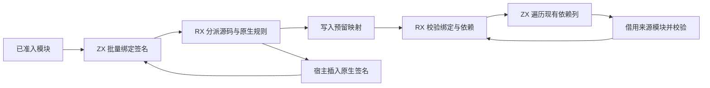
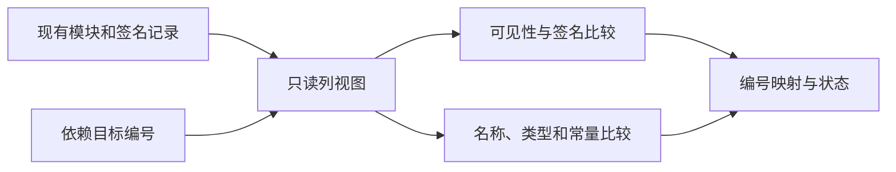

# 产物签名与依赖联结自举

## Intent

迁移编译产物的签名绑定与导入依赖校验。正式路径直接借用已有的签名、依赖、成员和常量，并将映射写入准入阶段已分配的槽位。

## Data

原先签名联结逐条进入生成函数，在首次处理源码签名时投影所有可见依赖。成员被拆为六个临时数组。依赖校验再次投影成员，且为枚举依赖展开常量。图阶段已提供按源码依赖顺序排列的目标编号。

## Edges

保留函数绑定的输入顺序、已有绑定复用、原生签名冲突规则，以及来源模块和名称空间的可见性。先校验自身绑定，再按照依赖声明顺序校验来源和原生依赖。处理枚举绑定时按原规则比较浮点位表示。原生插入仍由宿主维护既有 FunctionStorage，依赖检查需要目标模块时从现有列借用视图。

## Answer

验收覆盖重联结结果、导入拒绝、原生签名复用与冲突、分段恢复及相邻和固定基线性能。

## 实现

- 签名批次在 ZX 遍历连续记录，在 Source 和原生签名之间沿用既有 RX 分支，复用时直接写目标编号。遇到插入才返回游标，由宿主追加原生签名后借用更新过的函数表恢复执行。
- 来源可见性检查沿图阶段已计算的目标编号访问现有成员和签名表。原先逐项投影可见依赖的 Zig 循环，以及成员名称、命名空间、编号、端口和内建操作的六列复制已移除。
- 依赖遍历先通过 RX 校验当前模块的绑定，然后在 ZX 扫描外部或内建依赖，收到源码目标时暂停以借入来源模块，恢复后先校验这个来源，再继续扫描。枚举常量按名称定位后只读取对应载荷。
- 准入分配的映射、原生签名的实际插入、单次来源视图的建立、模块级原生联结和函数体写入仍使用既有宿主存储。旧 Zig seed 保留初始引导路径。

## 验收

- 两代 Source 引导各通过 22 步，二进制 SHA-256 同为 `5d1dd65702214c55b082f4965331447aff1f981b31323d85f8cee83ca4d5a1c6`。
- 171 个回归步骤和 180 项 Zig 测试通过，覆盖联结边界、独立重联结、模块产物、库联结和语义缓存；另有 7 项独立导入与原生库发布的 CLI 检查。
- 零容量定向核验覆盖原生签名插入请求、恢复、复用与冲突，以及按声明顺序请求源码依赖、拒绝非法来源和非法内建依赖。
- 相邻 Source 使用同一份 730 入口清单，11,876 份产物逐字节一致，5,401 条源码缓存键和负载一致。所有权缓存摘要同为 `e90133623048da3dfa36c6c054a1e80328b7cd07400af1880b761f5b75095dc8`。固定输入仍有同样的 134 份既有 Zig 差异和单独的文件清单差异。各工具冷暖产物一致。

## 性能

Zig 0.17.0，ReleaseSmall，16 分区，关闭常驻服务。相邻与候选工具均由上一代 Source 引导器生成，运行 Source 分析与生成。固定与相邻配对各交替三轮，表内取中位数。

| 场景               | 冷生成墙钟 | 冷生成 CPU | 冷生成进程树采样峰值 RSS | 冷生成单进程峰值 RSS | 暖生成墙钟 / CPU |
| ------------------ | ---------: | ---------: | -----------------------: | -------------------: | ---------------: |
| 当前输入，上一阶段 |    2.83 秒 |   12.66 秒 |                 777.4 MB |             834.5 MB |   2.22 / 8.66 秒 |
| 当前输入，候选     |    2.88 秒 |   12.70 秒 |                 776.7 MB |             825.7 MB |   2.22 / 8.67 秒 |
| 冻结输入，固定基线 |    2.86 秒 |   12.58 秒 |                 887.9 MB |             922.1 MB |   2.23 / 8.57 秒 |
| 冻结输入，候选     |    2.80 秒 |   12.49 秒 |                 758.5 MB |             804.4 MB |   2.19 / 8.53 秒 |

使用实际重联结测试工具，包含输入分析、产物提取、重联结、IR 校验与 Zig 输出。交替测量六轮，普通用例墙钟从 3.93 毫秒降至 3.79 毫秒、CPU 从 2.80 降至 2.78 毫秒；绑定槽用例墙钟从 3.74 增至 3.80 毫秒、CPU 从 2.53 增至 2.56 毫秒。两组峰值 RSS 均下降 32.8 KB。各组原始与重联结产物在两版间逐字节一致。

关闭语义缓存的 Store 库、原生库和 120 常量库分别生成 14、20 和 6 个逐字节一致的文件。三组 CPU 中位数分别保持 0.03、0.01 和低于 0.01 秒计时精度。计时覆盖上述输入和用例。
