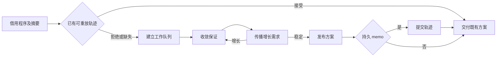
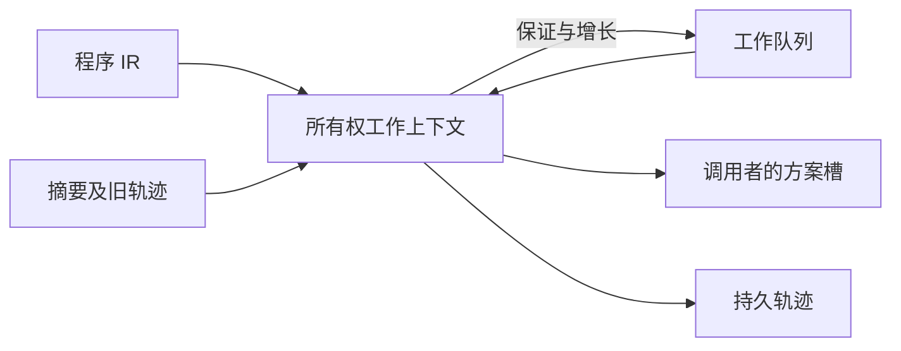

# 全程序所有权调度自举

## Intent

从正式库生成和单程序生成入口迁出全程序所有权调度。让 Source 决定何时重放已有轨迹、何时启动工作队列、何时交替收敛保证和增长需求，以及何时发布计划和提交轨迹。

## Data

两种并发配置共用 `Uniqueness.analyzeWithConcurrency`。原路径在重放成功时直接返回。在重放未命中或被拒绝时，才创建工作队列和并行预分析。保证轮因预算耗尽而停止时，下一轮需求传播之前清除保证。增长需求继续变化时，下一轮重新收敛保证。达到固定点后重填工作队列，发布计划并在持久 memo 上提交轨迹。

## Edges

共享原输入 IR、摘要、memo 和工作队列。继续复用函数级迭代、预分析线程池和现有 Source 工作队列。临时原生边界负责可变 Zig 容器的借用、线程及分配器生命周期和既有逐函数求解；输入输出只传句柄、几个标量与调用者的结果槽。后续迁移队列与分析上下文需要在普通 Source 调用间共享其可变存储。seed 继续使用同一组宿主原子操作。

## Answer

### 正确性验收

- Zig 0.17.0、ReleaseSmall 下，源码与归档的缓存所有权、模块生成、所有权契约及统一库链接共通过 272 项既有测试。
- 以上一阶段 Source 引导器构建本阶段工具，分区构建通过 25 个步骤。新工具重生成本批 763 个入口，除输入戳外，12,780 个文件逐字节一致。
- 同一常驻编译器依次生成现有所有权样例、切换到无借用调用的版本并还原。三个请求生成的 43、41、43 个 Zig 文件各自与独立进程结果一致，恢复结果与首轮一致。使用原有夹具和磁盘函数缓存。
- 下沉代码使用一个栈上布尔值控制迭代，向已有工作阶段传递预算、是否耗尽及增长结果。新调度闭包无需分配，轮内分析与计划的原有分配器继续由宿主提供。

### 固定语料性能

以固定 735 个入口交替测量三轮，取中位数。Zig 0.17.0、ReleaseSmall、16 分区，关闭常驻。两版工具均由 Source 引导器构建，运行 Source 分析和生成路径。前后 11,758 个生成文件及所有权 memo 逐字节一致。

| 场景                 | 相邻对照 |   本阶段 | 固定基线 |
| -------------------- | -------: | -------: | -------: |
| 冷生成墙钟           |   2.68 s |   2.60 s |   2.85 s |
| 冷生成 CPU           |  12.31 s |  12.24 s |  12.58 s |
| 冷生成采样进程树峰值 | 719.0 MB | 718.8 MB | 893.0 MB |
| 冷生成单进程峰值     | 821.7 MB | 741.9 MB | 939.7 MB |
| 热生成墙钟           |   2.01 s |   2.00 s |   2.25 s |
| 热生成 CPU           |   8.33 s |   8.31 s |   8.61 s |
| 未变输入墙钟         |   0.03 s |   0.03 s |   0.04 s |

这些数据衡量引导生成，其中的单进程峰值按系统报告取样。逐函数分析时间及完整冷构建没有单独计量。
