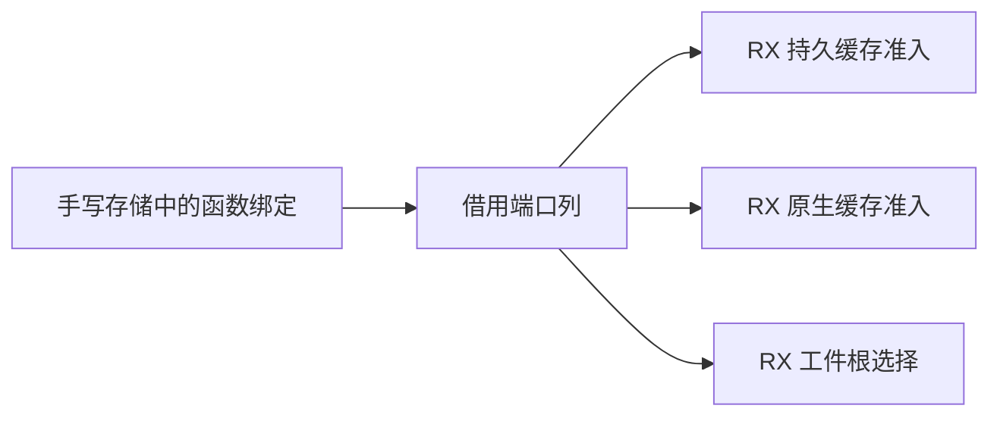

# 函数绑定校验与根遍历自举

## Intent

让持久缓存准入、原生缓存准入和编译工件根查找直接读取已有函数绑定列，由 RX 明确校验阶段，由 ZX 遍历借用的数据。

## Data

从 `441d60c5` 的统一库编译与语义缓存入口追踪。普通缓存校验以固定批量将两组绑定转换为临时行，与行指针一起反复传给生成模块。原生缓存重复使用相同的转换。工件根准备先统计普通绑定，再分配并填充三列压紧数据，之后 ZX 才能根据函数编号标记所需类型。三条路径都能复用已有内部内存借用接口及函数绑定端口模型。

## Edges

保留输入组顺序、初始 seed 的算法、未知字段错误和已有签名与原生契约。绑定底层存储在生成调用期间保持有效。验证失效依旧进入现有的缓存未命中路径。Zig 仍提供存储布局与 Arena，保持原来的发布边界。工件联结的模块级调度属于后续迁移范围。

## Answer

持久缓存的路径、头部、导入绑定、成员绑定和函数体依序在 RX 中校验。原生缓存先验证描述符与来源，再按原签名顺序核对绑定。两处都在单次生成入口内完成原先每 32 行一次的遍历。

工件提取借用两组绑定的端口列。根标记按导入、转发顺序校验端口形态并跳过 intrinsic，再标记签名类型及原生关联类型。随后的签名规划继续读相同的列，保留原来的编号分配顺序。在同一组的生成 Zig 中，签名规划遍历前后各有三个已有的描述符分配点，两版都直接更新映射和顺序数组。

仓库仍使用单条绑定转接来借用默认成员及比较历史成员。正式库联结仍由 Zig 协调逐模块合并、依赖和结果发布。

### 验收

模块工件、联结边界、语义缓存、持久缓存、缓存编解码、库导入、联结执行和原生生成八组全部通过，共 161 个构建步骤、173 项 Zig 回归和 12 项 Node 集成。以前一阶段 Source 自编译工具生成候选，再由候选生成下一代，两次均通过 22 个构建步骤。两代工具的 SHA-256 均为 `2f17d6ef48014336ed980f65927ebcab4fb8055e84b1b17e347df506da166ccc`。

两组原样联结运行的生成文件一致，墙钟中位数为 3.988 → 3.974 ms 和 3.886 → 3.709 ms。双模块磁盘缓存按 15 组配对测量，热恢复为 2.370 → 2.346 ms，命中计数及生成结果一致。

两版均由对应的 Source 工具生成，并运行 Source 分析和生成。macOS arm64，Zig 0.17.0，ReleaseSmall，16 个生成分区。计时为交替配对三次的中位数，RSS 为进程树采样峰值，以十进制 MB 计。

| 场景                              |    墙钟，秒 |       CPU，秒 | 进程树峰值 RSS，MB |
| --------------------------------- | ----------: | ------------: | -----------------: |
| 同输入冷生成，上一阶段 → 本阶段   | 2.92 → 2.91 | 12.87 → 12.83 |      878.1 → 864.0 |
| 同输入热生成，上一阶段 → 本阶段   | 2.26 → 2.28 |   8.82 → 8.86 |      796.9 → 796.4 |
| 冻结输入冷生成，固定基线 → 本阶段 | 2.78 → 2.77 | 12.39 → 12.47 |      934.9 → 855.1 |
| 冻结输入热生成，固定基线 → 本阶段 | 2.18 → 2.17 |   8.43 → 8.40 |      934.2 → 778.2 |

同输入的 12,070 个生成文件、5,468 个源码缓存键与载荷以及 memo 哈希全部一致。冻结输入保留此前的 135 个已知差异，路径与两侧哈希一致。完整冷构建未在本批重测。
