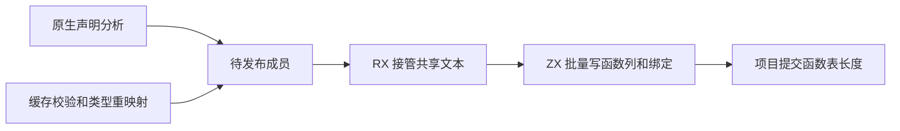
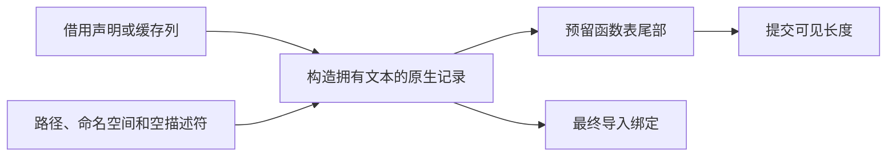

# 原生接口成员发布自举

## Intent

迁移普通源码分析和原生接口缓存恢复中的成员发布。共享原生签名与函数表写入规则，消除生产路径中间的 Zig 成员数组和逐项登记。

## Data

源码分析生成成员语义，缓存恢复生成映射后的输入、输出类型 ID。两条路径分别由 Zig 复制文本、构造原生成员，然后在项目加载器中逐项登记函数及导入绑定。编译产物的函数表另有 ZX 写入器，可直接填预留的最终列。

## Edges

RX 先接管本批文件名与命名空间，再由 ZX 从源码成员或缓存签名读取输入。每行拥有自己的名称和路径描述符，复用同批已拥有的路径片段和静态空函数体描述符。函数字段与导入绑定落入最终预留区，已转移的数据在分析或缓存工作区释放后仍有效。

项目仍在原有联结边界提交表长度。缓存恢复在类型合并成功前写入未发布区，失败时这些行不会进入函数表。缓存产物创建与初始引导保留既有路径。

## Answer

验收覆盖原生声明、类型重映射、原生缓存复用、编译库导入、生成执行和分配失败。

原生接口加载、原生与普通联结、语义缓存、编译库和模块产物共通过 225 项 Zig 测试与 6 项独立库导入。另通过原生对象 ABI 集成场景，覆盖冷生成、生成复用、声明重排和禁用缓存的运行结果。两代 Source 引导各通过 22 步，其二进制 SHA-256 同为 `357596acffb36b28574cd2a7f14ddcae0f224dd124020739540e8c16db9738b0`。

两版相邻 Source 工具用同一原生对象输入和外部声明生成，14 个文件逐字节一致。关闭缓存的单体 CLI 产物也与既有工具一致，SHA-256 为 `47236c13a687313b59ebc6204a343620e0a2f3b58932f0525ab5c07878d559fe`。

本阶段新增 0 个 Zig 文件。现有适配器增加预留列、声明行及缓存列的 ABI 绑定。项目按成员逐条登记的循环仅在 seed 分支保留，源码分析和缓存恢复各自的 Zig 成员构造循环退出 Source 路径。容量、最终长度提交、缓存产物自身的持久化继续由现有 Zig 代码负责。

相邻 Source 引导器使用同一个 730 项清单和 Zig 0.17.0，ReleaseSmall、16 分区、关闭常驻服务，交替各跑三轮。11,950 个生成文件、5,430 条源码缓存记录及所有权备忘录一致。固定基线的 134 个既有 Zig 差异与上阶段相同。

| 对照            | 冷生成墙钟     | 冷生成 CPU       | 采样进程树峰值 RSS | 单进程峰值 RSS   |
| --------------- | -------------- | ---------------- | ------------------ | ---------------- |
| 上阶段 → 候选   | 2.84 → 2.84 秒 | 12.66 → 12.69 秒 | 776.7 → 778.8 MB   | 817.6 → 818.5 MB |
| 固定基线 → 候选 | 2.87 → 2.83 秒 | 12.51 → 12.55 秒 | 884.7 → 763.6 MB   | 927.0 → 838.3 MB |

普通及 Store 重联结产物逐字节一致，墙钟中位数分别是 4.00 → 4.09 毫秒和 3.69 → 3.99 毫秒。本阶段计时覆盖生成及重联结，完整冷构建未重测。
