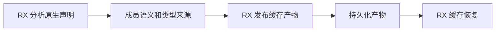
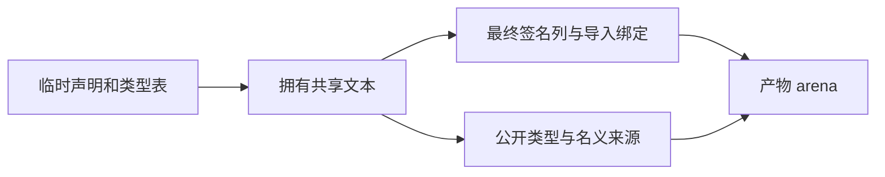

# 原生接口缓存产物自举

## Intent

迁移原生接口缓存未命中时的产物发布，复用源码和缓存恢复已有的成员规则。由最终产物直接拥有字段，减少临时签名列与重复重建。

## Data

原生分析的生成入口已得到成员、公开类型及名义来源。旧流程在分析 arena 生成全部签名列、局部函数编号和原生模块的数据，再由 Zig 在产物 arena 重建签名及绑定。

## Edges

保留分析与产物两个 arena。分析完成后才预留产物目标列，路径、命名空间、类型标签、成员名称、参数及错误文本均需跨 arena 持有。共享字段在产物内引用同一份拥有数据。缓存的本地函数编号与原生模块编号沿用既有协议。初始引导器保持既有分支。

## Answer

原生缓存首次创建时，`create.rx` 返回分析后的成员、导出和类型增量。`publish.rx` 组织拥有共享文本、写入导出行、原生模块、最终签名列、绑定和名义来源。签名列写入与正式函数表复用同一个 ZX 实现。源码分析、缓存恢复和缓存产物创建共用成员签名和导入绑定规则。旧的临时签名表和 Zig 逐成员重建已退出 Source 路径。Zig 仍预留目标列和完成类型表快照，负责资源生命周期和磁盘缓存编解码。

九组受影响入口全部通过，共 225 个构建步骤、348 项 Zig 回归，另包含七组独立 Node 测试。原生对象 ABI 测试核对了重复生成、声明重排和实际运行结果。以前一阶段自编译工具生成候选工具，再由候选生成第二代，均通过 22 个构建步骤。两代二进制 SHA-256 均为 `845fa24b60a6877c75f0f61372d693baa406c247e0d06ce57973fc97adf72d6a`。

### 性能与产物

使用各自 Source 自编译的工具和 Source 分析、生成实现，按 Zig 0.17.0、ReleaseSmall、16 个生成分区交替配对测量，以下为三次中位数。RSS 使用十进制 MB，进程树项为采样总和最大值，单进程项由 `/usr/bin/time` 记录。测试覆盖生成、未修改重跑、热缓存及小型联结执行。完整冷构建墙钟未在本批重新测量。

| 冷生成输入与阶段   | 墙钟 / 秒 | CPU / 秒 | 进程树 RSS / MB | 单进程 RSS / MB |
| ------------------ | --------: | -------: | --------------: | --------------: |
| 731 入口，上阶段   |      2.88 |    12.79 |           784.4 |           874.5 |
| 731 入口，本阶段   |      2.93 |    12.78 |           784.9 |           846.5 |
| 735 入口，冻结基线 |      2.83 |    12.46 |           898.1 |           922.5 |
| 735 入口，本阶段   |      2.84 |    12.57 |           768.6 |           844.0 |

731 入口下，未修改重跑均为 0.03 秒，热生成从 2.28 秒降至 2.22 秒。排除输入戳后，11,987 个输出文件一致，5,436 个源码缓存键及负载和唯一性缓存负载哈希也一致。与冻结基线已有的 134 个 `.zig` 文件和一份 `.zxc-files` 差异的路径、两侧哈希均与上一批相同。两种小型联结输入的输出哈希一致，墙钟中位数分别增加约 0.25 和 0.29 毫秒。
