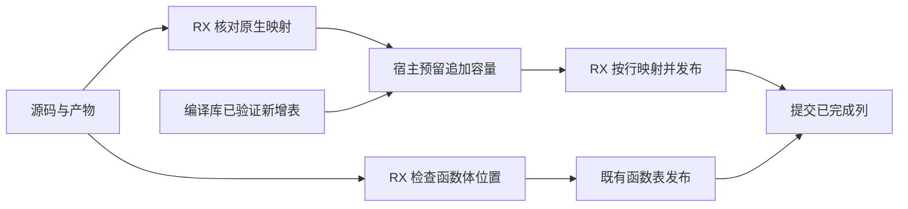
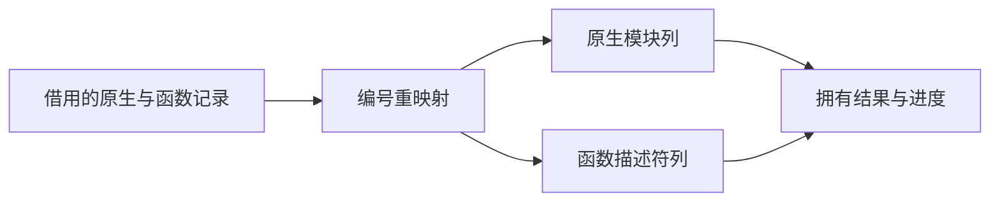

# 原生模块与函数体发布自举

## Intent

让源码联结、产物重联结和编译库装载共用原生模块批量发布。将常规依赖函数和新建源码入口接入已验证的 ZX 函数表写入路径。

## Data

原生模块已经按 ZX 规则规划复用、新增和冲突，但 Zig 逐个取出新增编号，再分配和追加行。编译库也逐行追加。函数表本身已经支持批量借用目标列，单函数入口仍通过手写 Zig 组装目标行。

## Edges

先验证整批原生模块，再为新增模块预留空间。按原顺序映射与复制声明字段，只发布已完成行。函数体仍在写入之前完成控制表校验，重联结为依赖函数预设自身编号，入口与 Store 模块保留原有的移交方式。宿主管理容量和长度，底层表仍为现有 IR 存储。

## Answer

验收覆盖原生复用与冲突、空间失败边界、独立重联结、编译库装载和源码函数发布，以及相邻和固定基线性能。

## 实现

- 源码联结和产物重联结用同一 RX 请求核对原生模块，映射全部通过后才申请发布容量。编译库使用已经过校验的连续新增表，直接走同一写入路径。
- ZX 依选择顺序遍历新增行，RX 重用既有类型编号重映射和文本所有权逻辑，写入最终六列。每一行写完才推进进度，分配失败时宿主只提交完整前缀。
- 产物重联结由 RX 登记函数自身编号，检查文件归属与外部标记，选择直接追加或保留。可直接追加的依赖函数、源码新建入口和 RX 导入入口均通过已有批量函数表写入，单函数视图只借用原有底层表。
- 图级联结顺序、递归主入口的最终 Program 组装、分配与存储长度仍由宿主维护。初次引导保留 seed。

## 验收

- 两代 Source 引导各通过 22 步，二进制 SHA-256 同为 `415c3d0f836ab03b6bc8be5cfc5a1e8eb055062facab25527174c4451798488d`。
- 库联结、独立导入、原生库发布、模块产物、磁盘 RX 项目以及联结边界和独立重联结均通过，共计 173 项 Zig 测试与 16 项 CLI 检查。修正保留函数体分支的可空结果转换后，仅补跑了受影响的两项联结目标。
- 定向核验覆盖既有模块复用、待追加模块去重、冲突拒绝、选择与连续发布、拥有文本、映射后的类型编号以及分配失败保留完整前缀。零容量分配器上验证了函数自身编号登记、直接追加、保留入口和外部函数体拒绝。
- 相邻工具使用同一份 729 入口清单，11,892 份生成文件逐字节一致，5,406 条源码缓存键和负载摘要一致。所有权缓存摘要同为 `3267ded0a6ffabb1c5fb81cdc3dec29244b9eb9352cb5a4f4f9ecfe01fc1b5e8`。固定输入仍有相同的 134 份既有 Zig 差异，以及一份文件清单差异。每版工具各自的冷暖产物一致。

## 性能

Zig 0.17.0，ReleaseSmall，16 分区，关闭常驻服务。相邻工具均从上一代 Source 生成，运行 Source 分析与生成。相邻和固定输入分别交替三轮，表内取中位数。

| 场景               | 冷生成墙钟 | 冷生成 CPU | 冷生成进程树采样峰值 RSS | 冷生成单进程峰值 RSS | 暖生成墙钟 / CPU |
| ------------------ | ---------: | ---------: | -----------------------: | -------------------: | ---------------: |
| 当前输入，上一阶段 |    2.87 秒 |   12.67 秒 |                 779.3 MB |             822.2 MB |   2.22 / 8.65 秒 |
| 当前输入，候选     |    2.93 秒 |   12.64 秒 |                 781.9 MB |             813.9 MB |   2.23 / 8.68 秒 |
| 冻结输入，固定基线 |    2.80 秒 |   12.39 秒 |                 884.8 MB |             972.9 MB |   2.19 / 8.49 秒 |
| 冻结输入，候选     |    2.79 秒 |   12.43 秒 |                 758.6 MB |             813.2 MB |   2.16 / 8.36 秒 |

实际重联结工具的普通和绑定槽用例各交替六轮。墙钟中位数从 3.87 增至 3.91 毫秒、从 3.63 增至 3.70 毫秒，CPU 变化分别为 0.04 和 0.01 毫秒。峰值 RSS 分别下降 49.2 KB 和保持不变。各用例的原始和重联结 Zig 均逐字节一致。

关闭语义缓存的 Store 库、原生库和 120 常量库分别生成 14、20 和 6 个逐字节一致的文件。各组的 CPU 中位数精度内相同，峰值 RSS 分别增加 49.2、81.9 和 131.1 KB。计时覆盖上述输入和用例。
