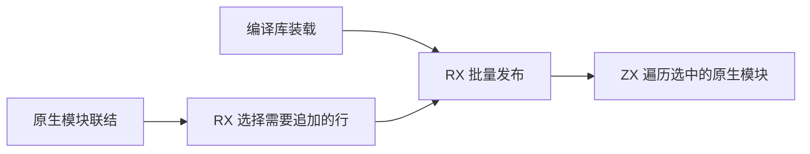

# 原生模块联结发布自举

## Intent

由同一 RX 入口完成原生模块的兼容性核对、编号映射和结果发布。编译库装载复用相同的发布阶段，沿用自己已经计算好的模块选择。

## Data

以 `1cca7324` 为对照。`Builder.module` 经 `native.link` 进入 `generated_native_link` 做映射，随后 Zig 读取选择结果、预留容量、借出尾部列、再次调用生成入口，并按进度提交已完成的前缀。编译库的 `compiled/host/publish` 直接经过后半段。上批已验证内存层能从 `ArrayList` 列借出存储并逐行追加。

## Edges

兼容性冲突优先于最终列预留。预留仍一次覆盖全部新增行，先于行载荷分配。每行先完成类型 ID 映射，再复制需要独立持有的名称及文本，最后一次提交整行。失败前已完成的行维持原前缀语义。映射决策和临时描述符使用调用方 scratch，最终列和内容归结果分配器。数组直接在最终分配器中填充。

## Answer

移除了宿主的两次生成入口切换、尾部列适配及进度游标。底层容量预留、行长度和结果缓冲仍通过通用内存原语操作，源码入口保留模块选择、映射与发布顺序。逐模块库联结调度和类型表差量提交仍在 Zig。

本批生产 Zig 净减 9 行。现有的通用预留函数接受整批行数，函数签名登记仍按一行调用。增加的数组分配原语同时返回最终数组的借用视图和写入描述符。读取数组的发布操作在所有元素写完之后执行。

### 验收

窄范围生成覆盖原生模块联结、签名登记和编译库装载三条入口，共 529 个模块、464 个函数文件。两代 Source 自编译各通过 22 个构建步骤，二进制 SHA-256 同为 `d70efb93e8569d7b46d0111a552e5d5e6ec7b11deef06c68066555d8133eaac3`。原生联结、联结执行、联结边界、原生运行、统一库联结、工件导入执行及语义缓存七组通过，共 122 个构建步骤、195 项测试。

普通联结和能力槽的生成产物一致，配对墙钟中位数分别为 3.946 → 3.979 ms 和 3.629 → 3.734 ms。三组原生执行的原始、联结、缓存和 ABI 文件也一致，墙钟中位数分别变化 +0.115、−0.020、+0.076 ms。

生成对照使用各版本的 Source 自编译工具与 Source 分析及生成实现。macOS arm64、Zig 0.17.0、ReleaseSmall、16 个生成分区。三次交替配对取中位数，进程树采样峰值 RSS 使用十进制 MB。

| 场景                              |    墙钟，秒 |       CPU，秒 | 进程树峰值 RSS，MB |
| --------------------------------- | ----------: | ------------: | -----------------: |
| 同输入冷生成，上一阶段 → 本阶段   | 2.98 → 2.92 | 12.86 → 13.01 |      797.2 → 796.4 |
| 同输入热生成，上一阶段 → 本阶段   | 2.30 → 2.31 |   8.87 → 8.98 |      799.6 → 800.0 |
| 冻结输入冷生成，固定基线 → 本阶段 | 2.86 → 2.84 | 12.55 → 12.63 |      898.9 → 762.8 |
| 冻结输入热生成，固定基线 → 本阶段 | 2.25 → 2.25 |   8.61 → 8.67 |      892.6 → 776.6 |

同输入的 12,132 个生成文件、5,498 个缓存键及载荷和 memo 哈希一致。冻结输入保留相同的 135 个历史差异路径及两侧哈希。本批未重测完整冷构建。
