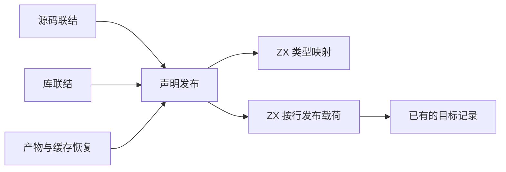
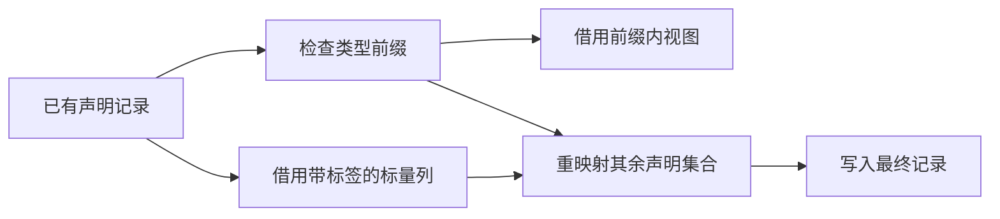

# 声明与常量载荷发布自举

## Intent

迁移源码联结、产物物化、库联结和语义缓存恢复中的声明批量发布。让 ZX 决定映射与文本所有权，并沿正式 RX 发布路径使用同一实现。

## Data

`artifact/surface.zig` 的类型导出已使用 ZX 批量写入，常量仍在 Zig 中逐行调用生成的单条声明方法。库联结还构造临时类型编号列和映射后的编号列。常量记录的载荷是带标签的 Zig 联合，只有文本活跃成员需要获得新的底层存储。

## Edges

复用带标签标量的原生存储与序列化字段。内存读取通过 Zig 的正常标签检查，保留底层布局与目标端序。非文本值直接写入最终载荷，文本留在原有结果 allocator。共享类型前缀内的声明直接借用。记录分配及 ABI 借用仍由宿主提供。

## Answer

验收检查六类常量载荷、共享前缀、源码与库发布、缓存恢复以及相邻、固定基线性能。

## 实现

- Source 调用声明发布 RX，先处理类型导出，再处理常量导出。两组分别判断其全部类型编号是否落在共享前缀内。无须重映射时继续借用原记录；需要重映射时先向宿主请求最终空间，再由 ZX 按行发布。第二次容量请求保留类型导出已完成的状态。
- 常量发布直接读取借入的名称、类型编号和标量列。字符串载荷和名称由结果分配器取得所有权，其余载荷沿用原有带标签表示直接写入最终记录。库联结移除了映射前后的两个临时类型编号数组，产物物化、缓存恢复和重联结复用同一批处理。
- 原有 Zig seed 继续提供初始引导。正式实现中，Zig 宿主负责物理容量、借用视图和标量内存读写。常量的物理表示、其他产物绑定记录和更早的 Program 接入仍需随对应职责迁移。

## 验收

- 两代 Source 引导构建各通过 22 步，生成二进制 SHA-256 同为 `58d608bf6775b1691c95cb413bcf71b641d90645eceeab8817fc1a4ee40f5d20`。
- 集中回归通过 170 个构建步骤和 218 项测试。覆盖库联结、编解码、独立进程导入、模块产物、联结边界、语义缓存与磁盘 RX 项目。
- 定向检查验证六类标量载荷，包括有符号零的浮点位表示和字符串所有权。共享前缀可在零容量分配器上运行。需要空间时先请求并写入类型导出，恢复后直接写入常量。
- 相邻 Source 工具使用同一份 734 入口清单，11,843 个生成文件逐字节相同，5,388 个源码缓存键及负载摘要相同，所有权缓存同为 `26f634027f663d366a752cd5e82468c406204f735e570282777d03d9486620c7`。固定输入的 134 份既有 Zig 差异和文件清单差异与上一阶段完全相同。相邻和固定对照中，每个工具各自的冷、暖产物一致。

## 性能

常驻服务关闭，Zig 0.17.0，ReleaseSmall，16 分区。候选与上一阶段工具均由上一代 Source 引导器生成，执行 Source 分析与生成。相邻和固定输入对照分别交替三轮，表内取中位数。

| 场景           | 冷生成墙钟 | 冷生成 CPU | 冷生成进程树采样峰值 RSS | 冷生成单进程峰值 RSS | 磁盘暖缓存墙钟 / CPU |
| -------------- | ---------: | ---------: | -----------------------: | -------------------: | -------------------: |
| 相邻，上一阶段 |    3.02 秒 |   12.57 秒 |                 771.9 MB |             850.7 MB |       2.19 / 8.58 秒 |
| 相邻，候选     |    2.85 秒 |   12.55 秒 |                 770.8 MB |             809.5 MB |       2.19 / 8.54 秒 |
| 冻结，固定基线 |    2.85 秒 |   12.48 秒 |                 896.8 MB |             921.8 MB |       2.22 / 8.53 秒 |
| 冻结，候选     |    2.80 秒 |   12.45 秒 |                 760.3 MB |             860.8 MB |       2.20 / 8.54 秒 |

禁用语义缓存后，Store 库、原生库和 120 常量库分别生成 14、20 和 6 个逐字节一致的文件。相邻两版在三个用例的墙钟和 CPU 中位数差值均低于测量时钟的 0.01 秒精度。Store 库峰值相同，其余两个用例分别增加 24.6 KB 和 32.8 KB。上述计时覆盖 Source 生成和库发布用例。
