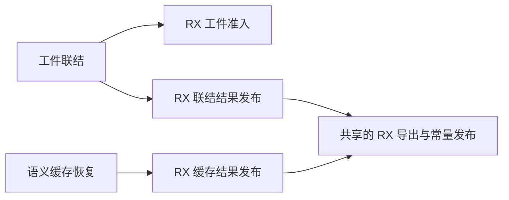
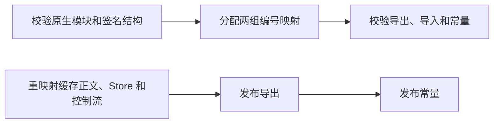

# 工件准入与缓存结果发布自举

## Intent

由 RX 编排工件布局校验、映射分配与接口准入。缓存结果的正文、Store、控制流和声明由同一 RX 入口按原顺序发布，复用库联结的导出表写入。

## Data

从 `63b35006` 的工件联结 `Builder.module` 和 `restoreChecked` 开始核对。准入原先由 Zig 在两次进入 RX 之间分配函数与原生模块的编号映射。缓存恢复的正文与 Store 由 RX 生成，导出和常量由 Zig 再分别发起复制。两条路径都已有接收借用列和写入最终目标的 ZX 函数。

## Edges

先校验布局，再依序分配函数和原生模块映射，再检查公开面与常量。缓存恢复在 Store 校验、正文重映射和控制流处理后发布导出，最后发布常量。产物继续使用原分配器，写入最终存储。缓存查找、类型提交、递归登记、事务回滚和最终 IR 校验仍由宿主处理。种子路径保留原实现。

## Answer

工件准入只进入一次 RX。内部内存层写入调用方借出的两个映射描述符，宿主在失败时按分配的逆序释放。缓存恢复调用共享的发布流程。与库联结共用的适配器借出最终列和已写入进度，只在失败时释放已发布的导出名称及行存储。

本批无新增 Zig 文件。五个既有 Zig 文件净增 35 行，增量来自共用的借用描述符和可空整数映射分配。准入的续传状态以及缓存恢复另外两次进入生成代码的调用均已移除。

### 验收

三条受影响入口的独立生成覆盖 80 个模块和 83 个函数。两代 Source 自编译各通过 22 个构建步骤，二进制 SHA-256 同为 `96a0ad80720e18eeb097962479a0221283cdb4348b6f4e7bc106f081e52f5283`。联结执行、联结边界、工件提取、库导入、工件导入执行、原生执行、语义缓存和跨进程缓存八组通过，共 211 个构建步骤、248 项 Zig 测试及 11 项 Node 集成。

普通联结和能力槽的生成文件逐字节一致，配对运行墙钟中位数为 4.027 → 4.002 ms 和 3.804 → 3.832 ms。三组原生运行的原始、联结、缓存及 ABI 文件也一致，运行墙钟中位数分别下降 0.098、0.059、0.097 ms。独立双模块跨进程缓存以 `2be0cee9` 的 Source CLI 为对照，15 次热恢复的中位数为 2.267 → 2.292 ms，命中计数和生成结果一致。

生成对照使用对应版本的 Source 自编译工具与 Source 分析及生成实现。macOS arm64、Zig 0.17.0、ReleaseSmall、16 个生成分区。三次交替配对的中位数如下。RSS 取进程树采样峰值，单位为十进制 MB。

| 场景                              |    墙钟，秒 |       CPU，秒 | 进程树峰值 RSS，MB |
| --------------------------------- | ----------: | ------------: | -----------------: |
| 同输入冷生成，上一阶段 → 本阶段   | 2.88 → 2.88 | 12.76 → 12.75 |      807.3 → 792.7 |
| 同输入热生成，上一阶段 → 本阶段   | 2.28 → 2.26 |   8.78 → 8.75 |      795.1 → 795.3 |
| 冻结输入冷生成，固定基线 → 本阶段 | 2.87 → 2.87 | 12.56 → 12.58 |      884.9 → 760.7 |
| 冻结输入热生成，固定基线 → 本阶段 | 2.26 → 2.23 |   8.61 → 8.62 |      892.7 → 776.0 |

同输入的 12,102 个生成文件、5,482 个缓存键与对应载荷以及 memo 哈希一致。冻结输入仍有已记录的 135 个历史差异，路径与两端文件哈希保持一致。本批未重测完整冷构建。
