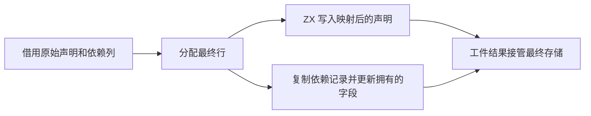

# 工件提取发布自举

## Intent

让工件提取的正式 Source 入口在完成类型表、签名与正文后，直接发布声明、标识和依赖。导出与常量使用库联结和缓存恢复已经采用的写入流程。

## Data

以 `d118e3cd` 为对照。正式 `artifact.extract` 经 `prepared.extract` 进入 `generated_artifact_materialize`。旧 RX 产生类型表、函数、原生模块和 Store 后，`prepared.extract` 依次通过 Zig 发布六组声明、工件路径和依赖。函数绑定与依赖字段内的写入已经由 ZX 执行。

## Edges

继续按类型、原生模块、签名、正文、接口声明、路径和依赖的顺序执行。接口内部按类型导出、常量导出、常量导入、类型导入、函数导入和具名成员的原顺序分配。声明直接写入最终行。依赖只保留原本就需要的最终行复制，让标志、位置及非源码目标字段沿用原值；再按原规则处理可独立拥有的文本和名称集合。适配器只描述宿主持有的行布局。函数登记、逐模块联结及结果的 Zig IR 视图接管仍属于后续范围。

## Answer

宿主端的六组声明复制调度和依赖生成入口已移除。已有最终行分配器接收嵌套字段的编译期偏移，依赖的 `target.path` 直接写入其中。工件外层 arena 继续负责错误时统一回收。

生产 Zig 净增 37 行，删除一个文件，新增文件数为零。增量用于在调用边界借出接口输入、依赖和最终行描述符。

### 验收

四条独立生成入口覆盖 130 个模块和 115 个函数文件。两代 Source 自编译工具各通过 22 步，二进制 SHA-256 同为 `8476b4a992fb5fa0fa6a802db6cdc709461e2eebd37a6550e11d751b236eecb0`。工件提取、联结边界、联结执行、工件导入执行、统一库联结、语义缓存和原生执行七组通过，共 158 个构建步骤、294 项 Zig 测试。

普通联结和能力槽的生成文件逐字节一致，墙钟中位数为 3.884 → 3.869 ms 和 3.704 → 3.792 ms。三组原生用例的原始、联结、缓存和 ABI 文件均一致，墙钟中位数分别变化 −0.069、+0.125、−0.028 ms。

生成对照使用对应版本的 Source 自编译工具及 Source 分析和生成实现。macOS arm64、Zig 0.17.0、ReleaseSmall、16 个生成分区。三次交替配对取中位数，RSS 为进程树采样峰值，单位为十进制 MB。

| 场景                              |    墙钟，秒 |       CPU，秒 | 进程树峰值 RSS，MB |
| --------------------------------- | ----------: | ------------: | -----------------: |
| 同输入冷生成，上一阶段 → 本阶段   | 2.91 → 2.92 | 12.81 → 12.82 |      788.8 → 788.7 |
| 同输入热生成，上一阶段 → 本阶段   | 2.31 → 2.28 |   8.81 → 8.82 |      794.8 → 795.3 |
| 冻结输入冷生成，固定基线 → 本阶段 | 2.86 → 2.83 | 12.55 → 12.53 |      893.7 → 765.3 |
| 冻结输入热生成，固定基线 → 本阶段 | 2.24 → 2.23 |   8.57 → 8.59 |      892.9 → 775.8 |

同输入的 12,108 个生成文件、5,483 个缓存键及载荷、memo 哈希均一致。冻结输入的 135 个历史差异保持相同路径和两侧哈希。本阶段未重测完整冷构建。
