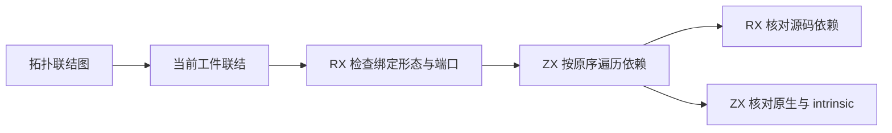

# 库联结依赖遍历自举

## Intent

将库联结中逐条选择和校验依赖的调度迁入 RX/ZX。沿同一正式入口核对 Zig 的游标及逐边调用已退出。

## Data

从 `2be0cee9` 的 `link`、`Builder.module` 和依赖校验宿主追踪。旧路径在 Zig 保留两级游标，每遇到一个源码依赖就构造提供方列并再次进入 RX。图的拓扑顺序保证当前模块所有直接提供方已经联结。成功联结的依赖有函数体时，其入口已登记到现有模块函数表。

## Edges

保留绑定校验先于依赖校验、原始依赖顺序和首个错误。借用图已有的目标索引、类型映射和入口表。嵌套列投影只读取切片描述符，使用一份固定大小的栈缓冲。保留 seed 路径、逐模块联结顺序、存储表提交和资源管理。阶段按实际调用链核对，并用真实库联结和固定性能基线验证。

## Answer

正式入口由 RX 先做导入和成员的形态及端口检查，再把整段依赖交给 ZX。源码依赖继续使用原 RX 规则校验默认函数、命名成员、通配和类型别名。原生与 intrinsic 校验在原来的边顺序内执行。旧宿主的续传游标、逐边构造请求及重复调用均已退出。

提供方的函数体标记来自现有模块函数 ID 表。依赖工件通过拓扑顺序先于消费方完成联结，带函数体的依赖会登记函数 ID。借用提供方时使用内部内存层的通用嵌套列投影。仍由 Zig 负责列布局和栈内视图，各边只更新描述符，底层字段和表继续借用原存储。新遍历和单条源码依赖的生成函数均无堆分配调用和字节复制指令。

### 验收

联结执行、联结边界、统一库联结、工件导入执行、原生联结、原生运行、库导入和工件提取八组通过，共 179 个构建步骤、293 项 Zig 测试和 6 项 Node 集成。覆盖缺失目标、循环、默认函数体缺失、接口冲突、分配失败清理和原生 ABI。用上一阶段 Source 引导构建候选，再由候选生成下一代，两个构建各通过 22 步。SHA-256 同为 `15849db676763357cefc0cfc71485d287f17305e6439d062c87bb10ed693fdf6`。

实际联结运行器使用 Zig 0.17.0、ReleaseSmall 和 Source 联结路径，交替测量六组，以下为墙钟中位数。普通联结旧运行器来自 `02998841`，原生运行器旧版来自 `2be0cee9`。五组的原始、联结和适用的缓存与 ABI 生成文件逐字节一致。

| 输入         | 上一版，ms | 本阶段，ms |
| ------------ | ---------: | ---------: |
| 普通联结     |      3.730 |      3.838 |
| 联结与能力槽 |      3.663 |      3.855 |
| 原生基本输入 |      5.421 |      5.445 |
| 原生混合输入 |     13.805 |     13.792 |
| 原生循环输入 |     19.439 |     19.332 |

生成对照使用对应的 Source 自编译工具和 Source 分析与生成实现。macOS arm64，Zig 0.17.0，ReleaseSmall，16 个生成分区。表内为交替配对三次的中位数。RSS 取进程树采样峰值，单位为十进制 MB。

| 场景                              |    墙钟，秒 |       CPU，秒 | 进程树峰值 RSS，MB |
| --------------------------------- | ----------: | ------------: | -----------------: |
| 同输入冷生成，上一阶段 → 本阶段   | 2.92 → 2.93 | 12.84 → 12.85 |      882.6 → 879.5 |
| 同输入热生成，上一阶段 → 本阶段   | 2.28 → 2.29 |   8.84 → 8.82 |      798.0 → 798.2 |
| 冻结输入冷生成，固定基线 → 本阶段 | 2.79 → 2.79 | 12.38 → 12.44 |      921.5 → 799.0 |
| 冻结输入热生成，固定基线 → 本阶段 | 2.20 → 2.17 |   8.51 → 8.48 |      934.5 → 778.3 |

同输入的 12,075 个生成文件、5,469 个源码缓存键与载荷以及 memo 哈希一致。冻结输入的 135 个历史差异保留相同的路径和文件哈希。完整冷构建未在本批重测。
