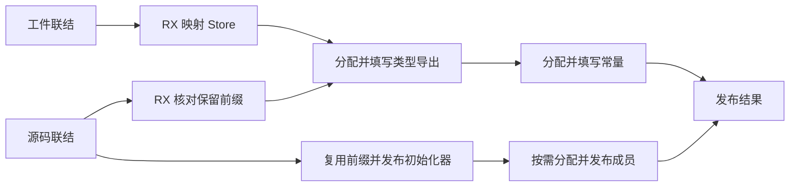
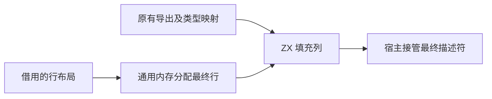

# 库联结结果与声明发布自举

## Intent

让工件联结结果、源码声明以及 Store 初始化器和成员发布分别在一次 RX 调用内按原顺序分配并填充最终表，移除三条正式路径上的宿主续传和发布状态。

## Data

从 `36482e19` 的 `link.finish` 和源码联结的 `declarations.publish` 追踪。旧实现先由 RX 请求数组容量，Zig 分配后再次进入 RX，表完成后才请求下一项。工件结果另外携带递归登记状态和已映射的 Store。源码表面发布也会为初始化器和成员多次返回请求。三条路径均已有写入最终行的 Source 函数。

## Edges

导出名称和常量内容直接写入分配的最终行。通用内存层根据宿主已知的行大小、对齐和列偏移分配并绑定描述符。递归函数的存储登记留在现有宿主，依旧先于 Store 映射。Store、类型导出、常量、路径与递归包装的原顺序保留。源码编译继续借用可保留的前缀声明。错误时由宿主和调用方的 arena 回收。类型合并的预检和映射分配顺序保持原路径。

## Answer

工件结果按 Store、类型导出、常量、路径与递归包装顺序完成。源码声明先判断类型导出是否可直接借用，再处理常量。源码初始化器保留全共享时直接借用的路径，部分共享时把原前缀一次写进最终行，再由 ZX 填充剩余行。具名成员按需分配，默认入口留在已有结果字段中。三个宿主入口均移除原有发布循环和续传枚举。

通用行分配从同一个 allocator 取得最终行，在编译期核对的行布局上绑定写入列。校验入口、递归函数表登记、IR 结果接管及 arena 生命周期仍由 Zig 负责。

### 验收

联结执行、联结边界、库初始化器、库导入、工件导入执行、原生运行和语义缓存七组通过，共 124 个构建步骤、169 项 Zig 测试和 6 项 Node 集成。覆盖递归入口、Store 前缀、跨库常量和分配失败清理。两代 Source 自编译各通过 22 步，SHA-256 同为 `31952e044528cb12bd1b44cdd5e7086babe2fdbc9f4973b140121e0e57f49563`。

普通联结和能力槽两组运行器的生成文件一致，墙钟中位数为 3.870 → 3.875 ms、3.861 → 3.738 ms。三个原生运行用例的原始、联结、缓存和 ABI 产物均一致，墙钟中位数的最大变化为降低 0.155 ms。

生成对照采用各自的 Source 自编译工具和 Source 分析与生成实现。macOS arm64，Zig 0.17.0，ReleaseSmall，16 个生成分区。以下为三次交替配对的中位数，RSS 取进程树采样峰值，单位为十进制 MB。

| 场景                              |    墙钟，秒 |       CPU，秒 | 进程树峰值 RSS，MB |
| --------------------------------- | ----------: | ------------: | -----------------: |
| 同输入冷生成，上一阶段 → 本阶段   | 2.90 → 3.00 | 12.79 → 12.84 |      838.6 → 829.4 |
| 同输入热生成，上一阶段 → 本阶段   | 2.29 → 2.29 |   8.81 → 8.80 |      796.1 → 796.4 |
| 冻结输入冷生成，固定基线 → 本阶段 | 2.86 → 2.85 | 12.57 → 12.62 |      966.4 → 833.8 |
| 冻结输入热生成，固定基线 → 本阶段 | 2.25 → 2.24 |   8.60 → 8.62 |      934.5 → 778.1 |

同输入的 12,091 个文件、5,479 个源码缓存键与载荷以及 memo 哈希一致。冻结输入维持 135 个历史差异，路径和两侧文件哈希一致。完整冷构建未在本批重测。
