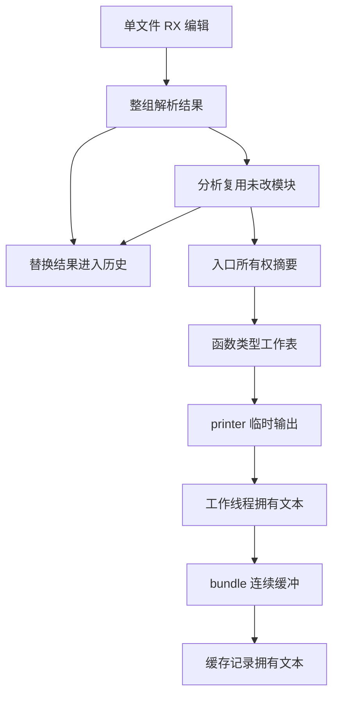
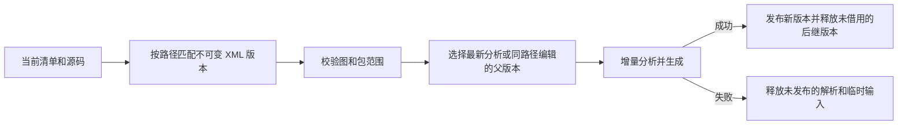
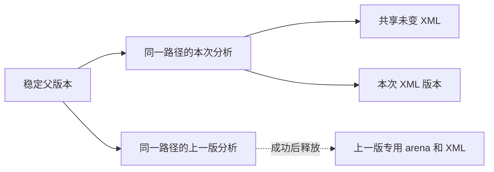

# 整体诊断执行记录

## Intent · 执行计划

冻结已推送源码和最近可复用的 Source 工具。先从正式入口核对已有进度，再追踪成本最高的状态与数据，选一个可证伪的真实编辑场景测量，最后将修复与恢复条件交给现有自举 goal。详细结论集中在[自举架构与性能诊断](../自举架构与性能诊断.md)。

## Data · 实际执行

- 源码 `3aff0196`。读取 `WAY.md`、自举完成标准、用户原话、性能技能及 11 月 14–17 日阶段记录。针对还在变化的项目装载代码，把已提交基线与工作区草稿分开核对。
- 原始对照的工作目录为 `.zig-cache/cold-build-analysis/ownership-research/rx-compiler-batch/native-table-publication/`。输入为 `performance-manifest.json`，工具为 `self-hosted/bin/zxc-bootstrap`，三轮证据为 `perf-{previous,candidate}/` 和 `frozen-perf-{fixed,candidate}/` 的 cold、warm、unchanged JSON 与日志。临时目录可按仓库规则回收，长期指标保存在根报告及阶段记录中。
- 实际重放使用仓库内 `.zig-cache/verification-tmp/bootstrap-design-audit/` 隔离输出与缓存。首轮由仓库根调用时，manifest 相对接口路径无法解析；沿原测量脚本切至 `packages/compiler` 后生成成功。失败启动没有进入性能样本。
- 冷生成固定参数为 `--manifest <manifest> <output> <cache> --partitions 16`，环境变量 `ZXC_RESIDENT_GENERATOR=0`。常驻重放从 Git 导出 compiler、lint、core、genz 的 src，按原顺序重定位清单四个 roots，将位于这些根内的绝对接口路径指向副本；其他相对声明仍从相同 cwd 解析。以 `--serve <cache>` 启动一个独立 PID，普通 manifest 客户端启用常驻并连接同一目录。仅在副本改动 lint/loop/postfix.rx。
- 7 次服务 RSS 原始字节按请求顺序为 787628032、1084309504、1118961664、1169080320、1206861824、1251098624、1297530880。哈希按相对路径排序，逐文件输入“相对路径 UTF-8、零字节、文件 SHA-256 的 32 字节值”计算总 SHA-256。隔离服务与可再生树均已清理。

## Edges · 解释界限

一次编辑轨迹只能证明当前工作负载的增长。冷启动到第一次编辑含预热；后续五次仍持续上升。未观测越过 3 GiB 预算时的行为，未把 RSS 归因到单一 arena。类型表写入与工件查询的公式来自已核对的执行路径。生成单元、缓存记录、原始函数文件、输出 Zig 文件分别计数。

## Answer · 交接

正式入口和数据流如下，A–F 的修复顺序、反证要求和关闭标准见根报告。核对对象是正式 Source 路径、原有所有权和失败语义及固定输入成本。诊断会话负责报告和通知；整改与后续自举由原 goal 执行。

《继续自举并保障性能》已在进行中的会话回复确认接收顺序调整，先处理常驻 RX 编辑的内存增长，并搁置通过不透明 Project 句柄把扫描和发布交回 Zig 的草稿接法。恢复条件已同步至[原自举目标](../../goal.md)。本次确认覆盖交接，六组修复的结果由该会话陆续验收。

## A · 常驻编辑的源码与分析归属

### Intent

同一文件的后续编辑替换上一版分析和解析，未变文档保留既有 XML 解析结果。失败请求只撤销本次未发布的数据，当前可复用的分析、依赖顺序和诊断位置继续有效。

### Data

正式入口为 `--serve` → `generate_parser.generate` → `resident.modules.prepare` → `shared_generation.run`。第一次小范围实现仅拆分 XML 版本，12 次编辑并恢复后仍达到 1,493.6 MB。旧版同一输入达到 1,594.1 MB，说明整批 XML 重建只是增长的一部分。逐轮分析仍复用 5,250 个模块，继续持有每轮完整分析的 arena 才是剩余斜率的主要来源。

### Edges

只有清单形状和 ZX 输入相同、相邻两次修改都落在同一 RX 路径时，才从上一次编辑的父版本开始推导。其余情况沿最新成功版本复用。父版本的传递依赖与 3 GiB 预算继续生效。XML 模块持有原文和源位置，文件路径与包配置仍重新走图验证。原始 ZX 文本和已发布的 ZX 解析继续按分析历史保留。emission 容量单独记录，沿用现有页复用策略。

### Answer

验收用 `ZXC_RESIDENT_MEMORY=1` 记录请求后各所有者的容量和版本数。设置只输出计数，用同一 725 入口对照 Source 自编译工具。两代候选二进制的 SHA-256 均为 `fc98d61be62da2815fdc6b58c56d6ab6e7a0a5f7841dc8af8e1046ff821d4528`。

| 同一 PID 的请求后 RSS | 冷启动 / MB | 第 1 次编辑 / MB | 第 12 次编辑 / MB | 还原 / MB | 编辑墙钟中位数 / ms |
| --------------------- | ----------: | ---------------: | ----------------: | --------: | ------------------: |
| `3aff0196`            |       789.4 |          1,082.6 |           1,557.1 |   1,594.1 |               477.1 |
| 修复后                |       789.0 |          1,073.0 |           1,116.0 |   1,133.8 |               464.2 |

修复后第 4 至第 12 次编辑的 RSS 为 1,113.8–1,116.0 MB。每次编辑只解析 1 个 RX 文件，复用另外 706 个；只分析 1 个模块，复用另外 5,250 个。分析保留两代，活跃 XML 版本数保持 708。文件和 ZX 解析的退役列表在该编辑序列内保持空。emission 保留容量全程约 1,672.6 MB，物理峰值与 arena 容量独立统计。

15 次连续失败覆盖 RX 语法、缺失依赖、循环依赖以及 ZX 语法。强制失败的 RX 版本退出请求时立即回收，ZX 连续失败只保留上一次成功分析引用的一版。循环诊断指向循环模块，ZX 语法位置随输入移动。无改动请求走现有快照路径。还原输入后生成文件与初次一致，改合法依赖与包表的结果分别与独立生成一致。RX 和 ZX 解析缓存共通过 53 项回归。

相邻 725 入口的 12,191 个生成文件、5,520 条源码记录和所有权备忘录逐字节一致。冻结 735 入口的 135 项历史差异保持不变。Zig 0.17.0、ReleaseSmall、16 分区、关闭常驻，表内为三轮中位数。

| 冷生成对照      |    墙钟 / s |       CPU / s |   树峰值 / MB | 单进程峰值 / MB |
| --------------- | ----------: | ------------: | ------------: | --------------: |
| 上阶段 → 候选   | 2.92 → 2.97 | 12.94 → 12.99 | 805.1 → 797.0 |   886.2 → 852.3 |
| 固定基线 → 候选 | 2.86 → 2.90 | 12.59 → 12.59 | 885.0 → 757.9 |   943.6 → 799.6 |

该组回测覆盖冷暖生成和常驻请求。持续编辑单一路径的增长已修复。多路径的有效变更仍可能借用多个分析世代，受原预算约束。源码目录发现缓存继续按路径保存当期文件，完整冷安装沿用历史记录。临时回放脚本和计数保存在当前阶段的 `resident-rx-ownership` 核验目录。

### 后续整改

B–E 待核验和修复。F 的项目装载草稿已从正式工作区移开，保存原差异供核对。草稿里把扫描和发布委托给 `opaque Project` 的专用接口没有进入候选，正式调度归属仍开放。常规自举在 B–F 全部收口后恢复。
