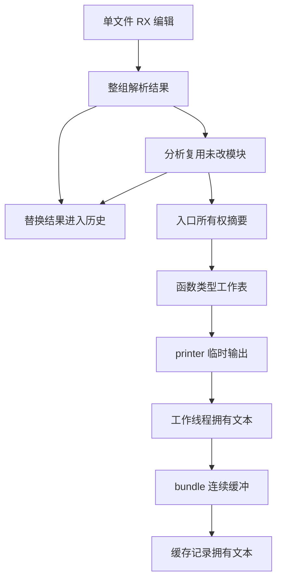
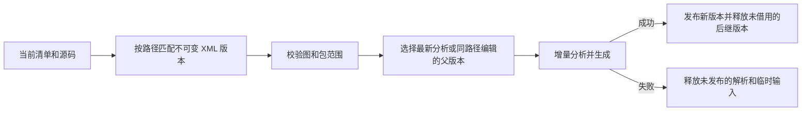
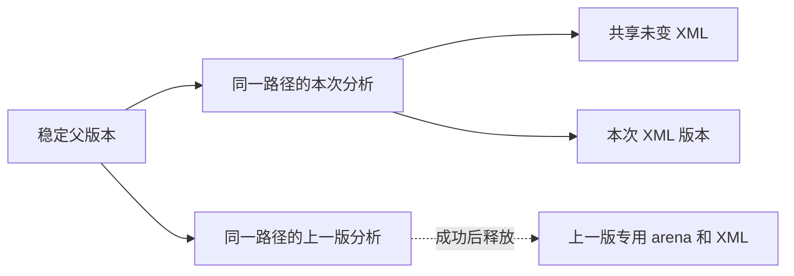
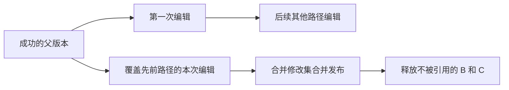

# 整体诊断执行记录

## Intent · 执行计划

冻结已推送源码和最近可复用的 Source 工具。先从正式入口核对已有进度，再追踪成本最高的状态与数据，选一个可证伪的真实编辑场景测量，最后将修复与恢复条件交给现有自举 goal。详细结论集中在[自举架构与性能诊断](../自举架构与性能诊断.md)。

## Data · 实际执行

- 源码 `3aff0196`。读取 `WAY.md`、自举完成标准、用户原话、性能技能及 11 月 14–17 日阶段记录。针对还在变化的项目装载代码，把已提交基线与工作区草稿分开核对。
- 原始对照的工作目录为 `.zig-cache/cold-build-analysis/ownership-research/rx-compiler-batch/native-table-publication/`。输入为 `performance-manifest.json`，工具为 `self-hosted/bin/zxc-bootstrap`，三轮证据为 `perf-{previous,candidate}/` 和 `frozen-perf-{fixed,candidate}/` 的 cold、warm、unchanged JSON 与日志。临时目录可按仓库规则回收，长期指标保存在根报告及阶段记录中。
- 实际重放使用仓库内 `.zig-cache/verification-tmp/bootstrap-design-audit/` 隔离输出与缓存。首轮由仓库根调用时，manifest 相对接口路径无法解析；沿原测量脚本切至 `packages/compiler` 后生成成功。失败启动没有进入性能样本。
- 冷生成固定参数为 `--manifest <manifest> <output> <cache> --partitions 16`，环境变量 `ZXC_RESIDENT_GENERATOR=0`。常驻重放从 Git 导出 compiler、lint、core、genz 的 src，按原顺序重定位清单四个 roots，将位于这些根内的绝对接口路径指向副本；其他相对声明仍从相同 cwd 解析。以 `--serve <cache>` 启动一个独立 PID，普通 manifest 客户端启用常驻并连接同一目录。仅在副本改动 lint/loop/postfix.rx。
- 7 次服务 RSS 原始字节按请求顺序为 787628032、1084309504、1118961664、1169080320、1206861824、1251098624、1297530880。哈希按相对路径排序，逐文件输入“相对路径 UTF-8、零字节、文件 SHA-256 的 32 字节值”计算总 SHA-256。隔离服务与可再生树均已清理。

## Edges · 解释界限

一次编辑轨迹只能证明当前工作负载的增长。冷启动到第一次编辑含预热；后续五次仍持续上升。未观测越过 3 GiB 预算时的行为，未把 RSS 归因到单一 arena。类型表写入与工件查询的公式来自已核对的执行路径。生成单元、缓存记录、原始函数文件、输出 Zig 文件分别计数。

## Answer · 交接

正式入口和数据流如下，A–F 的修复顺序、反证要求和关闭标准见根报告。核对对象是正式 Source 路径、原有所有权和失败语义及固定输入成本。诊断会话负责报告和通知；整改与后续自举由原 goal 执行。

《继续自举并保障性能》已在进行中的会话回复确认接收顺序调整，先处理常驻 RX 编辑的内存增长，并搁置通过不透明 Project 句柄把扫描和发布交回 Zig 的草稿接法。恢复条件已同步至[原自举目标](../../goal.md)。本次确认覆盖交接，六组修复的结果由该会话陆续验收。

## A · 常驻编辑的源码与分析归属

### Intent

同一文件的后续编辑替换上一版分析和解析，未变文档保留既有 XML 解析结果。失败请求只撤销本次未发布的数据，当前可复用的分析、依赖顺序和诊断位置继续有效。

### Data

正式入口为 `--serve` → `generate_parser.generate` → `resident.modules.prepare` → `shared_generation.run`。第一次小范围实现仅拆分 XML 版本，12 次编辑并恢复后仍达到 1,493.6 MB。旧版同一输入达到 1,594.1 MB，说明整批 XML 重建只是增长的一部分。逐轮分析仍复用 5,250 个模块，继续持有每轮完整分析的 arena 才是剩余斜率的主要来源。

### Edges

只有清单形状和 ZX 输入相同、相邻两次修改都落在同一 RX 路径时，才从上一次编辑的父版本开始推导。其余情况沿最新成功版本复用。父版本的传递依赖与 3 GiB 预算继续生效。XML 模块持有原文和源位置，文件路径与包配置仍重新走图验证。原始 ZX 文本和已发布的 ZX 解析继续按分析历史保留。emission 容量单独记录，沿用现有页复用策略。

### Answer

验收用 `ZXC_RESIDENT_MEMORY=1` 记录请求后各所有者的容量和版本数。设置只输出计数，用同一 725 入口对照 Source 自编译工具。两代候选二进制的 SHA-256 均为 `fc98d61be62da2815fdc6b58c56d6ab6e7a0a5f7841dc8af8e1046ff821d4528`。

| 同一 PID 的请求后 RSS | 冷启动 / MB | 第 1 次编辑 / MB | 第 12 次编辑 / MB | 还原 / MB | 编辑墙钟中位数 / ms |
| --------------------- | ----------: | ---------------: | ----------------: | --------: | ------------------: |
| `3aff0196`            |       789.4 |          1,082.6 |           1,557.1 |   1,594.1 |               477.1 |
| 修复后                |       789.0 |          1,073.0 |           1,116.0 |   1,133.8 |               464.2 |

修复后第 4 至第 12 次编辑的 RSS 为 1,113.8–1,116.0 MB。每次编辑只解析 1 个 RX 文件，复用另外 706 个；只分析 1 个模块，复用另外 5,250 个。分析保留两代，活跃 XML 版本数保持 708。文件和 ZX 解析的退役列表在该编辑序列内保持空。emission 保留容量全程约 1,672.6 MB，物理峰值与 arena 容量独立统计。

15 次连续失败覆盖 RX 语法、缺失依赖、循环依赖以及 ZX 语法。强制失败的 RX 版本退出请求时立即回收，ZX 连续失败只保留上一次成功分析引用的一版。循环诊断指向循环模块，ZX 语法位置随输入移动。无改动请求走现有快照路径。还原输入后生成文件与初次一致，改合法依赖与包表的结果分别与独立生成一致。RX 和 ZX 解析缓存共通过 53 项回归。

相邻 725 入口的 12,191 个生成文件、5,520 条源码记录和所有权备忘录逐字节一致。冻结 735 入口的 135 项历史差异保持不变。Zig 0.17.0、ReleaseSmall、16 分区、关闭常驻，表内为三轮中位数。

| 冷生成对照      |    墙钟 / s |       CPU / s |   树峰值 / MB | 单进程峰值 / MB |
| --------------- | ----------: | ------------: | ------------: | --------------: |
| 上阶段 → 候选   | 2.92 → 2.97 | 12.94 → 12.99 | 805.1 → 797.0 |   886.2 → 852.3 |
| 固定基线 → 候选 | 2.86 → 2.90 | 12.59 → 12.59 | 885.0 → 757.9 |   943.6 → 799.6 |

该组回测覆盖冷暖生成和常驻请求。持续编辑单一路径的增长在此阶段修复。独立复核随后发现交替编辑仍增长，见[A 的多路径复核](#a-的多路径复核)。源码目录发现缓存继续按路径保存当期文件，完整冷安装沿用历史记录。临时回放脚本和计数保存在 `resident-rx-ownership` 核验目录。

## A 的多路径复核

独立复核用 `8bbf61bd` 的 Source 工具在同一 725 入口交替修改两个 RX 文件。每次只改文件尾部的空行，首尾产物一致。第 12 次编辑仍保留 13 代、826.8 MB 分析容量，服务 RSS 达到 1,465.5 MB。还原后保留 14 代、875.5 MB，RSS 为 1,495.5 MB。

每代现在记录相对所借用父版本实际修改的 RX 路径集合。在 ZX 源码与清单形状相同的历史段中，新编辑定位最早被覆盖的一代，以其父版本为复用起点。成功后，新版本接管这一段改动，旧后缀退出。若用户还原到原父版本，则恢复其已验证的解析批次并直接释放后缀。ZX 源码或清单形状变化仍形成借用边界。

合并时，从父版本重算仍有变化的模块及受影响的依赖，按现有签名和 IR 对齐规则复用其余模块。XML 缓存仍按当前请求和上一请求的文本精确比较。因此重算可能覆盖多条已改路径，XML 仍只解析本次真正修改的文件。

| 同一 725 入口，代数、分析容量和请求后 RSS |                  第 12 次编辑 |                          还原 |
| ----------------------------------------- | ----------------------------: | ----------------------------: |
| `8bbf61bd` 两路径交替                     | 13 代 / 826.8 MB / 1,465.5 MB | 14 代 / 875.5 MB / 1,495.5 MB |
| 本次候选两路径交替                        |  2 代 / 350.5 MB / 1,144.0 MB |  1 代 / 301.8 MB / 1,144.3 MB |

两路径从第 3 次编辑起仅保留两代。每次编辑解析 1 个 XML，复用 706 个。合并重算 2 个模块、复用 5,249 个，全部 5,519 个生成单元继续命中。服务推导中位数为 74.5 → 71 ms，emit 为 365.5 → 340 ms。独立复核通过普通客户端提交，本次回放直接走同一服务协议，端到端时长分别记录。

四路径回放混合单文件、双文件与四文件，共 20 次。启动后先各改不同路径，最多保留 5 代。首次同时覆盖早、晚两代的路径时收缩到 2 代，后续保持两代，还原后为 1 代。两组还原的生成文件与各自首轮一致。六次真实依赖切换逐次与独立生成逐字节一致，依赖缺失的失败请求保留上一代，修复后恢复输出。无改动请求继续命中快照。原始回放见 `resident-rx-lineage` 核验目录。

两代 Source 引导器各通过 22 个构建步骤，SHA-256 均为 `7240a977bf0295c7857b59ba3cad3406dd2007285fef9387bf2b44edf9b39d4d`。相邻 725 入口的 12,191 个生成文件、5,520 条源码缓存和所有权备忘录一致。冻结 735 入口中 135 项历史差异保持不变。

相邻工具的冷生成墙钟 2.93 → 2.96 秒、CPU 12.97 → 13.01 秒，树峰值 792.1 → 790.7 MB。固定基线的对应指标为 2.85 → 2.86 秒、12.58 → 12.62 秒和 893.0 → 775.7 MB。计时仍用 Zig 0.17.0、ReleaseSmall、16 分区、关闭常驻，并取三轮中位数。完整冷安装沿用历史记录。

## A–I 最终报告接收与状态

已接收[最终设计复核与整改报告](../自举设计复核与整改报告.md)。以下按修正后的证据和关闭条件执行，常规自举在各项收口后恢复。

| 项                   | 状态与关闭证据                                                                                                                                 |
| -------------------- | ---------------------------------------------------------------------------------------------------------------------------------------------- |
| A 常驻编辑           | 已修复及验证。`8bbf61bd` 拆分 XML 版本，`e3a5d6b6` 收口多路径历史。沿 `--serve` 复用上节的交替、四路径和依赖变更回放，沿用首轮失败与恢复回归。 |
| B 生成文本           | 待证。按命中与未命中分开核对复制、同时存活的字节和 cache/bundle 最后读者。                                                                     |
| C 公开入口摘要       | 已移除普通应用预建摘要和库逐入口对两张只读事实表的重复清理。需求表仍按入口重置，稀疏化待证，见下节。                                           |
| D 类型工作表         | 自举根工作表三项有效分配的判断已撤回。五张按项目规模初始化的类型节点表待测。                                                                   |
| E 类型与成员查询     | 待证。分开计别名投影、成员和通配查找成本，保留查找和诊断顺序。                                                                                 |
| F 宿主编排           | 项目装载、RX 语句降低、独立库联结及所有权固定点仍开放。项目装载的 `opaque Project` 草稿移出工作区，保留原差异供核对。                          |
| G 缓存身份           | 已修复及验证。两种正式 CLI 构建、原始字节与汇编、并行失败和无改动写入均已核对，见下节。                                                        |
| H 内部声明和公开接口 | 四份声明均在行数限额内，生成产物和引导器字节一致。原子行存在可执行的公开原生宿主 ABI，保留该契约，见下节。                                     |
| I 内联临时存储       | 待证。用真实内联和空改写分别核对实际释放、持久数据和峰值。                                                                                     |

## G · CLI 缓存身份

### Intent

保持内嵌和分区链接得到同一缓存身份。身份准备仍在构建步骤中，保留指纹顺序、内容及无改动时的时间戳。

### Data

`packages/cli/build/cache_identity.zig` 从 CLI 正式构建注册辅助进程。旧进程为每个源文件分配索引，但多个工作线程在失败时写同一个可选错误字段。它还把同一个摘要输出为生成的 Zig 声明和汇编符号。

### Edges

各线程只写自己认领的输入结果。主线程在 join 后沿原有顺序折叠结果，首个错误直接结束且不更新输出。静态 Zig 适配模块嵌入定长字节数据，汇编符号从同一数组生成。

### Answer

同一输入传给原辅助和候选。原 Zig 声明的 32 字节与新二进制文件一致，两份汇编输出逐字节一致。真实 Zig 适配模块和 Clang 汇编的链接结果也返回同一值。重复执行未更新输出时间戳。240 项输入中设置多处读取失败，重复运行时保留旧输出，空目录输入场景也未发布新文件。混合失败返回清单中最早的错误。

使用 A 多路径阶段的 Source 引导器，Zig 0.17.0、ReleaseSmall 下普通内嵌安装通过 58 步，16 分区并使用 macOS 平台链接的安装通过 61 步。两份可执行文件包含同一个缓存身份，编译既有算术输入的输出逐字节一致。当前未覆盖其他平台。

五个生产源码目录交替交给原辅助与候选各六次，墙钟中位数均为 0.06 秒，CPU 为 0.56 → 0.555 秒。这组只测身份辅助进程。缓存身份继续在构建步骤中计算。

## C · 应用生成与库重入摘要

### Intent

在生成分析批次内一起处理摘要所有权、重复能力传播及两项静态接口冗余。让普通应用只构造实际使用的分析状态，库按需共享独立入口的暂存。

### Data

普通应用的稳定命名现接收函数分析已生成的 I/O 和 process 能力，复用库路径的 `createWith`。公开入口使用的摘要由库在首个非 type-only 导出时准备，在生成作业开始前归还。C 的 735 个固定输入中，733 个发布可执行入口，另外两项只发布常量。独立入口读取未知的输入、输出事实，只经 demand 修改需求表。从独立入口的 RX 删除只读事实的清理步骤，其初始值直接取生成存储分配时的 `Knowledge.None`。seed 使用相同初始值。顺带移除 seed 中静态不可达的 effects 调用及导出阶段未读取的 `ModuleInput`。

### Edges

全程序分析保留原来的乐观初始化。入口需求两张表仍在每次重入时清零，保留入口隔离和收敛顺序。分析提前于稳定命名分配，内存耗尽可以早于名义来源诊断。领域错误仍由原命名路径返回。需求表实际写入密度及稀疏重置的收益仍待测量。

### Answer

Source 引导阶段通过 22 个构建步骤。使用同一 Source 引导器构建 16 分区 CLI，运行现有应用、原生调用和 Store 共 36 项回归。算术、进程工作目录、标准输出和文件读取四组既有输入生成的 Zig 字节一致，Store 和依赖闭包两份既有库发布目录也一致。

冻结构建输入包括 735 个入口，使用 Zig 0.17.0、ReleaseSmall、16 分区、Source 分析与生成。两版各三次交替运行，中位数如下。比较 11,758 个文件一致，冷暖产物一致，所有权 memo 的 SHA-256 相同。

| 场景           | 上阶段墙钟 / CPU | 本阶段墙钟 / CPU | 固定基线墙钟 / CPU |
| -------------- | ---------------- | ---------------- | ------------------ |
| 冷生成         | 2.81 s / 12.41 s | 2.75 s / 12.33 s | 2.85 s / 12.58 s   |
| 热缓存重新输出 | 2.19 s / 8.42 s  | 2.11 s / 8.34 s  | 2.25 s / 8.61 s    |
| 无改动已有输出 | 0.03 s / 0.03 s  | 0.04 s / 0.03 s  | 0.04 s / 0.03 s    |

冷生成的采样进程树峰值从 762.8 MB 到 758.8 MB，单进程峰值中位数从 845.4 MB 到 805.9 MB。固定基线分别为 893.0 MB 与 939.7 MB。本轮测的是引导器生成阶段。工具本体由上阶段 Source 引导器生成，固定基线沿用同一冻结输入的原始日志。

架构专项的应用重入摘要、重复能力传播和静态接口清理已完成。整程序所有权调度归 F。最终 IR 复核和 Node/Wasm 源码归属进入各自整改批次。

## H · 内部内存声明与宿主原子行

### Intent

按职责拆分两份内部内存声明，保留原生类型归属、签名、生成文件名和私有可见性。核实标准库原子行是否属于可用的公开宿主契约。

### Data

此前最小探针确认原生声明入口不接受 `import type`。一个 opaque 类型的归属来自原生模块标识，函数稳定名还使用逻辑路径。独立模块化声明会改变这些契约。现在物理声明分别描述视图、缓冲区值、列集合和列值，行数为 225、105、162 和 121。构建将它们按原声明顺序拼成两个字节一致的 ZX 声明输入，由现有解析器处理。清单通过绝对物理目录和原逻辑路径前缀关联内容，CLI 缓存身份计入新的文件目录。

### Edges

源自普通 ZX 值的借用继续由编译器处理。标准库 `AtomicRows` 的公开宿主路径确实可用。用安装版发布一个接收 `std:bytes.AtomicRows` 并返回行数的库，再由 Zig 宿主传入两个可写切片组成的有效描述符，链接真实标准库后执行得到 2。这个宿主 ABI 提前于本次整改存在，保留已发布的类型和操作。

### Answer

留存安装版逐份 lint 通过。Zig 0.17.0、ReleaseSmall、16 分区下使用 C 阶段 Source 工具完成引导构建，25 项构建步骤通过。正式主清单的 12,533 个生成文件逐字节一致，另行排除记录输入路径及指纹的 `.zxc-inputs`。上阶段与候选引导器的 SHA-256 相同，均为 `2356fefcef88dc7e055cd01dc34e7fc70beea9817f0998ec7a3fa13cffcf2b4c`。借用报告使用另外的派生清单，原有两项测试通过。

16 分区 CLI 安装通过 64 项构建步骤。用该安装版重验 lint，普通应用直接导入 `memory` 仍在模块解析阶段拒绝，`AtomicRows` 探针的公开库发布目录与原安装版逐文件一致。

构建新增一次可缓存的清单接线。首次构建日志包含约 1 秒的辅助工具编译及 313 毫秒的执行时间。无改动再构建时两步均命中缓存，墙钟 0.37 秒。此处记录新增构建成本和缓存结果。编译器运行时二进制一致，复用上阶段运行时性能证据。
