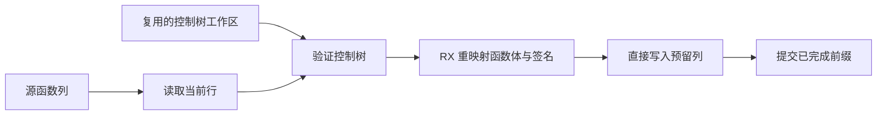
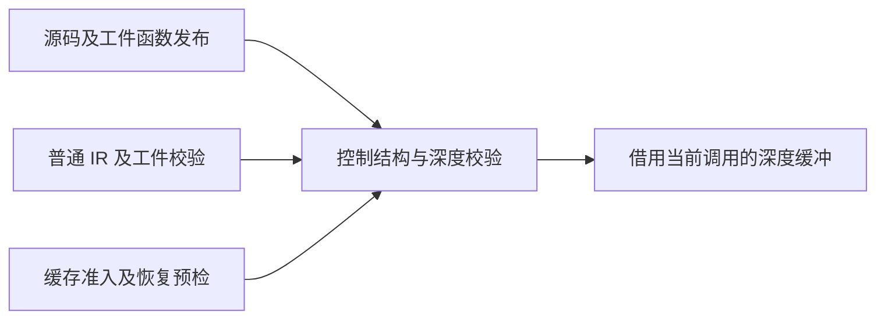
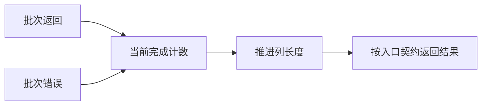

# 源码函数尾部与入口自举

## Intent

迁移源码模块导入的函数尾部发布与入口选择。从混合项目的 ZX、RX 发布和 RX 函数导入追到 `Source.appendBody`、`Nodes.appendFunctions` 和 `Nodes.appendFunction`。在源码链接、源码产物和已编译库路径共享底层表发布能力。

## Data

源码函数表按未发布尾部保留容量。现有 Zig 读取签名和控制体，再逐行调用已迁入 RX 的函数物化，最后发布列。入口函数可能引用自身，源码投影的尾行只在函数本身与引用候选完全相符时复用。函数范围映射同时支持共享前缀、稠密、稀疏和标记过的映射表。已完成的编译库批量发布证明独占可写但无增长头的列表可以原地写入。

本批次涉及源码联结、函数表裁切及校验、函数和入口物化、源码产物联结、共享 Store 初始值与 RX 函数导入。逐路径核对既有验证与错误传播，再复用正式 Source 引导器。

## Edges

保留函数和类型 ID、前缀别名、原生签名空值、Store 初始化顺序和分配失败后的已完成行。控制深度工作区在批次内复用，发布表长期持有的只有函数自己的数据。空控制树与 Store 表继续使用约定的静态描述符。Zig 的容量管理与描述符 ABI 适配在本批次保留。

## Answer

验收检查同一 Source 入口的实际调用路径、列表借用形态、现有源码联结及库回归，以及相邻和固定基线的性能。整项自举还需传递依赖审计和阶段自编译。

## 已迁移的执行路径

- 源码模块链接、完整 Program 联结和 RX 函数导入都通过生成的函数尾部批次入口。ZX 按原顺序读取已有列，RX 逐行校验控制结构并调用既有函数物化链，ZX 写入预留列后推进已完成前缀。
- 每批复用一份深度表。小控制树使用固定工作区，大控制树只在当前行需要时扩展临时工作区，然后从当前行恢复。结构错误仍在该行停止。Zig 只为扩大工作区重入一次批次，并提交已完成列。
- 已编译库路径和源码路径共享同一列契约与尾部 ABI。原有编译库实例重映射继续由独立 RX 流程执行。源码路径保留静态空描述符和底层共享节点。
- 源码入口复用判断、单独入口的追加、公共成员和初始化器发布仍由宿主协调，属于后续收口范围。

## 验收

- 上一阶段 Source 工具生成新引导器，再由新引导器构建候选工具，两个构建各通过 22 个步骤。最终引导器包含调用方提供临时分配器的改动。
- 205 个回归构建步骤、242 项 Zig 测试和 13 项 CLI 检查通过，覆盖源码模块联结和独立重联结、分配失败、混合 RX/ZX 项目、Store 初值与库复用。
- 生成代码探针验证 13 列原地写入、工作区逐步扩展后从原位置恢复、无效控制根保留已完成前缀，以及空控制表和空 Store 表保留静态地址。
- 相邻工具使用同一份 735 入口清单，11,811 个生成文件逐字节一致，5,372 条源码缓存键与负载摘要一致。两侧所有权缓存摘要均为 `afd7c87f83cf036243539a92438179414abd675c19c61521111d6547b0a31560`。固定输入既有 134 份 Zig 文件差异的两侧摘要与上一阶段一致，生成清单随冻结路径变化。

## 性能

Zig 0.17.0、ReleaseSmall、16 分区，关闭常驻服务。对照工具由各自上一阶段 Source 引导器构建，运行 Source 分析和生成。两组对照各交替三轮取中位数。

| 场景           | 冷生成墙钟 | 冷生成 CPU | 冷生成进程树采样峰值 RSS | 冷生成单进程峰值 RSS | 磁盘暖缓存墙钟 / CPU |
| -------------- | ---------: | ---------: | -----------------------: | -------------------: | -------------------: |
| 相邻，上一阶段 |    2.84 秒 |   12.59 秒 |                 768.6 MB |             810.8 MB |       2.20 / 8.57 秒 |
| 相邻，候选     |    2.84 秒 |   12.52 秒 |                 775.5 MB |             806.3 MB |       2.20 / 8.56 秒 |
| 冻结，固定基线 |    2.86 秒 |   12.52 秒 |                 885.4 MB |             921.5 MB |       2.22 / 8.52 秒 |
| 冻结，候选     |    2.83 秒 |   12.51 秒 |                 760.2 MB |             834.5 MB |       2.19 / 8.50 秒 |

相邻冷生成的进程树采样峰值范围为 767.5–769.3 MB 和 768.7–778.0 MB，固定输入的进程树采样峰值降低 125.1 MB。本轮计时范围为 Source 生成阶段。

## 统一控制流工作区与批量发布

### Intent

将正式源码及工件联结的函数批量发布一次执行到底。控制结构校验、深度工作区扩容和遍历共用同一实现，供缓存准入及恢复路径复用。

### Data

基线为 `064f53b4`。生成入口在深度缓冲不足时返回需要的槽数。Zig 扩容后重新进入批量生成入口，由当前未完成行再次校验控制结构。普通控制树校验另用一条数组构造与初始化路径。

### Edges

先验证控制表和根节点，再按需扩容。根为空或只有一个块的短路顺序保持原样。批量发布继续复用栈上缓冲和临时分配器。单体校验使用原分配器并按需要槽数精确预留，完整 Program 校验在入口和函数间复用缓冲。验证时只借用工作区，生成结果继续持有自己的列与节点。出错时仍提交已经完整写入的前缀。

普通只读数组视图在写入时会触发生成器的续借复制。最终实现使用编译器内部的独占缓冲原语，普通 native reference 的作用域规则保持原样。

### Answer

批量发布直接在当前行完成扩容、初始化、控制树遍历和已有物化步骤。删除 Zig 重入循环和相应的游标、需要槽数、续借值。统一校验入口现在用于源码函数、工件及 IR 校验、缓存准入和恢复预检。

定向生成覆盖 7 个入口、532 个模块和 472 个函数文件。生成的深度初始化及遍历只访问原缓冲，未产生列表续借、堆分配或复制指令。容量实际增长仍由通用内存原语执行。函数表容量预留和已完成前缀的长度提交仍在 Zig。

没有新增 Zig 文件。通用深度缓冲原语增加 40 行，各正式入口的借用适配及旧重试移除合计净增 23 行。独立的 `tree.zx` 校验实现删除。

### 验收

两代 Source 引导器各通过 22 步，SHA-256 同为 `a7ac4c4284d63a858989b870714a1f662d87ad3f6d3e1e8d4f1c662188ecbba7`。联结边界、工件提取、语义缓存、缓存编解码、库联结、普通联结执行、原生 ABI 和独立工件导入八组通过，共 167 个构建步骤和 333 项测试。

两版均由相应 Source 引导器生成，并执行 Source 分析与生成。macOS arm64、Zig 0.17.0、ReleaseSmall、16 分区，关闭常驻。每组交替各三轮，表内为中位数，RSS 取十进制 MB。

| 对照            | 冷生成墙钟     | 冷生成 CPU       | 采样进程树峰值 RSS | 单进程峰值 RSS   |
| --------------- | -------------- | ---------------- | ------------------ | ---------------- |
| 上阶段 → 候选   | 2.97 → 2.94 秒 | 12.97 → 12.98 秒 | 789.7 → 787.8 MB   | 879.1 → 886.2 MB |
| 固定基线 → 候选 | 2.89 → 2.86 秒 | 12.58 → 12.58 秒 | 893.9 → 771.9 MB   | 922.4 → 800.0 MB |

对应 724 个入口的 12,168 份生成文件、5,511 个缓存记录及 memo 哈希一致。磁盘缓存墙钟保持 2.33 秒，CPU 从 8.93 到 8.98 秒。固定冻结输入的 135 项既有差异保留相同路径和两端哈希。普通、Store 和三组原生 ABI 重联结生成产物一致，墙钟差异均小于 0.18 毫秒。本批未重测完整冷构建，也未另跑超过固定工作区容量的独立压力样本。

## 源码和编译库函数表前缀提交

### Intent

把源码与编译库函数表批量写入后的长度提交统一迁入 ZX。保留既有列写入、编号顺序和分配失败时的完整前缀。

### Data

基线为 `3ab8f641`。源码和编译库入口在每一行完全写入后递增进度，Zig 在返回或报错时用 `defer` 提交进度对应的尾部长度。函数表预留和借出尾部均在批量调用前执行。

### Edges

先捕获整批写入结果，再读取进度并提交各列长度。部分写入失败的行留在未发布尾部。源码入口和编译库入口各自保留既有的错误分类。可写状态入口继续直接借用本次调用的预留尾部，生成产物持有的仍是原函数表。

原型中的原生对象参数使生成器无法选用可写状态入口。通用内存接口改为借用实际的列表长度字段。它仅推进长度，避免复制载荷或持有函数行类型。预留与可写尾部描述符装配仍在 Zig。

### Answer

定向生成覆盖两个入口、79 个模块和 74 个函数文件。两个正式入口继续生成 `executeState`，直接使用已借出的列。错误捕获与长度提交没有新增对象分配。

源码发布与编译库加载的两个 Zig `defer ...commitTail` 已退出正式路径。生产 Zig 文件数持平，通用长度借用及入口接线净增 30 行。原生签名登记的提交仍走独立路径。

### 验收

两代 Source 引导各通过 22 步，SHA-256 同为 `929e8f4cdcab84c410eab05662f88beaed5b847cbc6a90b1e06550ef7e21661d`。联结边界、工件提取、语义缓存、库联结、普通联结、原生 ABI 执行和独立工件导入七组通过，共 158 个构建步骤、294 项测试。两代引导各约 49 秒，回归构建及执行共 316 秒，两组性能对照共 80 秒。

两版工具由对应的 Source 引导器生成，并执行 Source 分析与生成。macOS arm64、Zig 0.17.0、ReleaseSmall、16 分区，关闭常驻。各组三次交替测量取中位数，RSS 用十进制 MB。

| 对照            | 冷生成墙钟     | 冷生成 CPU       | 采样进程树峰值 RSS | 单进程峰值 RSS   |
| --------------- | -------------- | ---------------- | ------------------ | ---------------- |
| 上阶段 → 候选   | 2.97 → 2.95 秒 | 12.97 → 12.99 秒 | 808.8 → 790.0 MB   | 851.9 → 839.3 MB |
| 固定基线 → 候选 | 2.86 → 2.84 秒 | 12.57 → 12.56 秒 | 885.3 → 759.4 MB   | 921.7 → 800.8 MB |

相邻版同一 724 入口的 12,171 份生成文件、5,512 项缓存记录和 memo 哈希一致。磁盘缓存墙钟从 2.32 到 2.35 秒，CPU 保持 8.99 秒。固定输入的 135 处历史差异保留相同路径和两端哈希。普通、Store 和原生 ABI 重联结产物一致，墙钟差异不超过 0.15 毫秒。本轮未重测完整冷构建。
