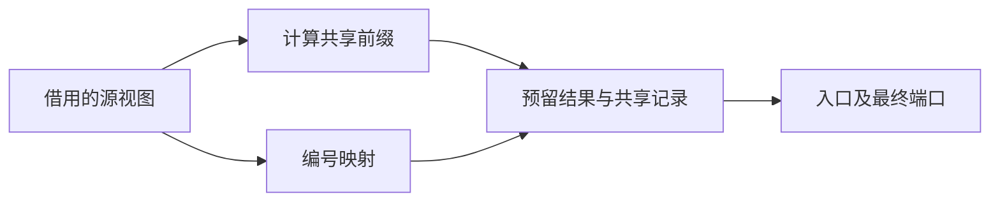

# 源码模块发布流程自举

## Intent

收口源码模块发布。将已有 ZX 函数尾部、入口、初始值、成员算法接入真正执行它们的 Source 流程，迁移最终端口解析。检查混合项目、源码重联结与独立库的调用路径。

## Data

`link/source.zig` 根据编译时 RX 返回的枚举数组执行阶段。公开面发布中，Store 初始值和成员都从原 ABI 借出列，并在需要时分配结果。最终端口必须由已发布成员的入口决定，纯类型模块使用映射后的公开类型。

## Edges

前置函数体与声明发布的原有错误顺序保留。初始化器与成员使用按需分配，收到后一个请求即表明前一个发布阶段已完成。继续借用共享初始化器前缀。宿主只响应物理容量请求并管理已分配存储。完整 Program 接入、类型合并、单独函数体写入及声明载荷仍在宿主边界。

## Answer

验收覆盖真实链接、Store、成员错误和产物一致性，与相邻和固定基线比较性能。

## 实现

- 公开面 RX 先处理 Store 初始值，再绑定公共成员，最后从成员决定的入口取得端口。纯类型模块直接映射已声明的端口。
- RX 在首次需要新记录时返回具体容量请求。宿主为初始化器或成员分配原布局，保留已经发布的数据，并从相应阶段恢复。命中整个初始化器共享前缀时直接借用原记录。
- 初始化器批次直接映射编号与复制必要文本，再写入预留列。生成代码没有为单行初始化器再分配临时对象。
- 原先由 RX 返回步骤数组、Zig 循环解释步骤的入口已退出。函数体接入、声明载荷、独立入口的宿主追加及物理容量管理继续分别沿原调用链执行。

## 验收

- 通过两代 Source 引导构建，各 22 个步骤。84 个回归构建步骤、44 项 Zig 测试和 11 项 CLI 检查通过，覆盖源码联结、分配失败、Store 发布和磁盘项目的诊断恢复。
- 定向执行确认初始化器先请求空间并写入，随后才请求成员空间。恢复时保持已写初始化器的地址，最终端口使用成员绑定后的入口。纯类型路径在零容量分配器上正常运行。
- 相邻 Source 工具使用同一份 735 入口清单，11,838 个生成文件逐字节一致，5,385 条源码缓存键与负载摘要一致。所有权缓存摘要同为 `7f1f9fb0d12af32e04d941934b8ae866ab4c0cb395ca09fa59599c676e8713c5`。固定输入既有 134 份 Zig 文件差异的摘要与上一阶段一致。

## 性能

Zig 0.17.0、ReleaseSmall、16 分区，关闭常驻服务。对比工具均由各自上一代 Source 引导器构建，运行 Source 分析与生成。相邻和固定输入各交替三轮，取中位数。

| 场景           | 冷生成墙钟 | 冷生成 CPU | 冷生成进程树采样峰值 RSS | 冷生成单进程峰值 RSS | 磁盘暖缓存墙钟 / CPU |
| -------------- | ---------: | ---------: | -----------------------: | -------------------: | -------------------: |
| 相邻，上一阶段 |    2.82 秒 |   12.59 秒 |                 770.3 MB |             854.8 MB |       2.19 / 8.58 秒 |
| 相邻，候选     |    2.79 秒 |   12.52 秒 |                 770.2 MB |             856.2 MB |       2.20 / 8.56 秒 |
| 冻结，固定基线 |    2.84 秒 |   12.53 秒 |                 901.5 MB |             924.8 MB |       2.22 / 8.57 秒 |
| 冻结，候选     |    2.81 秒 |   12.49 秒 |                 757.6 MB |             854.1 MB |       2.20 / 8.48 秒 |

固定输入的冷生成进程树采样峰值减少 143.9 MB。禁用语义缓存后，Store 库和原生库各预热再交替六轮。Store 库墙钟与 CPU 两版均为 0.03 秒，原生库墙钟均为 0.015 秒且 CPU 均为 0.01 秒。两组分别生成 14 和 20 个逐字节一致的发布文件。本轮计时覆盖 Source 生成和两个库发布用例。
