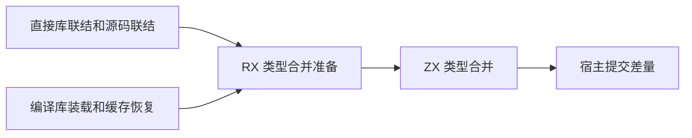

# 类型合并准备自举

## Intent

由 RX 执行类型表预检、映射分配、前缀核对和合并。直接库联结、编译库装载和语义缓存恢复复用同一个准备流程。

## Data

以 `379920cb` 为对照。从 `link` 到 `Types.appendTemporary`，以及从源码联结到 `Types.appendAnalyzed`，当时先由 Zig 调用生成的预检入口，再分配映射并进入生成的类型合并。编译库装载和缓存恢复已有 RX 编排，但另外组织了一套预检和初始化步骤。现有类型合并回归分别通过可控的所有者和临时分配器，覆盖此前的错误顺序、失败清理与名义类型冲突。

## Edges

保留源表形态、名义绑定、来源索引和边界的原校验顺序。直接联结仍从所需生命周期对应的分配器分配映射，预检通过后才分配，前缀内容校验随后执行。预先持有映射的装载路径继续借用原缓冲。预检索引和合并差量共用单次调用的临时 arena，发布结束即释放。最终表容量预留、差量提交和逐模块联结仍持有 Zig 宿主状态。

## Answer

移除正式路径中独立的 Zig 预检适配器和单独生成入口。映射由内部内存原语直接分配到调用方的借用描述符，其后由 ZX 写入，不产生一份临时映射再复制。类型表和名义绑定仍借用原列。旧 seed 的预检结果结构归入 seed 实现。

生产 Zig 净减 61 行，删除一个文件。新增内部内存原语的 13 行已包含在净值中，没有新增 Zig 文件。

### 验收

三条独立生成入口覆盖 114 个模块和 91 个函数文件。两代 Source 自编译各通过 22 个构建步骤，SHA-256 同为 `80525f5e8a0dd3bf9fc19e80ec28035d85e84f888b044bd7b6dcd58ab0be673f`。类型合并、类型校验、联结边界、联结执行、工件提取、原生执行、语义缓存和统一库联结八组通过，共 162 个构建步骤、485 项 Zig 测试。预检回归以两个独立的故障分配器确认了映射分配前后各分支的错误优先级。

普通联结和能力槽的产物逐字节一致，配对墙钟中位数分别为 4.019 → 3.859 ms 和 3.733 → 3.760 ms。三组原生运行的原始、联结、缓存和 ABI 产物一致，墙钟中位数分别变化 +0.030、−0.114、−0.223 ms。

生成对照使用对应的 Source 自编译工具和 Source 分析与生成实现。macOS arm64、Zig 0.17.0、ReleaseSmall、16 个生成分区。表内为三次交替配对的中位数。RSS 为进程树采样峰值，单位为十进制 MB。

| 场景                              |    墙钟，秒 |       CPU，秒 | 进程树峰值 RSS，MB |
| --------------------------------- | ----------: | ------------: | -----------------: |
| 同输入冷生成，上一阶段 → 本阶段   | 2.95 → 2.91 | 12.87 → 12.87 |      805.5 → 798.7 |
| 同输入热生成，上一阶段 → 本阶段   | 2.29 → 2.30 |   8.88 → 8.83 |      797.9 → 798.2 |
| 冻结输入冷生成，固定基线 → 本阶段 | 2.87 → 2.87 | 12.55 → 12.54 |      885.5 → 760.7 |
| 冻结输入热生成，固定基线 → 本阶段 | 2.26 → 2.25 |   8.64 → 8.62 |      893.1 → 775.8 |

同输入的 12,105 个生成文件、5,484 个缓存键及载荷以及 memo 哈希一致。冻结输入保持相同的 135 个历史差异文件，两侧哈希也一致。本批未重测完整冷构建。
