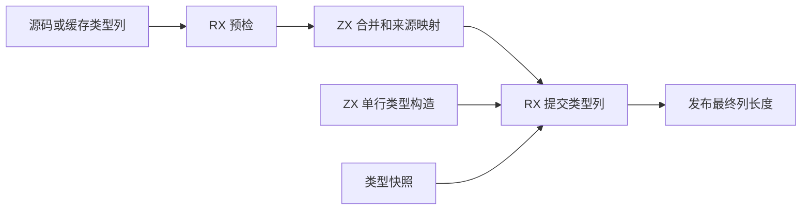
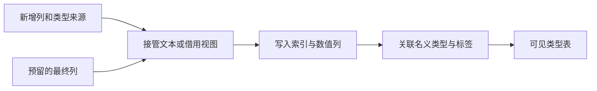

# 类型表提交与预检自举

## Intent

把类型表预检、列提交和文本所有权决策迁入 RX/ZX。源码分析、编译库和语义缓存继续使用同一条提交路径。

## Data

主联结入口在 Zig 中先调用类型表验证，再调用 RX 索引名义来源。生成的合并规则返回新增列。旧 Zig 提交端把类型列和名义来源列打包成两个无名描述符数组，并在宿主选择复制文本或复制视图。单行类型构造另有自己的 Zig 发布分支。

## Edges

RX 先执行必要的类型结构检查，再处理名义来源和前缀校验。保留既有映射存储、临时 arena 及错误顺序。写入阶段先准备文本，然后写入已重基化的索引与数值列，最后用已拥有的标签关联名义来源。借用快照只复制列描述符，独立快照和跨 arena 追加按原契约拥有文本。原生宿主继续按容量预留和发布最终列长度，并在失败时释放已拥有的文本。

单行类型的偏移由构造规则计算，写入时使用这些绝对偏移。缓存恢复分配列和拥有文本时继续使用各自的 allocator。保留初始引导器的 Zig 路径。

## Answer

验收覆盖保留前缀、结构及名义类型合并、缓存恢复、编译库和分配失败。以同输入生成与实际联结对照观察 CPU、墙钟和内存。

两代 Source 引导各通过 22 步，二进制 SHA-256 同为 `bc743afa83ae55a4e021bffd860c878c1ce79ad1da7eaae4921b5b9122ee25f0`。类型校验、合并、名义来源、产物、库联结、语义缓存及运行联结共 415 项 Zig 测试通过，另有 6 项独立库导入。内存接口按职责划分所影响的解析缓存和 RX 文本校验另通过 136 项测试。已有前缀索引分配、数据验证、映射分配与前缀比较的错误顺序回归仍通过。

Zig 0.17.0、ReleaseSmall、16 分区、关闭常驻。相邻两版 Source 自编译工具交替执行同一 729 项清单，各执行三轮。11,933 个生成文件、5,424 项源码缓存与所有权备忘录一致。固定基线继续使用相同冻结语料，134 处既有 Zig 差异的路径和两侧哈希一致。

| 对照            | 冷生成墙钟     | 冷生成 CPU       | 采样进程树峰值 RSS | 单进程峰值 RSS   |
| --------------- | -------------- | ---------------- | ------------------ | ---------------- |
| 上阶段 → 候选   | 2.84 → 2.86 秒 | 12.74 → 12.69 秒 | 775.6 → 782.3 MB   | 857.1 → 875.7 MB |
| 固定基线 → 候选 | 2.87 → 2.80 秒 | 12.61 → 12.52 秒 | 885.0 → 757.3 MB   | 962.6 → 803.7 MB |

相邻样本的冷生成树峰值范围重叠，候选首轮墙钟为 4.11 秒且 CPU 为 12.69 秒。其余两轮墙钟为 2.82 和 2.86 秒。普通与 Store 两组重联结的墙钟中位数分别为 4.00 → 4.02 毫秒和 3.84 → 3.65 毫秒，产物逐字节一致。本阶段计时覆盖生成与重联结，完整冷构建未重测。

相对上阶段，未新增手写 Zig 文件。最终提交的 Zig 新增 175 行、删除 183 行，净减 8 行，其中通用内存边界提供按类型批量复制所需的 20 行 Zig。类型语义、重基化和选择文本所有权由 RX/ZX 决定。容量与工作区回收、静态标量表初始化及逐模块联结调度仍由 Zig 执行。

## 统一容量预留与长度发布

### Intent

将源码分析、类型联结、编译库装载和缓存恢复共用的差量提交迁入同一 RX 流程。普通追加、已构造类型和快照共用列写入和发布。

### Data

基线为 `37247150`。正式路径经 `merging/commit.zig` 预留类型和名义来源容量，借出尾部切片，进入 RX 写入，再从 Zig 发布长度。独立快照在进入 RX 前另行精确分配容量。

### Edges

追加先预留名义来源，再核对所有类型列的长度上限，最后按原列顺序分配。快照沿用精确容量。两组列在写入完成前保持原长度。名义类型的名称从更新后的标签前缀或新标签尾部借用，前缀搬迁后重新读取切片描述符。容量和文本载荷继续使用各自的分配器。已有追加回滚释放成功复制的文本，原生内存层负责局部复制失败时清理该列。

### Answer

RX 顺序执行预留、拥有或借用文本、重基化、数值列写入、名义名称绑定和发布。输入中的列范围描述符由 Zig 在栈上借出。新增的内存原语根据编译期列元素类型操作原生列表，直接填充最终列尾部。两个 RX 调用共用一个目的地记录，窄范围生成的 24 个函数文件中没有对象堆分配。

跨列复制失败时的文本回收仍在 Zig 宿主，逐模块联结和类型合并与提交之间的入口切换也仍在 Zig。

本批未新增 Zig 文件。编译器提交适配减少 22 行，核心旧发布方法减少 7 行，通用内存原语增加 92 行，生产 Zig 净增 63 行。

### 验收

两代 Source 引导各通过 22 步，二进制 SHA-256 同为 `445b81ff6b5a220c58fe365be7fa3f8e333415987bf1ca6c8f31b02de61eb4e6`。类型合并、类型校验、名义来源、联结边界、工件提取、原生联结、语义缓存、统一库联结和联结执行九组通过，共 153 个构建步骤和 439 项测试。现有分配失败和压紧回归分别核对失败清理、重试和保留前缀的指针身份。

两版由对应的 Source 引导器生成，并执行 Source 分析和生成。macOS arm64、Zig 0.17.0、ReleaseSmall、16 分区，关闭常驻生成。每组交替各三轮，下表为中位数，RSS 单位为十进制 MB。

| 对照            | 冷生成墙钟     | 冷生成 CPU       | 采样进程树峰值 RSS | 单进程峰值 RSS   |
| --------------- | -------------- | ---------------- | ------------------ | ---------------- |
| 上阶段 → 候选   | 2.95 → 2.92 秒 | 12.93 → 12.79 秒 | 779.5 → 779.1 MB   | 847.8 → 827.6 MB |
| 固定基线 → 候选 | 2.89 → 2.85 秒 | 12.59 → 12.60 秒 | 885.5 → 762.9 MB   | 924.8 → 807.7 MB |

相邻版同输入的 12,148 份生成文件、5,506 项缓存记录与 memo 哈希一致。磁盘缓存 CPU 为 8.87 → 8.87 秒，墙钟为 2.29 → 2.28 秒。冻结输入的 135 项历史差异保留相同路径和两侧哈希。普通及 Store 重联结墙钟为 3.99 → 4.02 和 3.92 → 3.87 毫秒，生成结果逐字节一致。本轮未重测完整冷构建。
