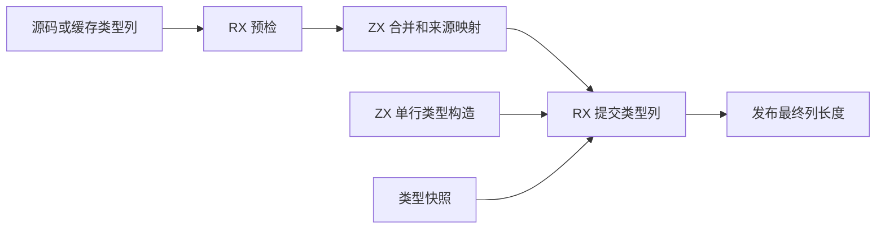
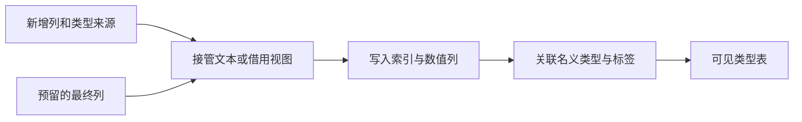

# 类型表提交与预检自举

## Intent

把类型表预检、列提交和文本所有权决策迁入 RX/ZX。源码分析、编译库和语义缓存继续使用同一条提交路径。

## Data

主联结入口在 Zig 中先调用类型表验证，再调用 RX 索引名义来源。生成的合并规则返回新增列。旧 Zig 提交端把类型列和名义来源列打包成两个无名描述符数组，并在宿主选择复制文本或复制视图。单行类型构造另有自己的 Zig 发布分支。

## Edges

RX 先执行必要的类型结构检查，再处理名义来源和前缀校验。保留既有映射存储、临时 arena 及错误顺序。写入阶段先准备文本，然后写入已重基化的索引与数值列，最后用已拥有的标签关联名义来源。借用快照只复制列描述符，独立快照和跨 arena 追加按原契约拥有文本。原生宿主继续按容量预留和发布最终列长度，并在失败时释放已拥有的文本。

单行类型的偏移由构造规则计算，写入时使用这些绝对偏移。缓存恢复分配列和拥有文本时继续使用各自的 allocator。保留初始引导器的 Zig 路径。

## Answer

验收覆盖保留前缀、结构及名义类型合并、缓存恢复、编译库和分配失败。以同输入生成与实际联结对照观察 CPU、墙钟和内存。

两代 Source 引导各通过 22 步，二进制 SHA-256 同为 `bc743afa83ae55a4e021bffd860c878c1ce79ad1da7eaae4921b5b9122ee25f0`。类型校验、合并、名义来源、产物、库联结、语义缓存及运行联结共 415 项 Zig 测试通过，另有 6 项独立库导入。内存接口按职责划分所影响的解析缓存和 RX 文本校验另通过 136 项测试。已有前缀索引分配、数据验证、映射分配与前缀比较的错误顺序回归仍通过。

Zig 0.17.0、ReleaseSmall、16 分区、关闭常驻。相邻两版 Source 自编译工具交替执行同一 729 项清单，各执行三轮。11,933 个生成文件、5,424 项源码缓存与所有权备忘录一致。固定基线继续使用相同冻结语料，134 处既有 Zig 差异的路径和两侧哈希一致。

| 对照            | 冷生成墙钟     | 冷生成 CPU       | 采样进程树峰值 RSS | 单进程峰值 RSS   |
| --------------- | -------------- | ---------------- | ------------------ | ---------------- |
| 上阶段 → 候选   | 2.84 → 2.86 秒 | 12.74 → 12.69 秒 | 775.6 → 782.3 MB   | 857.1 → 875.7 MB |
| 固定基线 → 候选 | 2.87 → 2.80 秒 | 12.61 → 12.52 秒 | 885.0 → 757.3 MB   | 962.6 → 803.7 MB |

相邻样本的冷生成树峰值范围重叠，候选首轮墙钟为 4.11 秒且 CPU 为 12.69 秒。其余两轮墙钟为 2.82 和 2.86 秒。普通与 Store 两组重联结的墙钟中位数分别为 4.00 → 4.02 毫秒和 3.84 → 3.65 毫秒，产物逐字节一致。本阶段计时覆盖生成与重联结，完整冷构建未重测。

相对上阶段，未新增手写 Zig 文件。最终提交的 Zig 新增 175 行、删除 183 行，净减 8 行，其中通用内存边界提供按类型批量复制所需的 20 行 Zig。类型语义、重基化和选择文本所有权由 RX/ZX 决定。容量与工作区回收、静态标量表初始化及逐模块联结调度仍由 Zig 执行。
