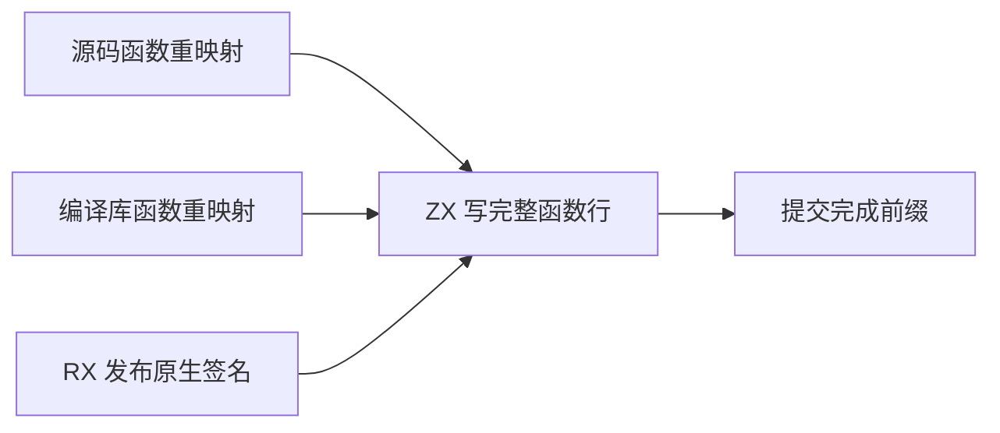
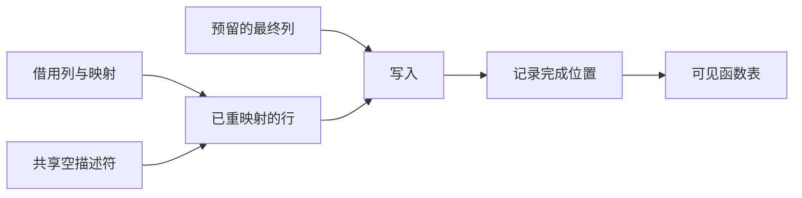

# 统一函数表发布自举

## Intent

统一源码函数、独立编译库函数和重联结原生签名的表写入。由 ZX 写入已预留的最终列，并保留前缀提交和分配失败语义。

## Data

源码函数和编译库函数各自批量转换。旧实现由 ZX 写入所有权相关的数据列，Zig 在返回时再补函数根、Store 模式、输出所有权和原生 ABI 标志。重联结插入原生签名时由 Zig 重建整个签名，并为无函数体的记录分配四份空描述符。初始引导器保留旧 Zig 实现。

## Edges

源码和库继续沿用各自原有的校验、类型与函数 ID 重映射，随后使用同一份函数表写入逻辑。原生签名由 RX 编排拥有文本、填充列和登记映射；映射写在整行填充后。静态空描述符来自既有函数表哨兵，释放时继续识别。出错时，Zig 仅提交已完成的行，未提交列仍由当前分配域回收。表容量和可见长度继续由现有 Zig 存储原语维护。

预留尾部由写入函数独占。跨函数调用时，普通拥有标记会触发 `.with` 的保留旧值分支，生成代码将变更写入新分配的数组。宿主对预留尾部传递独占状态，对输入列继续使用只读状态。验收包含源码和库导入两个路径的输出比对、原生 ABI 冲突及分配失败检查。

## Answer

验证三条调用路径的生成、独立导入和执行结果，并对照产物、CPU、墙钟及内存峰值。

使用上阶段 Source 引导器生成第一代，再用第一代生成第二代。两代各完成 22 步，二进制的 SHA-256 同为 `cb055266947044bc80023601918d3ac6964a698093421f8d7dcf78fd27c69938`。

产物提取、普通和原生联结、独立库重联结、语义缓存与别名运行用例合计通过 222 项 Zig 测试。另有 6 项独立库导入执行通过。别名场景覆盖全部六种导入顺序和源码、编译库两条消费路径。分配失败回归涵盖联结、原生签名与缓存恢复。

固定 ReleaseSmall 配置交替运行相邻工具。普通函数和 Store 重联结产物分别逐字节一致，墙钟中位数为 3.95 → 3.92 毫秒和 3.84 → 3.95 毫秒，CPU 变化分别是 +0.013 毫秒和 −0.034 毫秒。两种别名顺序在源码和独立库消费中也与上阶段逐字节一致。四组别名样本的墙钟变化为 −0.17 至 +0.31 毫秒，CPU 变化为 +0.014 至 +0.226 毫秒。原生签名插入随联结回归验证。

相邻 Source 自编译工具在相同的 730 项清单交替各运行三轮，使用 Zig 0.17.0、ReleaseSmall、16 分区并关闭常驻服务。11,926 个生成文件和 5,418 项源码缓存逐字节一致，所有权备忘录一致。固定基线继续使用相同的 `0e7ff384` 冻结语料，134 处既有 Zig 差异的路径和两侧哈希与上阶段一致。

| 对照            | 冷生成墙钟     | 冷生成 CPU       | 采样进程树峰值 RSS | 单进程峰值 RSS   |
| --------------- | -------------- | ---------------- | ------------------ | ---------------- |
| 上阶段 → 候选   | 2.85 → 2.87 秒 | 12.67 → 12.68 秒 | 777.2 → 775.0 MB   | 851.3 → 827.9 MB |
| 固定基线 → 候选 | 2.84 → 2.79 秒 | 12.42 → 12.44 秒 | 887.2 → 766.3 MB   | 921.7 → 830.0 MB |

相邻热生成墙钟、CPU 均增加 0.02 秒，无变化路径为 0.03 秒。阶段计时覆盖源码生成和重联结，完整冷构建未重测。
