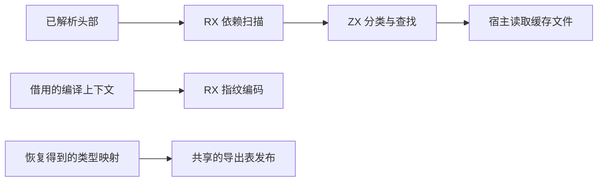
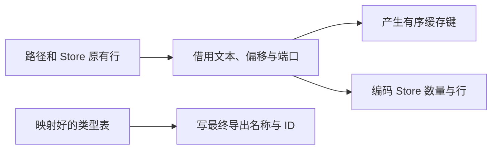

# 缓存依赖扫描与指纹自举

## Intent

让缓存的原生依赖扫描、Store 上下文编码及原生导出表写入直接在借用的数据上运行，减少 Zig 循环和中间数组。

## Data

从 `02998841` 追踪 CLI 磁盘缓存入口、语义缓存的上下文指纹及原生缓存恢复。依赖扫描在 Zig 每次组装 32 个路径，分别调用路径分类和身份扫描。上下文指纹在编码主表后，由 Zig 分批组装 Store 行和行指针。原生缓存恢复先写临时导出 ID 列，再由 Zig 拷贝到最终导出表。

## Edges

保留原生和内部依赖在每个 I/O 批次的相对顺序，以及包作用域第一次查询的时点。解析得到的路径偏移继续以原源码字节为准。Store 指纹继续按原序列编码。导出名仍归项目分配器持有。Zig 保留文件读取、作用域借用、容器扩容与提交检查点。工件联结中需要借用提供方可空函数和嵌套表的逐边调度尚待迁移。

## Answer

缓存扫描的 RX 入口先分类，首次遇到可能的原生引用时请求包作用域，继续时使用已经计算的位图。ZX 直接借用索引解析器的导入记录或原生 AST 的路径列。原生键仍先于同批内部键交给 CLI。Store 数量及各行在同一个 RX 调用内按原顺序编码。缓存原生导出复用工件的导出表写入规则，已映射 ID 和归项目所有的名称直接写到最终行。

### 验收

语义缓存、持久缓存、缓存编解码、原生生成、原生运行、原生联结和 Store 路径七组全通过，共 113 个构建步骤、130 项 Zig 测试和 22 项 Node 集成。以前一阶段 Source 工具构建候选，再由候选自编译，两次分别通过 22 个构建步骤，二进制 SHA-256 同为 `08b6b416b84c87904e179a86b35b282f0a3400a401abdca13ac1733ae6a03ac9`。

在复用原生生成用例的跨进程配对测量中，原生缓存冷建各写入一条，热恢复各命中一条。两个语义载荷的字节内容、生成的 Zig 和 ABI 文件一致。15 次热恢复中位数为 3.160 → 3.192 ms。独立双模块持久缓存用例的热恢复中位数为 2.292 → 2.287 ms，行为和产物一致。

macOS arm64、Zig 0.17.0、ReleaseSmall、16 个生成分区。两版使用对应的 Source 自编译工具和 Source 分析、生成实现。表内为交替配对三次的中位数。RSS 是按进程树采样得到的峰值，以十进制 MB 计。

| 场景                              |    墙钟，秒 |       CPU，秒 | 进程树峰值 RSS，MB |
| --------------------------------- | ----------: | ------------: | -----------------: |
| 同输入冷生成，上一阶段 → 本阶段   | 2.92 → 2.94 | 12.82 → 12.84 |      825.0 → 831.6 |
| 同输入热生成，上一阶段 → 本阶段   | 2.27 → 2.27 |   8.81 → 8.86 |      801.6 → 802.0 |
| 冻结输入冷生成，固定基线 → 本阶段 | 2.85 → 2.82 | 12.55 → 12.52 |      963.1 → 799.1 |
| 冻结输入热生成，固定基线 → 本阶段 | 2.23 → 2.21 |   8.54 → 8.59 |      934.7 → 777.7 |

同输入的 12,067 个生成文件、5,465 个源码缓存键与载荷以及 memo 哈希一致。冻结输入保留 135 个历史差异，路径和两侧文件哈希一致。完整冷构建未在本批重测。
