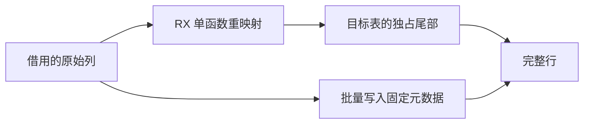

# 编译库函数表批量发布自举

## Intent

延续函数体物化自举。将已编译库函数的逐行装配和增量列写入移入 ZX，直接使用函数表预留的尾部，保留库作用域、编号偏移和失效处理。

## Data

`compiled/host/publish.zig` 已经一次预留容量，但仍由 Zig 遍历函数、重建整行 `ir.Function`，再调用 Source 重映射和宿主追加。原地替换的写入指令生成正确。首次库加载在循环入口的续借步骤提前复制了独占列，导致写入落到副本，已发布尾部仍未初始化。指针探针复现了这一偏差。

## Edges

新列在追加成功或已完成前缀被提交前始终位于未发布尾部。生成函数只改变需要拥有或重映射的列，借用输入签名及列内容。失败时继续保留先前完整的行。原地替换只要求独占可写，扩容仍要求增长头。所有权分析把两种要求记录到循环续借计划，发射器按要求选择权限。变更后的续借记录使用 v18 缓存格式。

## Answer

验收覆盖库加载、重发布、资源及 Store，用已有 Source 引导器检查生成形态和相邻、固定基线的产物及性能。

## 实现与边界

- `compiled/host/publish.zig` 一次调用函数表批量发布入口。ZX 读取原表 13 列并将重映射结果写入对应的预留列。每次写完一行便更新完成计数。Zig 提交已写前缀，同时按连续列复制未改变的签名标记与根节点编号。
- RX 单行联结保留端口、符号、表达式、约束、Store、控制流和元数据的阶段边界。ZX 批量循环保留顺序与前缀语义。宿主管理底层容量、指针适配和失败后的长度提交。
- 定向检查使用上一阶段 Source 生成的引导器，确认实际新生成代码保留三个成功行的全部 13 个写入列地址。第三行输入下标无效时，已完成计数保持为二，失败行的文件名仍为初始值。

## 验收

- Source 引导器先由上一阶段工具生成，再用这次生成的引导器重新构建，两个阶段各通过 22 个构建步骤。两代候选引导器对同一份 734 入口清单生成的 11,790 个文件逐字节一致。
- 六组库回归通过，覆盖独立加载、原生库、Store、RX 编译库和重发布。集合的不可变更新、借用、列转移和追加回归也通过。首轮共有 1,030 项 Zig 测试和 30 项 CLI 检查通过。更新形态检查以识别续借调用后，受影响的循环初值所有权组通过 72 个构建步骤与 128 项测试。
- 相邻工具的同一份 734 入口清单共生成 11,790 个文件，两侧文件集合相同。11,673 个文件逐字节相同，117 个文件有差异。差异覆盖续借函数签名、生成器声明与实现、受所有权事实改变影响的函数以及生成清单。两侧的磁盘暖缓存输出分别与各自冷生成一致，各有 5,365 条源码缓存记录，其中 5,307 条键和负载摘要在两侧一致。

## 性能

使用 Zig 0.17.0、ReleaseSmall、16 分区，关闭常驻服务。相邻对照和固定 `0e7ff384` 冻结输入对照各交替三轮，表内取中位数。候选工具由此次重新生成的 Source 引导器构建，运行 Source 分析和生成。

| 场景           | 冷生成墙钟 | 冷生成 CPU | 冷生成进程树采样峰值 RSS | 冷生成单进程峰值 RSS | 磁盘暖缓存墙钟 / CPU |
| -------------- | ---------: | ---------: | -----------------------: | -------------------: | -------------------: |
| 相邻，上一阶段 |    2.81 秒 |   12.55 秒 |                 771.8 MB |             873.2 MB |       2.19 / 8.53 秒 |
| 相邻，候选     |    2.82 秒 |   12.49 秒 |                 784.0 MB |             816.9 MB |       2.20 / 8.53 秒 |
| 冻结，固定基线 |    2.84 秒 |   12.52 秒 |                 884.9 MB |             977.6 MB |       2.22 / 8.57 秒 |
| 冻结，候选     |    2.82 秒 |   12.49 秒 |                 762.2 MB |             849.7 MB |       2.21 / 8.50 秒 |

相邻三轮冷生成的进程树采样峰值范围为 771.3–773.7 MB 和 772.1–787.8 MB。固定输入的冷生成墙钟与 CPU 分别减少 0.02 秒和 0.03 秒，进程树采样峰值减少 122.7 MB。这组计时只包含 Source 生成阶段。

同目录禁用语义缓存，用已有原生库夹具交替测量六轮重发布。两版输出的 21 个发布文件逐字节一致。CPU 中位数均为 0.01 秒，墙钟 0.010 → 0.015 秒，单进程峰值 RSS 13.05 → 12.97 MB。计时分辨率为 0.01 秒。
