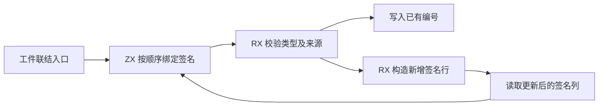

# 联结函数登记自举

## Intent

移除库联结时 Zig 在签名查找与单行登记之间的续传循环。ZX 遍历工件签名，RX 编排新增签名行的预留、载荷准备、编号写入和发布。

## Data

以 `82cee4ec` 为对照。正式 `Builder.module` 调用 `signature.bind`。原宿主在遇到未登记的原生签名时暂停 ZX，预留函数表一行，调用生成发布入口，更新已联结的列切片，再重新进入 ZX。单条查找、重用与接口冲突规则已经由 RX/ZX 执行。

## Edges

保留原签名顺序和遇到首个错误即退出的行为。只有找到一条需要新增的签名时，才按现有 `ArrayList` 策略预留一行。先预留列容量再向结果分配器复制需要独立持有的文本，最后公开行。供后续查找的视图在公开后重新从当前列取得，只更新描述符。分析阶段生成的临时对象仍使用模块 scratch，避免进入联结结果的 arena。

原生接口声明当前只接受本文件内的完整 ABI 类型。内部内存接口因此记录签名读列和一行发布的 ABI 形状。Zig 以编译期检查绑定这些字段和宿主列，运行时存储操作只对列容量、视图和行长度生效。源码和缓存中的其它签名发布仍使用各自已经接入的流程。

## Answer

联结宿主只借出当前列、用时分配器和空正文的静态描述符，再调用一次 Source 入口。共同内存层的泛型按生成的 ABI 形状使用 `ArrayList`，无需函数指针或中间表。

本批生产 Zig 净增 98 行。移除了编译器侧的签名续传循环和单行宿主发布函数，并新增一个供引导代码借用 `ArrayList` 列的内存模块。模块操作按编译期绑定的列顺序预留和提交。签名查找、持有规则、行发布顺序和异常分支均留在 RX/ZX。逐模块联结调度与函数表的其它提交路径仍在 Zig。

### 验收

窄范围生成包含 66 个模块和 42 个函数文件。两代 Source 工具各通过 22 个构建步骤，二进制 SHA-256 同为 `1cb01280c297c83bd410c1b5b71d92cb7ceb03d75dcc49b1d1dbb1f00c4ddcaa`。在库测试中核对生成的标量入口后，原生联结、联结执行、联结边界、原生执行、统一库联结和工件导入执行六组通过，共 117 个构建步骤和 188 项测试，覆盖分配失败清理、重复签名重用、ABI 冲突和多个原生函数的联结执行。

普通联结与能力槽的全部生成文件一致，配对墙钟中位数分别为 3.948 → 3.983 ms 和 3.782 → 3.730 ms。三组原生执行的原始、联结、缓存和 ABI 文件也一致，墙钟中位数分别变化 −0.037、−0.155、+0.199 ms。

生成对照使用各自的 Source 自编译工具及 Source 分析和生成实现。macOS arm64、Zig 0.17.0、ReleaseSmall、16 个生成分区。三次交替配对取中位数，RSS 为进程树采样峰值，单位为十进制 MB。

| 场景                              |    墙钟，秒 |       CPU，秒 | 进程树峰值 RSS，MB |
| --------------------------------- | ----------: | ------------: | -----------------: |
| 同输入冷生成，上一阶段 → 本阶段   | 2.95 → 2.90 | 12.89 → 12.86 |      812.9 → 795.0 |
| 同输入热生成，上一阶段 → 本阶段   | 2.29 → 2.28 |   8.88 → 8.84 |      797.3 → 797.0 |
| 冻结输入冷生成，固定基线 → 本阶段 | 2.86 → 2.85 | 12.55 → 12.51 |      886.5 → 759.5 |
| 冻结输入热生成，固定基线 → 本阶段 | 2.22 → 2.22 |   8.58 → 8.58 |      893.0 → 776.1 |

同输入的 12,122 个生成文件、5,491 个缓存键及载荷和 memo 哈希一致。冻结输入仍保持 135 个历史差异的路径与两侧哈希。本批未重测完整冷构建。
