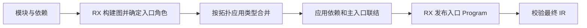
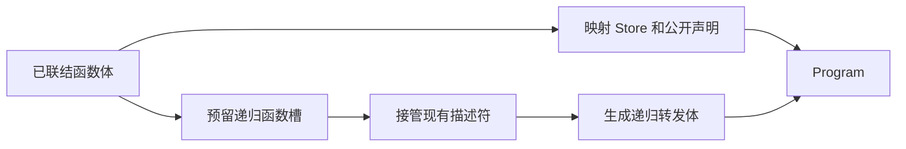

# 联结图与递归入口发布自举

## Intent

移除产物联结入口的固定步骤数组。由 RX 生成实际图角色，并完成入口 Program 的 Store、公开声明和递归转发体发布。

## Data

RX 已经执行图注册、边解析和拓扑排序。Zig 仍逐项填路径，在拓扑结果中自行划分入口，并在最终发布时重复分配递归函数已经拥有的表描述符。Store、公开类型、常量与递归转发均有现用的生成规则。

## Edges

图校验仍先于类型合并。按拓扑顺序应用类型合并及逐模块联结，每个模块用后回收临时空间。主入口完成后释放整份阶段工作区。递归原函数先入表，随后发布 Store、公开类型、常量和路径，最后生成转发体并校验 IR。宿主仍负责逐模块提交类型及函数表状态，以及 IR 表的布局与容量。

## Answer

验收覆盖图错误、重联结、递归原函数与转发入口、缓存、分配失败以及两套性能基线。

正式 Source 路径从排序结果获取入口和依赖范围，发布阶段负责 Store、公开声明与递归转发。保留递归原函数时直接复用它的表描述符。逐模块的类型合并与函数表写入保留在 Zig。

前一版 Source 引导器生成第一代候选，第一代再生成第二代。两代各通过 22 个构建步骤，二进制 SHA-256 一致。联结、模块产物、生成、语义缓存及库导入共通过 203 项 Zig 测试与 6 项独立导入。通过正式重联结入口验证递归原函数和转发体，候选与上阶段生成的 Zig 逐字节一致，SHA-256 为 `f77f9146ed4e79e810cdb380cd17a7d43512d1dcd02850606ce6b5a204f7b002`。该递归样本核对 IR 和生成代码，不执行无限递归体。

相邻 Source 自编译工具对当前 729 项清单交替各执行三轮。冷生成、热生成、无变化检查使用相同配置。11,908 个生成文件逐字节一致，5,410 条源码缓存及所有权备忘录一致。固定基线使用冻结输入，对比结果仍为已知的 134 个 Zig 文件及 `.zxc-files` 有差异，134 个文件的差异哈希和上阶段一致。

| 对照            | 冷生成墙钟     | 冷生成 CPU       | 采样进程树峰值 RSS | 单进程峰值 RSS   |
| --------------- | -------------- | ---------------- | ------------------ | ---------------- |
| 上阶段 → 候选   | 2.85 → 2.88 秒 | 12.68 → 12.65 秒 | 779.5 → 799.2 MB   | 860.2 → 843.1 MB |
| 固定基线 → 候选 | 2.86 → 2.83 秒 | 12.52 → 12.46 秒 | 884.3 → 768.0 MB   | 943.5 → 850.6 MB |

相邻进程树采样中位数增加 19.7 MB，三轮范围重叠。固定基线下树峰值减少 116.3 MB。两类独立重联结的墙钟中位数分别为 3.97 → 3.86 毫秒与 3.79 → 3.78 毫秒，产物一致。本阶段测量生成器与重联结，未重测完整冷构建。
