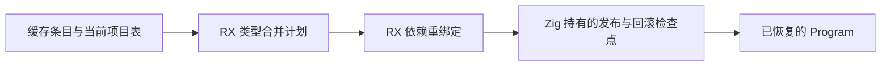

# 自举整体进度盘点

## Intent

用文件数、物理行数和正式调用路径核对 zray 自举进展，分别衡量 Source 规模、Zig 净变化和职责迁移。

## Data

长期对照沿用 10 月 14 日盘点基线 `f570aa73`，近期对照沿用 11 月 14 日基线 `aa2fcd40`。上一份盘点的源码快照为 `8f911321`，本次快照为 11 月 17 日提交 `63b35006`。

统计 Git 文件树中 `packages/*/src` 的 `.rx`、`.zx`、`.zig`，包含声明、注释和空行。Zig 路径中含 `seed` 的文件单列。排除测试、构建脚本、文档、缓存和未跟踪的生成产物。已提交到生产目录的数据表仍计入。净量按两端文件树计算，增删和重命名使用各语言生产路径内的 `git diff -M`。长期对比还包含语言新特性、标准库迁入和包重组。`packages/compiler/build` 下另有 38 个 Zig 文件、4,899 行，`packages/compiler/bootstrap` 下另有 62 个、10,661 行，两者均在主表之外。

## Edges

路径不含 `seed` 的文件中也有 seed 兼容分支、数据表和平台 ABI。正式编译器仍执行的专用 Zig 遍历、调度和状态操作均需追踪。全仓库尚无逐文件、逐调用覆盖完毕的传递依赖清单。源码构成可以精确计算，待迁移的准确净行数和完成百分比仍需该清单。[自举完成标准](../../rules/自举完成标准.md)

## Answer

### 生产源码总量

每格为文件数 / 行数。

| 范围                   | 10 月基线 `f570aa73` | 11 月基线 `aa2fcd40` |            本次快照 |   较近期基线净变化 |
| ---------------------- | -------------------: | -------------------: | ------------------: | -----------------: |
| RX                     |          156 / 2,704 |         604 / 19,313 |        700 / 23,012 |       +96 / +3,699 |
| ZX                     |       1,328 / 41,046 |      4,460 / 236,677 |     4,960 / 257,689 |     +500 / +21,012 |
| **RX + ZX**            |   **1,484 / 43,750** |  **5,064 / 255,990** | **5,660 / 280,701** | **+596 / +24,711** |
| Zig 全部               |         781 / 61,654 |      1,427 / 127,899 |     1,534 / 140,248 |     +107 / +12,349 |
| Zig，路径含 seed       |           29 / 2,945 |         216 / 16,558 |        221 / 17,075 |          +5 / +517 |
| **Zig，路径不含 seed** |     **752 / 58,709** |  **1,211 / 111,341** | **1,313 / 123,173** | **+102 / +11,832** |

- 自 `f570aa73` 起，RX/ZX 净增 4,176 个文件、236,951 行。Zig 净增 753 个文件、78,594 行。
- 自 `aa2fcd40` 起，Zig 新增 20,626 行、删除 8,277 行。Git 识别为 115 个新增文件、8 个删除文件和 2 个重命名。同期 RX/ZX 新增 29,756 行、删除 5,045 行。
- 排除路径含 seed 的 Zig 后，RX/ZX 的文件和行数占比分别为 81.17% 和 69.50%，近期基线分别为 80.70% 和 69.69%。计入全部 Zig 时，占比分别为 78.68% 和 66.68%。
- 自上一份盘点 `8f911321` 起，RX/ZX 净增 10 个文件、263 行。修改了 18 个现有生产 Zig 文件，合计新增 524 行、删除 593 行，净减 69 行。该范围内没有新增、删除或重命名生产 Zig 文件。

### 最近四个源码阶段

| 提交       | 已退出 Zig 宿主的职责                                          | RX/ZX 净变行数 | Zig 净变行数 |
| ---------- | -------------------------------------------------------------- | -------------: | -----------: |
| `02998841` | 普通和原生缓存的函数绑定批次校验、工件类型根的遍历             |            +98 |         −119 |
| `2be0cee9` | 缓存原生依赖扫描、Store 上下文编码和原生导出行写入             |            +95 |          −13 |
| `36482e19` | 依赖边选择和校验调度、逐边进入 RX 的宿主循环                   |           +109 |          +59 |
| `63b35006` | 工件联结结果、源码声明、初始化器和成员表发布的三处宿主续传循环 |            −39 |           +4 |

`36482e19` 增加了借用嵌套列所需的通用视图适配。`63b35006` 在既有内存文件中扩展最终行的分配和列绑定接口。后续仍要沿同一入口移除编译器专用的状态和调度。[函数绑定校验与根遍历](函数绑定校验与根遍历自举.md) [缓存依赖扫描与指纹](缓存依赖扫描与指纹自举.md) [库联结依赖遍历](库联结依赖遍历自举.md) [库联结结果与声明发布](库联结结果与声明发布自举.md)

### Zig 的包与模块分布

下表排除路径含 seed 的文件。`compiler`、`genz` 和 `core` 合计 1,056 个 Zig 文件、89,384 行，约占该口径 Zig 行数的 72.6%。这三个包的 RX/ZX 共 5,613 个文件、278,705 行，占三个包所统计文件的 84.17%、行数的 75.72%。

| 包       |   近期基线文件 / 行 |       当前文件 / 行 |      净增文件 / 行 |
| -------- | ------------------: | ------------------: | -----------------: |
| compiler |        544 / 43,125 |        635 / 53,885 |      +91 / +10,760 |
| genz     |        347 / 29,136 |        353 / 29,342 |          +6 / +206 |
| std      |         87 / 20,842 |         87 / 20,843 |             0 / +1 |
| cli      |         117 / 9,165 |         117 / 9,110 |            0 / −55 |
| core     |          63 / 5,239 |          68 / 6,157 |          +5 / +918 |
| lint     |          27 / 1,773 |          27 / 1,775 |             0 / +2 |
| dsl      |          11 / 1,180 |          11 / 1,180 |              0 / 0 |
| pkgs     |             8 / 458 |             8 / 458 |              0 / 0 |
| napi     |             7 / 423 |             7 / 423 |              0 / 0 |
| **合计** | **1,211 / 111,341** | **1,313 / 123,173** | **+102 / +11,832** |

`std` 的 20,843 行包含三个合计 14,207 行的 IDNA 数据表和两个合计 2,129 行的路径 Unicode 数据文件。单独看 `compiler`，RX/ZX 有 2,661 个文件、131,398 行。计入该包的 71 个、6,033 行路径含 seed 的 Zig 文件后，RX/ZX 占三种生产源码文件的 79.03%、行数的 68.68%。

| compiler 目录  | Zig 文件 / 行 | 近期净增 Zig 行 | 正式路径中剩余的职责示例                                 |
| -------------- | ------------: | --------------: | -------------------------------------------------------- |
| `rx/analysis`  |  185 / 19,711 |          +7,269 | 项目装载、约束和 RX 语句遍历、作用域、部分诊断及 IR 写入 |
| `zx/modules`   |  151 / 12,202 |          +2,060 | 依赖栈、联结的类型追加与模块顺序、缓存物化与回滚         |
| `zx/analysis`  |   100 / 7,361 |            +125 | 语义分析状态、集合与类型表的宿主接口                     |
| `zx/frontend`  |    46 / 3,951 |             +14 | 解析结果、资源和 Program 的宿主适配                      |
| `backends/zig` |    39 / 3,579 |            +792 | 输入指纹、构建请求和落盘编排                             |
| 其他目录       |   114 / 7,081 |            +500 | IR、输入快照、验证、库入口和其他后端                     |

`genz` 中部分分析、分区及生成规则已接入 Source。`genz/src/zx/uniqueness` 仍有 64 个 Zig 文件、7,381 行，正式生成入口仍调用其中的唯一性分析。降级状态、调度、结构化 printer 接入和宿主接口也有手写 Zig。核心表的布局、借用和发布存储仍有 Zig 实现。[生成入口](../../packages/genz/src/zx/render.zig) [函数分析入口](../../packages/genz/src/zx/function_analysis.zig) [类型表存储](../../packages/core/src/type_table/storage.zig)

### 新增 Zig 的来源

自近期基线起，`compiler` 净增 10,760 行路径不含 seed 的 Zig，占同口径总净增的 90.9%。RX 分析与 ZX 模块两个目录合计净增 9,329 行，现有 336 个文件、31,913 行。迁移过程中，RX 分支和步骤选择陆续交给生成代码，部分遍历栈、作用域和 IR 写入则保留在手写 Zig 中。例如 `statements/traversal.zig` 的 211 行包含正式 Source 路径仍用的帧栈，`operands/host.zig` 的 229 行包含表达式操作数的列适配和发布。编译器内部 `core/src/memory` 另有五个 Zig 文件、799 行，负责借用、列描述符及最终行分配。对这些文件仍须逐个核对执行归属。[RX 语句遍历](../../packages/compiler/src/rx/analysis/program/statements/traversal.zig) [操作数发布](../../packages/compiler/src/rx/analysis/program/linking/operands/host.zig) [行布局实现](../../packages/core/src/memory/rows.zig)

### 按正式入口核对

| 职责             | 已由 RX/ZX 执行的部分                                                                        | 仍由 Zig 执行的部分                                                        |
| ---------------- | -------------------------------------------------------------------------------------------- | -------------------------------------------------------------------------- |
| 项目装载与公开面 | 导入目标分类、相对路径与包域规则、目录索引和回退、依赖下钻标记、公开签名、转发和默认入口选择 | 输入及包域注册、依赖栈容器和恢复调度、混合分析、部分诊断                   |
| 模块联结         | 产物准入、签名与依赖核对、逐边遍历，声明、Store 初始化器和 Program 公开面发布                | `link` 仍逐模块追加类型、调度依赖模块、登记函数，并管理 scratch 与 IR 结果 |
| 语义缓存         | 结构预检、类型合并计划、指纹、常量与依赖重绑定、恢复入口选择、部分产物物化                   | 文件 I/O、容器提交、失败回滚、部分缓存编解码与 IR 恢复                     |
| 前端、分析及生成 | Source 解析、约束、语义和生成规则已覆盖多条正式路径                                          | RX 分析及 ZX 前端的遍历、状态处理，genz 的降级与打印接入仍有手写路径       |

最新源码阶段的七组回归通过，共 169 项 Zig 测试和 6 项 Node 集成，两代 Source 自编译工具的 SHA-256 相同。该结果验证本阶段的生成可重复性。完整交付仍须核对正式入口的传递依赖，并完成 seed 至 stage 3 的最终验收。[模块联结入口](../../packages/compiler/src/zx/modules/link.zig) [最新源码阶段验收](库联结结果与声明发布自举.md)
