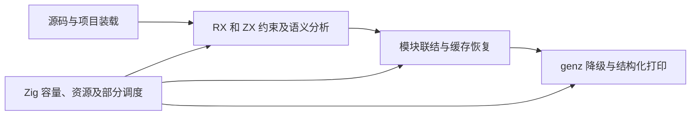

# 自举整体进度盘点

## Intent

按代码量和文件数核对 zray 自举的实际进展，列出生产 Zig 的分布，并以正式 Source 调用路径解释剩余职责。

## Data

已推送的代码快照为 `6c81992d`。`f570aa73` 是 10 月 31 日设立当前 goal 之前主线上的最后一个提交，`aa2fcd40` 是 11 月 14 日开始盘点本轮迁移时选定的固定基线，距当前快照有 87 个提交。总量取自 Git 文件树，增删行与纯新增、纯删除文件采用 Git 重命名检测。统计 `packages/*/src` 的物理行，包含空行、注释和声明文件。路径含 `seed` 的 Zig 单列，生成缓存、构建输出及其他未跟踪产物排除。[迁移计划](../2026-11-14/自举大批次迁移计划.md)

## Edges

文件后缀用于盘点源码构成。仍在正式路径上执行的调度、分配约定、状态发布和语义检查均计入剩余工作，过渡适配器也适用。路径未标记 seed 的生产 Zig 仍混有平台 ABI、生成式数据和初始引导兼容代码，需要逐条调用链核对。两代 Source 工具产物一致只能证明当前阶段可重复生成，最终标准还要求审计闭包，并从 seed 连续生成和核对三个阶段。[自举完成标准](../../rules/自举完成标准.md)

## Answer

### 生产代码规模

每格依次为文件数和行数。

| 范围               | Goal 起点 `f570aa73` | 11 月 14 日 `aa2fcd40` | 已推送 `6c81992d` | 较 11 月 14 日净变化 |
| ------------------ | -------------------: | ---------------------: | ----------------: | -------------------: |
| RX                 |          156 / 2,704 |           604 / 19,313 |      691 / 22,754 |         +87 / +3,441 |
| ZX                 |       1,328 / 41,046 |        4,460 / 236,677 |   4,933 / 256,572 |       +473 / +19,895 |
| RX + ZX            |       1,484 / 43,750 |        5,064 / 255,990 |   5,624 / 279,326 |       +560 / +23,336 |
| Zig 全部           |         781 / 61,654 |        1,427 / 127,899 |   1,535 / 139,959 |       +108 / +12,060 |
| Zig，路径含 seed   |           29 / 2,945 |           216 / 16,558 |      221 / 17,075 |            +5 / +517 |
| Zig，路径不含 seed |         752 / 58,709 |        1,211 / 111,341 |   1,314 / 122,884 |       +103 / +11,543 |

从 `aa2fcd40` 算起，生产 Zig 新增 19,885 行、删除 7,825 行。Git 识别出 116 个纯新增文件、8 个纯删除文件和 2 个重命名文件。纯删除文件原有 511 行。生产 RX/ZX 新增 27,937 行、删除 4,601 行。全仓库含生产范围外的源码时，RX/ZX 新增 27,979 行、删除 4,687 行，Zig 新增 20,425 行、删除 8,170 行。

排除路径含 seed 的 Zig 后，从 `aa2fcd40` 算起，生产 RX/ZX 的文件占比从 80.70% 到 81.06%，行数占比从 69.69% 到 69.45%。这是源码构成比例。逐模块还未完成正式调用链的全量分类，因此没有可审计的自举完成百分比。

### 生产 Zig 的包分布

以下盘点排除路径含 seed 的文件。

| 包       |       起点文件 / 行 |     已推送文件 / 行 |      净增文件 / 行 |
| -------- | ------------------: | ------------------: | -----------------: |
| compiler |        544 / 43,125 |        636 / 53,777 |      +92 / +10,652 |
| genz     |        347 / 29,136 |        353 / 29,342 |          +6 / +206 |
| std      |         87 / 20,842 |         87 / 20,816 |            0 / −26 |
| cli      |         117 / 9,165 |         117 / 9,110 |            0 / −55 |
| core     |          63 / 5,239 |          68 / 6,003 |          +5 / +764 |
| lint     |          27 / 1,773 |          27 / 1,775 |             0 / +2 |
| dsl      |          11 / 1,180 |          11 / 1,180 |              0 / 0 |
| pkgs     |             8 / 458 |             8 / 458 |              0 / 0 |
| napi     |             7 / 423 |             7 / 423 |              0 / 0 |
| **合计** | **1,211 / 111,341** | **1,314 / 122,884** | **+103 / +11,543** |

`compiler` 占该口径 Zig 净增行数的 92.3%。`std` 的 20,816 行中有 14,207 行是三个 IDNA 数据表文件。平台绑定、增量缓存和构建工具还须按职责分别核对。

### 正式调用路径

| 区域                | 已由 RX/ZX 执行的部分                                                        | 仍在 Zig 中执行的部分                                                                                                                                 |
| ------------------- | ---------------------------------------------------------------------------- | ----------------------------------------------------------------------------------------------------------------------------------------------------- |
| RX 项目分析         | 依赖图与引用路由、若干约束阶段、表达式和共享表发布已接入 Source              | 项目装载、状态协调与诊断适配仍有手写路径。`compiler/src/rx/analysis` 盘点为 185 个文件、19,711 行                                                     |
| ZX 类型、前端与分析 | 类型结构校验、名义来源核对和合并规则已接入 Source                            | 前端及分析仍有宿主、类型表的状态与外部适配。`compiler/src/zx/frontend` 和 `compiler/src/zx/analysis` 合计 146 个文件、11,312 行                       |
| ZX 模块、联结与缓存 | 已接入产物准入、签名解析、依赖验证、函数表、Program 公开面和原生接口成员发布 | 联结入口仍逐模块应用类型合并和依赖写入。项目原生导入、缓存编解码和恢复仍有 Zig 调度与状态更新。`compiler/src/zx/modules` 盘点为 152 个文件、12,094 行 |
| genz                | 已有生成式唯一性事实、函数表和分区相关规则                                   | 仍有 353 个非 seed Zig 文件、29,342 行，包含唯一性 55 个文件、5,862 行，以及表达式降级和结构化 Zig printer                                            |
| core、CLI 与工具包  | 部分表填充和规则由上层 Source 执行                                           | 表的增长与长度提交、工具命令、诊断、包管理和平台 ABI 仍须按正式路径核对                                                                               |

原生签名发布是适配器增长的具体例子。近期将文本准备、字段填充和映射登记移入 RX/ZX，同时增加一个 47 行 Zig 文件接入预留列、共享空描述符及长度提交。生成器架构已经改变，Zig 储存接口的调用仍在正式路径中。相同模式应收敛到通用能力，并核对哪些专用 Zig 文件随之退出。[函数表发布](统一函数表发布自举.md) [联结入口](../../packages/compiler/src/zx/modules/link.zig) [原生签名宿主](../../packages/compiler/src/zx/modules/link/signature/publication/host.zig) [类型表存储](../../packages/core/src/type_table/storage.zig)

### 最新一批

原生接口成员发布已于 `6c81992d` 推送。对比上一份盘点对应的 `f462502d`，生产 RX/ZX 增加 6 个文件、278 行。生产 Zig 新增 137 行、删除 51 行，净增 86 行，文件数不变。新增内容主要落在既有签名宿主，用于借出预留列、提交长度和接入新旧两种数据来源。冷分析与缓存恢复的签名和绑定批量写入由 RX/ZX 执行。[原生接口成员发布](原生接口成员发布自举.md)

后续按同一口径报告新退出正式路径的函数或状态，并核对专用适配器是否可以随语言能力一起移除。
