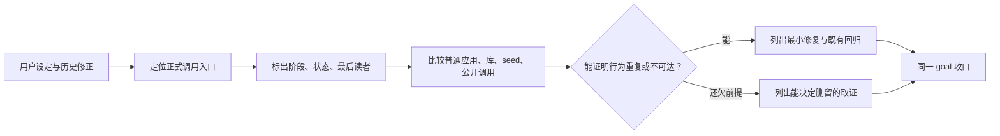

# 架构取证与执行记录

## Intent · 执行计划

以真实应用、自举生成和多导出库为三个消费入口，从职责和所有权的角度回答两个问题：每个阶段谁作决定，每份状态或防御由哪个调用者实际需要。先找可能推翻判断的对照，再把确定问题及验收条件交现有 goal。[架构诊断](../../自举架构边界与代码冗余诊断.md)

## Data · 取证过程

1. 核对用户原话、WAY、RX 开发约定、自举完成标准、统一库设计。回看 10 月 10 日主分析器正式接线、10 月 11 日 IR 校验与构建清单收敛、11 月 9 日普通调用需求分析、11 月 10 日 Node 宿主、11 月 11 日重放记录。取证源码起点为 `bd70f979`，执行会话同期在修改 CLI 缓存身份；本报告的代码判断不依赖该未提交改动。
2. 从 CLI 与 shared_generation 分别追入 compiler/backends/zig。按消费者区分普通应用 Batch、多导出库和公开 emit 直接传入的结果。追同一 Program 的首次分析、能力列、再次进入分析的调用者、最终校验和外部验证。比较库已有能力传递和应用的构造次序。并行取证限一个只读分析子智能体，主会话对照引用源码和可证伪条件。
3. 检查手写 Zig 和 Source 两侧的枚举、编译期开关、错误捕获及实际状态发布点。把编译期真/假代入摘要创建函数，证明一个异常处理分支两种模式均不执行。检索 `.reentry(` 的生产调用，沿库入口确认真实消费者；读取四个 rows 的分配与释放所有者。
4. 对 Git 追踪的 packages/{compiler,genz,core,lint}/src 下 .zig、.rx、.zx 分类。按文件原始字节分组，不剥空行、注释或标识符。重复行数为每组物理行数乘（文件数减一）。共 6,986 份，逐字节相同的组见下表。另对 RX 做整文件 `<Module fn="…" />` 形式匹配，compiler、genz、core、lint 分别有 31、9、0、4 个。在同目录的 N-API codec 对照调用和导入；跨目录相同名称继续解析其相对模块身份。
5. 枚举 genz/src/analysis/host/wasm 下 RX/ZX 的显式 from、fn、module 目标并解析相对路径。43 条引用指到 Node 目录下 8 个模块，其中 7 个在 task、1 个在 context，来自 30 份源文件。invoke 18、method 16、catch 2、defer_scope 2、error_union 2、initialize 1、model 1、optional 1。补追 wasm_host 注册、Wasm RX 阶段和 node/task/invoke → host/cli/invoke，确认构建期依赖。逐个判断共享语义，未以文本出现次数代替动态调用数。

| 源码类别 |  文件 | 整文件重复组 | 组内文件数 | 额外副本物理行 |
| -------- | ----: | -----------: | ---------: | -------------: |
| Zig      | 1,303 |            0 |          0 |              0 |
| RX       |   707 |            3 |         12 |             27 |
| ZX       | 4,976 |            9 |         18 |            264 |

## Edges · 限制与反例

全文扫描只能找到字节相同的完整文件。不同目录中相同的 ./model 可绑定不同类型；生成稳定名可能依赖源码身份。应用编译器多建的表与生成应用的运行时内存分属两个进程。与正常编译同机并行运行的 goal 本轮已有回归任务，诊断依靠源码可达性与原有证据，未触发新的程序构建或测试。

## Answer · 交付及自我核查

根目录报告给每项标出正式入口、反例、整改和成功标准。能立即关闭的死分支、需实际裁决的信任边界、应保留的外部校验分别记录。确证的摘要构造与重复能力推导可证明工作存在；其绝对时间、峰值与消除后的生成文件变化仍需在实施后量测。本轮延续同一 goal，不单开实现分支。
