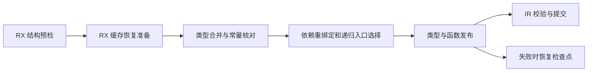

# 语义缓存恢复准备自举

## Intent

让 Source 串联语义缓存恢复中的类型合并、常量校验和依赖重绑定。仅在这些步骤全部成功后发布类型增量及恢复入口映射。

## Data

从 `79380249` 的 `restoreChecked` 追踪。旧事务 RX 返回静态步骤枚举，Zig 在编译期遍历并执行预检、重绑定、物化、入口加入和验证。类型计划与重绑定已有彼此独立的 RX 实现，两者在宿主分别调用，重绑定通过临时索引回读恢复入口。

## Edges

结构预检先于工作缓冲分配和项目状态检查点。类型、函数和原生模块的重映射共用调用方已预留的列。准备结果和临时类型增量使用同一工作 arena，持有的结果仍写入项目的载荷 arena。失败回收遵循原有类型列、名义来源、函数尾部和载荷检查点，保留缓存无效和分配失败的不同处理方式。入口注册只在完整计划通过后执行。

## Answer

新的 `transaction.rx` 直接联结两个既有 Source 模块。类型合并失败时立即结束，防止读取未完成的类型映射。重绑定返回通过验证的入口编号，宿主接收同一份计划并在之后提交增量。移除了静态枚举步骤和相应的 Zig 分派器。预检、恢复计划、已有的 RX 物化和验证保持原执行顺序，物化间的检查点、容量预留以及失败回滚继续由 Zig 管理。

### 验收

语义缓存、持久缓存、缓存编解码、库导入、联结执行和原生生成全部通过，共 113 个构建步骤、50 项 Zig 回归以及 Node 集成测试。先用上一批的 Source 自编译工具构建候选，再由候选生成下一代，分别通过 22 个构建步骤。两代 `zxc-bootstrap` 的 SHA-256 均为 `935de272dac9a9ce29bba2894113595f33b28ace4989de485b823f7553049731`。

macOS arm64、Zig 0.17.0、ReleaseSmall、16 个生成分区。生成对照各用对应阶段的 Source 自编译工具和 Source 分析、生成实现，以下为交替配对三次的中位数。进程树 RSS 使用采样峰值，单位为十进制 MB。

| 场景                              |    墙钟，秒 |       CPU，秒 | 进程树峰值 RSS，MB |
| --------------------------------- | ----------: | ------------: | -----------------: |
| 同输入冷生成，上一阶段 → 本阶段   | 2.89 → 2.89 | 12.84 → 12.79 |      833.0 → 871.6 |
| 同输入热生成，上一阶段 → 本阶段   | 2.27 → 2.27 |   8.86 → 8.81 |      799.9 → 799.4 |
| 冻结输入冷生成，固定基线 → 本阶段 | 2.95 → 2.86 | 12.74 → 12.54 |      921.9 → 856.7 |
| 冻结输入热生成，固定基线 → 本阶段 | 2.22 → 2.20 |   8.61 → 8.56 |      934.3 → 777.9 |

同输入对比的冷生成进程树峰值增加 38.6 MB，单进程峰值从 786.9 MB 到 784.1 MB。固定输入的进程树峰值低于固定基线。完整冷构建未在本批重测。

同输入生成的 12,067 个文件和 5,467 个源码缓存记录一致，缓存键、载荷及 memo 哈希一致。冻结输入的 11,758 个文件中有 135 个已知差异，差异路径和两侧文件哈希与上一阶段一致。另以既有双模块持久缓存用例分别用两套 CLI 交替测量 15 次，跨进程热恢复中位数从 2.290 ms 到 2.284 ms。解析与语义缓存各命中两个模块，所有生成输出一致。
