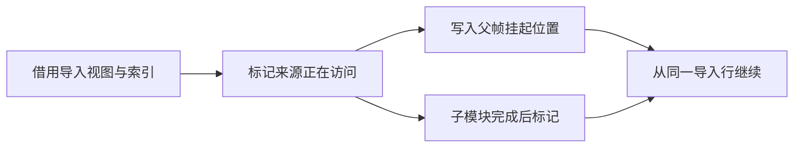

# 项目依赖挂起与恢复自举

## Intent

将源码导入下降时的挂起状态、内部接口路由和索引式导入记录的持有操作迁入 Source。沿用原深度优先顺序、循环与深度诊断、上下文状态和缓存记录格式。

## Data

从 `c6180c07` 的 `Project.loadFrames`、`loadInput` 和 `bindSignature` 追踪。此前 Source 决定单条源码依赖是否下降，Zig 按地址持有每帧的扫描位置。子模块完成后，Zig 重新构造一个来源目标，再进入来源分派复用已经完成的单元。内部接口优先于包查找的规则与导入记录的目标拼写及身份持有也分散在宿主。

## Edges

挂起时保留当前导入位置，子模块成功完成后才恢复绑定。恢复不会重复登记名字或解析路径。保持原生接口和编译包的类型更新、签名模式的 RX 延迟转发以及依赖记录的顺序。挂起字段直接借用现有帧内的标量位置，每帧无需增加独立分配。初始 seed 仍提供兼容实现。

## Answer

`source.rx` 下降分支调用 ZX 原子操作，把导入位置写到当前帧。宿主恢复时直接读取完成单元，再与所有正常来源共享目标绑定和记录提交。索引式导入记录一起持有名字、原名、拼写和原生身份，底层编译包目标的持有逻辑沿用既有实现。栈容器的扩容、解析载荷、混合分析以及缓存恢复事务仍由 Zig 驱动。

### 验收

模块记录、语义缓存、联结边界、联结执行、库导入、原生生成、RX 磁盘项目和包清单共 122 个构建步骤通过。39 项 Zig 回归和 2,037 项 Node 测试通过。另外运行了八项已有的导入路径和栈深度用例，覆盖相对路径与根路径共用缓存、目录索引、包域越界、未使用导入形成的环，以及超过 256 层的诊断。

用上一阶段 Source 工具生成候选，再由候选生成第二代，两次均通过 22 个步骤。两代工具 SHA-256 均为 `7b61cf2ed095fda0eddd5c537c148c53bf086e31c826b89984255198aa8a2e46`。

各自使用 Source 自编译工具和 Source 后端，在 Zig 0.17.0、ReleaseSmall、16 分区下交替测量三次。表内为中位数。完整冷构建未在本批重测。

| 冷生成                     | 墙钟 / 秒 | CPU / 秒 | 进程树峰值 RSS / MB | 单进程峰值 RSS / MB |
| -------------------------- | --------: | -------: | ------------------: | ------------------: |
| 736 入口，上阶段           |      2.93 |    12.87 |               783.3 |               834.6 |
| 736 入口，本阶段           |      2.97 |    12.84 |               784.2 |               837.1 |
| 735 入口，冻结基线         |      2.81 |    12.39 |               887.3 |               958.5 |
| 735 入口，本阶段，冻结输入 |      2.80 |    12.46 |               788.7 |               811.2 |

排除输入戳后，736 入口生成的 12,058 个文件逐字节一致。5,469 个源码缓存键及负载和唯一性缓存负载均一致。冻结输入与历史工具间已有的 135 项差异保留同一路径与两侧哈希。热生成墙钟均为 2.28 秒，未修改重跑均为 0.03 秒，两组联结输出哈希一致。
