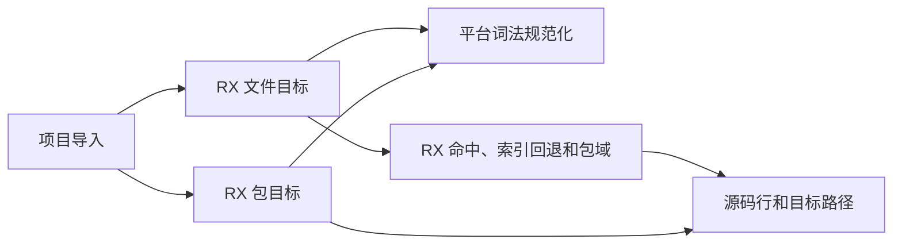

# 项目导入目标解析自举

## Intent

从正式项目入口迁出文件目标和包目标的解析规则。目录入口、源码索引回退、包域检查与目标类型在 RX/ZX 中表达。

## Data

起点为 `aa239f72`。`Project.loadInput` 和 RX 项目的文件目标分别进入 `Target.resolveIndexed`、`Target.resolveScoped` 或 `Target.resolvePath`。原路径由生成代码判定扩展名和基准类型，再由 Zig 组合后缀、选择基准目录、按索引查找并检查包域。包依赖已用 ZX 核对记录形状，源文件及已编译工件的路径此前由 Zig 生成。

## Edges

文件导入保留现有 `.zx` 和 `.rx` 策略，目录优先选择对应的索引文件。普通 `.zx` 目标精确命中优先，缺失时尝试目录入口。包域检查使用最终选择的路径。已有路径标记和诊断顺序沿用。词法规范化保持原平台行为，支持相对路径和平台分隔符。公开 `std:path.resolve` 延续绝对工作目录契约。

## Answer

`lexical_path` 只在编译器引导清单中静态注册，复用 Zig 标准库的词法路径运算。它持有处理后缀和组合路径的临时缓冲，源语言分支负责基准目录、索引文件、后缀及回退策略。文件选择复用原索引和包域视图，宿主统一回收未采用的临时路径，并保留诊断适配。已编译包目标的路径先规范化，再拥有实例名和公开名，分配失败时释放已获得的字段。包域注册、扫描输入及依赖栈仍由项目宿主协调。

### 验收

模块记录、联结边界、库导入、模块产物、语义缓存、联结执行、包清单和 RX 磁盘项目通过。共 161 个构建步骤、144 项 Zig 回归和 2,036 项 Node 测试通过。用上一阶段的 Source 自编译工具生成候选，再由候选生成第二代。两次均通过 22 个步骤，二进制 SHA-256 均为 `a130051702b32a22bd5000ee478f44b5b5f1338bc064413df6098d2016d45463`。核验平台为 macOS arm64。

以 Zig 0.17.0、ReleaseSmall 和 16 分区，分别用各自的 Source 自编译工具和 Source 后端交替运行三次。表内为中位数。完整冷构建未重测。

| 冷生成                     | 墙钟 / 秒 | CPU / 秒 | 进程树峰值 RSS / MB | 单进程峰值 RSS / MB |
| -------------------------- | --------: | -------: | ------------------: | ------------------: |
| 735 入口，上阶段           |      2.97 |    12.83 |               798.3 |               878.7 |
| 735 入口，本阶段           |      2.91 |    12.87 |               790.9 |               837.1 |
| 735 入口，冻结基线         |      2.90 |    12.54 |               899.6 |               940.1 |
| 735 入口，本阶段，冻结输入 |      2.85 |    12.63 |               779.2 |               837.2 |

当前输入排除输入戳后的 12,052 个文件逐字节一致。5,466 个源码缓存键及负载和唯一性缓存负载一致。冻结输入相对历史工具已有的 135 项差异保持同一路径及两侧哈希。两组联结样例生成结果哈希一致。配对热生成墙钟从 2.27 秒到 2.28 秒，CPU 从 8.83 秒降到 8.79 秒，未修改重跑均为 0.03 秒。
