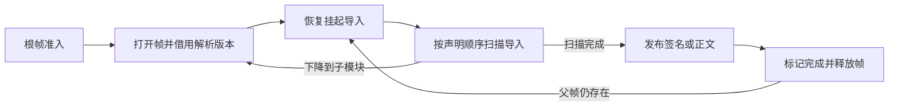
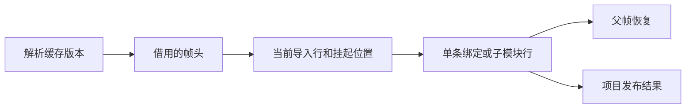

# 项目装载帧驱动自举

## Intent

把项目签名与正文共用的深度优先推进迁入 Source。范围覆盖根帧准入、导入顺序、挂起后恢复、签名与正文发布、完成标记及出栈。

## Data

正式入口 `Project.loadFrames` 调用 `project/load/run.rx`。它接入已有的准入规则，ZX 遍历帧，`step.rx` 先恢复挂起导入，再启动导入扫描。原生视图每次提供当前帧的模块行、导入数、挂起位置和深度。结果发布后由 Source 标记完成，宿主释放对应帧。旧的 scan 和 complete 独立引导入口已合并进这条链。

## Edges

沿用原有解析版本、帧容器和项目所有权，保留导入声明顺序、首次错误、循环和深度诊断。恢复直接绑定已完成的子模块，跳过已处理的导入行。栈上借用的游标和帧头不增设堆分配。生成器会为普通形状的循环状态装箱，当前循环沿用输入及借用游标，生成闭包中未出现分配调用。

静态内部 ABI 暂承载取得帧、解析装载、单条导入绑定、既有分析与发布入口以及帧释放。项目路径、单条导入的目标处理、终端分析和缓存事务仍有 Zig 实现。初始 seed 保留兼容驱动。

## Answer

## 验收

Source 引导构建通过 25 步。导入路径、模块记录、语义缓存、独立联结边界、原生联结和工件回归共通过 141 个构建步骤及 157 项 Zig 测试。CLI 另通过 14 项导入路径测试，包括由未使用导入形成的环。

候选 Source 使用相同的 763 入口清单再次生成，排除输入指纹后 12,705 个文件逐字节一致。

固定 735 入口，Zig 0.17.0、ReleaseSmall、16 分区，关闭常驻。两侧均为 Source 工具和 Source 分析生成路径，交替三轮。11,758 个生成文件与所有权 memo 一致。此口径覆盖引导生成。

| 场景                 | 相邻对照      | 本阶段        | 固定基线      |
| -------------------- | ------------- | ------------- | ------------- |
| 冷生成墙钟           | 2.59 s        | 2.62 s        | 2.85 s        |
| 冷生成 CPU           | 12.29 s       | 12.33 s       | 12.58 s       |
| 冷生成 infer 中位数  | 1.145 s       | 1.145 s       |               |
| 冷生成采样进程树峰值 | 718.7 MB      | 720.1 MB      | 893.0 MB      |
| 冷生成单进程峰值     | 753.5 MB      | 791.4 MB      | 939.7 MB      |
| 热缓存重写墙钟 / CPU | 2.02 / 8.32 s | 2.03 / 8.30 s | 2.25 / 8.61 s |

冷生成的系统进程峰值三轮范围为 747.3～777.2 MB 与 745.3～802.2 MB，分别有交叠。采样进程树峰值中位数增加 1.4 MB。生成闭包未增加堆分配，现有记录尚无法将进程峰值的变化归因于具体阶段。
