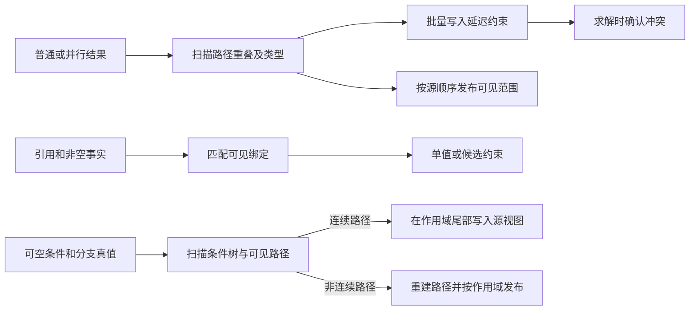

# RX 作用域绑定读取与冲突登记自举

## Intent · 目标

迁移可见绑定的多候选读取、普通 Call 和 Parallel 的路径冲突登记。调用链从项目约束遍历进入表达式作用域，求解器在类型收敛后读取延迟约束。相关范围含作用域、表达式、项目约束、条件、并行和控制流程等 25 个 Zig 文件、3,327 行。沿同一作用域继续迁移条件事实的可见性检查与发布。

## Data · 当前路径

原实现以 Source 判断路径重叠和绑定类型，Zig 为每个待定冲突追加一行。普通和并行分支各自驱动扫描。多候选读取首次找到两个值后由 Zig 建候选列表，继续检查后缀时可能为没有候选的行扩容。

## Edges · 边界

保留首个冲突的位置、并行行的发布顺序与分配失败时已经提交的前缀。确定无冲突的路径不分配约束行；名称匹配保留顺序并过滤 void。普通和并行调用共用判定。节点、绑定和名称列只借用。

## Answer · 验收

核对两代 Source 自生成、现有 RX 正反例及分配失败回归，比较同一清单下产物与运行成本。初始 seed 与正式 Source 实现分别核查。

### 已退出正式 Zig 入口的职责

- 名称读取由 RX 连接匹配和候选收集。零个或一个候选直接返回，至少两个才初始化缓冲区。ZX 逐项追加匹配的非 void 节点。候选缓冲区直接由延迟查找约束接管。若约束登记失败，宿主释放缓冲区并撤销刚创建的未知节点。
- 普通绑定与并行结果使用同一个 ZX 冲突扫描。它把待定绑定对、原始诊断位置及消息写入已预留列。并行模式在处理一行的第一个待定冲突或确定冲突前，要求先发布此前已检查的行。宿主批量提交行数并按需扩容。发生错误时，指向出错绑定的约束和可见作用域前缀顺序与之前一致。
- 分支的真假值、取反、合取和析取的遍历顺序仍由 ZX 判定。现在直接把已确认可见的连续路径写入作用域的空闲列，省去原先收集第二个及后续事实所用的临时节点编号数组。写满时交还一个已定位的源码范围；宿主扩容后从下一节点继续。非连续路径沿同一份布局重建一次，并在可见时发布。父节点栈沿用深度预算与栈上优先的分配策略。
- 为字节切片列补齐了与既有整数切片列对称的内部 memory 写操作，复用同一有界列写入实现，仅存储指针和长度。手写 Zig 仍持有图节点与约束存储、管理扩容及消费错误。初始原生 seed、表达式 AST 适配和控制流的其余宿主调度仍在自举范围中。

### 行为与产物

前一阶段的 Source 引导器生成当前编译器实现，候选再生成相同的 769 入口清单。排除工具身份相关的输入戳，13,068 个文件逐字节一致。初始 seed 与 RX 检查通过 39 项。推导、并行、属性、CLI 磁盘项目和库链接的现有回归通过 437 项，包含并行绑定组合、首错位置和分配失败检查。仓库 RX 格式检查通过。

### 生成性能

基线和候选均为 Source 构建、使用 Source 分析和生成。采用 ReleaseSmall、16 分区，关闭驻留，交替三轮取中位数。内存单位为十进制 MB。固定清单含 735 个入口，11,758 个产物及所有权 memo 相同。

| 指标                 | 同轮上一阶段 |   本阶段 | 阶段差异 | 相对固定基线 |
| -------------------- | -----------: | -------: | -------: | -----------: |
| 冷生成墙钟           |       2.60 s |   2.59 s |  −0.01 s |      −0.26 s |
| 冷生成 CPU           |      12.23 s |  12.27 s |  +0.04 s |      −0.31 s |
| 冷生成进程树采样峰值 |     719.1 MB | 718.2 MB |  −0.9 MB |    −174.8 MB |
| 冷生成单进程系统峰值 |     756.4 MB | 755.0 MB |  −1.5 MB |    −184.7 MB |
| 热生成墙钟           |       2.00 s |   2.01 s |  +0.01 s |      −0.24 s |
| 热生成 CPU           |       8.26 s |   8.27 s |  +0.01 s |      −0.34 s |
| 输入未变墙钟         |       0.03 s |   0.03 s |   0.00 s |      −0.01 s |

实际编译器和 genz 的 40 个入口产生 3,343 个相同文件。墙钟 1.03 → 1.02 秒，CPU 5.31 → 5.33 秒，单进程系统峰值 453.2 → 464.7 MB。另从其余正式 RX 入口选出 48 个使用可空条件的入口，源码共含 74 处与 null 的比较、270 次上下文读取。该组 1,817 个产物逐字节相同，墙钟均为 0.44 秒，CPU 1.95 → 1.93 秒，单进程系统峰值 309.2 → 304.3 MB。

### 最终 CLI 的 Zig 编译

回归构建摘要的 CLI 编译峰值从上一阶段的 `3G` 变为本阶段的 `4G`。Zig 在这里向下取整到十进制 GB。为核对实际差值，取两版回归构建各自留下的 CLI 编译参数和已生成模块，使用相同路径的源码快照、清空的局部编译缓存和同一全局缓存，单独执行最终的 `zig build-exe`。本批生成的 CLI 与回归实际执行的二进制逐字节相同。上批重编二进制的全部 Mach-O 命名节与上批回归二进制相同，全文件有 112 个字节不同，差异均在这些节之外。此计时仅含最后一次编译和链接。

| 顺序       | 上批墙钟 | 本批墙钟 | 上批 CPU | 本批 CPU | 上批单进程峰值 | 本批单进程峰值 |
| ---------- | -------: | -------: | -------: | -------: | -------------: | -------------: |
| 上批先运行 |  97.91 s |  98.92 s | 100.17 s | 101.00 s |     4,743.9 MB |     4,657.8 MB |
| 本批先运行 |  99.04 s |  98.44 s | 101.16 s | 100.61 s |     4,658.8 MB |     4,655.0 MB |

两组平均墙钟增加 0.21 秒，CPU 增加 0.14 秒。两组中本批峰值分别低 86.1 MB 和 3.9 MB。最终 CLI 的 LLVM 编译仍需约 4.66 GB，持续跟踪这一阶段与前端生成的内存趋势。本批未计整条安装版冷构建墙钟。

内存接口分片中的命名行读写与分配声明一起归入缓冲区文件后，两份源声明分别为 233 和 172 行。按正式构建规则合并得到的接口与候选实际编译的接口逐字节一致，SHA-256 为 `3a5dfec140674de86d3886ecd9396e226feccad64bce798789bb74b8beb59175`。
