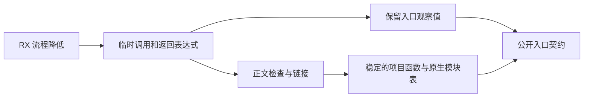
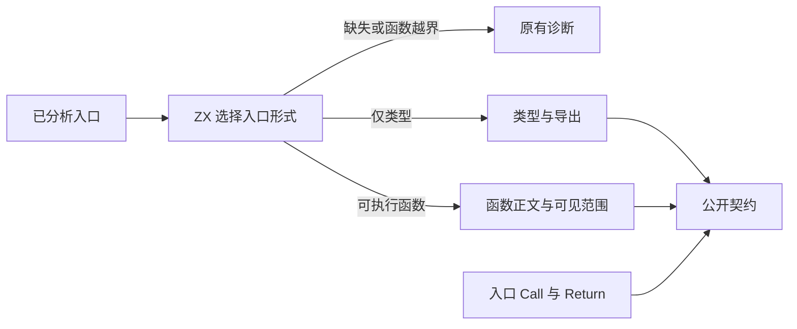

# RX 入口元数据发布

## Intent · 目标

让混合项目仅保留对外承诺的入口调用和返回信息。所有依赖模块仍完成相同的正文分析、所有权检查和链接，项目在共享表稳定后一次构造公开契约。

## Data · 调用路径

当前 mixed/rx 为入口快照整个函数表，module_compile 为每个模块保留调用元数据。metadata.retain 随后复制入口的整个 Call 数组、类型和原生模块。链接和最终发布各构造了一次入口 Program。入口的调用元数据使用降低时的局部类型编号，项目最终 Program 使用链接后的类型编号。

## Edges · 边界

保留入口分析时可见的函数、原生模块及 Store 初始化器前缀。并行 Task 的私有函数尾部必须接在原前缀后。临时表达式中被内联的符号名和字符串必须活到目标正文使用结束。保留失败诊断顺序和 seed 路径。

## Answer · 验收

检查正式入口与 seed 的已有推导、项目、库和增量回归，比较两代 Source 产物、冷暖生成与有 Task、Store 的真实工程。

### 实现

从 `815f98e15` 的项目推导入口向下核对模块降低、表达式内联、提前并行分析、共享表链接及最终发布。涉及的原实现和直接依赖共 26 个 Zig 文件、3,315 行。本次改动把入口选择交给 ZX，将正文链接所需的临时数据与入口公开的调用记录分开。

- 依赖模块把调用行和实参表达式放在降低期间的临时内存中。内联时复制目标仍需持有的文本，模块返回时即可释放临时数据。顶层入口保留调用方能查询的记录。
- 顶层 Return 在编译该表达式时直接登记。Task 或条件分支内部的 Return 只影响所在流程。原先从最后一个流程行再读一遍结果的函数已删除。
- 入口沿用降低时已有的调用数组和局部类型列。共享函数、原生模块和 Store 初始化器只记当时的范围，等项目表停止增长后再引用其前缀。有独立函数的并行 Task 使用自己的尾部，调用其他模块只借用共享表。
- ZX 区分入口缺失、函数编号越界、仅导出类型和可执行函数。Zig 按选择结果从最终共享表构造一次 Program，并登记公开函数与常量。Zig 仍负责各调用记录的字段写入、表的实际存储和外部函数入口适配。本批生产 Zig 净增 60 行，ZX 净增 20 行。

### 验收与性能

上一代 Source 引导器构建候选，两个工具均使用 Source 分析和生成。772 个当前入口生成 13,092 个逐字节相同的文件，排除工具身份戳。seed 的 39 项测试通过。正式回归 238 个构建步骤全部通过，Zig 报告 431 项测试通过，覆盖推导、并行调用与 Task、Store 执行、正反顺序链接统一库；另外 9 项磁盘项目检查通过。379 模块的常驻生成器在初次编译、ZX 修改、RX 修改和失败恢复后，各有 709 个文件与冷生成一致。

固定清单含 735 个入口，ReleaseSmall、16 分区、关闭驻留，交替三轮取中位数。11,758 个生成文件及所有权缓存的哈希一致。表中内存单位为十进制 MB。

| 指标                 | 上一版同轮 |     本批 | 本批相对固定基线 |
| -------------------- | ---------: | -------: | ---------------: |
| 冷生成墙钟           |     2.72 s |   2.66 s |          −0.19 s |
| 冷生成 CPU           |    12.51 s |  12.40 s |          −0.18 s |
| 冷生成进程树采样峰值 |   722.8 MB | 719.8 MB |        −173.2 MB |
| 冷生成单进程系统峰值 |   737.9 MB | 739.1 MB |        −200.6 MB |
| 热生成墙钟           |     2.22 s |   2.03 s |          −0.22 s |
| 热生成 CPU           |     8.64 s |   8.36 s |          −0.25 s |

两版 CLI 在现有工程各交错运行 15 次。嵌套 Task 从 8.74 到 8.60 ms，借用外层值的嵌套 Task 从 8.69 到 8.75 ms，双 Store 工程从 13.12 到 13.07 ms。三个工程产生的 Zig 均逐字节相同。固定清单数据只覆盖源码生成，本阶段没有重新测包含 Zig/LLVM 的完整冷构建。

### 全仓 Zig 盘点

截至本批，Git 跟踪且位于根目录 `docs/` 之外的 Zig 共 2,855 个文件、252,335 行，含空行和注释。沿用上一轮口径，生产目录为 `packages/*/src`，其中 Zig 有 1,564 个文件、144,599 行。单列路径含 `seed` 的 224 个文件、17,314 行后，余下 1,340 个文件、127,285 行。五个 IDNA 和路径 Unicode 数据文件合计 16,336 行，单列这部分后为 110,949 行。这个数仍包括平台接口和混合文件里的引导分支。[上一轮盘点](../2026-11-17/自举整体进度盘点.md)

| 生产包                | 路径不含 seed 的 Zig 文件 |   行数 |
| --------------------- | ------------------------: | -----: |
| compiler              |                       655 | 57,035 |
| genz                  |                       357 | 29,713 |
| std                   |                        87 | 20,843 |
| cli                   |                       118 |  9,155 |
| core                  |                        70 |  6,674 |
| lint、dsl、pkgs、napi |                        53 |  3,865 |

另从实际构建记录核对本批 ReleaseSmall CLI 和 Source 引导器。按文件身份与 Git 源码匹配，两者共读取上述非 seed 生产文件中的 1,332 个、126,936 行；还读取生产目录外的 23 个项目 Zig 文件、3,678 行。文件进过编译，并不能区分同一文件里的正式函数和 seed 分支。精确的待迁函数清单仍需沿调用关系核对。

自当地 11 月 18 日零点前最后一次提交 `9d715f9c8` 起，生产 RX/ZX 从 284,251 增至 286,188 行，净增 1,937 行。非 seed 生产 Zig 从 126,930 增至 127,285 行，净增 355 行。近期增长中，入口与作用域适配仍有手写 Zig。按这些文件中的实际算法、表和遍历继续迁移。
