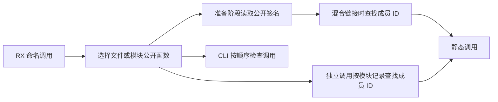
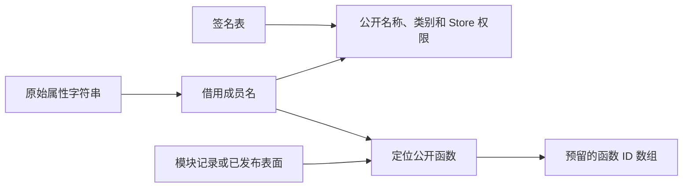

# RX 命名调用的签名校验与正文链接

## Intent · 阶段目标

沿相同的命名调用贯通 `check-rx`、项目签名推导、混合链接及独立调用。将查找公开成员、检查可调用性、从已发布函数表取得 ID 的逻辑迁入 Source。原计划范围包括 Call 分析、项目准备、引用与约束、混合编译的调用绑定，以及 CLI 校验，在父提交中共 24 个 Zig 文件、2,823 行。本阶段的迁移量按退出正式路径的职责核算。

## Data · 源码与执行路径

- `result_name/select.zx` 在原引用上计算结果名。普通模块选文件名，函数引用继续从文件名选择成员后缀。返回字符串直接借用输入。
- `call/named/signature.zx` 复用公开名称查找，再读取匹配行的成员种类和 Store 标记。项目推导取得原有的端口，CLI 对收集到的调用按源码顺序检查，同一检查识别默认调用及第一处被拒绝的命名调用。
- `call/named/record.rx` 先按路径定位已分析的模块，再查找其公开函数。混合编译的 `mixed/callees/scan.zx` 直接从已发布的成员列取函数 ID，连续的命名调用可以在同一扫描里写入预留结果。此前每遇到一个命名调用都会返回宿主，再由宿主遍历成员并重启扫描。

## Edges · 数据与权限

保留完整文件名优先、目录入口、同名首项及错误定位。类型导出缺少可调用行，Store 事务继续要求显式授权。宿主以固定大小的描述符借用原始属性指针列和嵌套成员列表；描述符不持有额外的字符串或成员数组。全批未引入新的专用原生回调。

文件系统探测、签名表和函数表的物理存储、编译库加载、Store setter 编译及诊断输出仍有手写 Zig。初始 seed 保留可独立构建的实现。

## Answer · 阶段验收

- 上一阶段 Source 工具构建候选通过 25 步，初始 seed 路径通过 29 步。候选重新生成 770 个入口，排除输入身份戳后，12,998 个输出文件与构建候选时逐字节一致。
- RX 文本、普通推导、并行推导、磁盘项目及编译库回归通过 365 项 Zig 测试和 26 项 CLI 测试。沿用上一次命名调用的真实项目，依次验证 barrel、同名模块文件、完整点号文件、显式扩展名及单函数简写。输入 3 的可执行结果分别为 8、12、20、10 和 4。类型导出、缺失成员、无默认函数和旧 export 属性均保留相应诊断。
- 选取混合编译、准备、推导及求解的六个实际入口，在相同源码上交替运行上阶段和本批 Source 工具各三次，关闭驻留并使用空缓存。161 个产物逐字节一致。墙钟中位数为 0.23 → 0.22 秒，CPU 为 1.02 → 1.02 秒，单进程峰值为 236.4 → 235.3 MB。

固定清单沿用 735 个入口，关闭驻留，ReleaseSmall、16 分区。对照与候选均由 Source 构建并使用 Source 分析及生成，三轮交替取中位数。11,758 个固定清单产物与所有权 memo 均一致。

| 指标                     | 上一阶段同机对照 |   本阶段 | 固定基线 |
| ------------------------ | ---------------: | -------: | -------: |
| 冷生成墙钟               |           2.60 s |   2.60 s |   2.85 s |
| 冷生成 CPU               |          12.25 s |  12.32 s |  12.58 s |
| 冷生成进程树峰值（采样） |         718.4 MB | 719.8 MB | 893.0 MB |
| 冷生成单进程峰值         |         777.0 MB | 757.6 MB | 939.7 MB |
| 热缓存墙钟               |           2.02 s |   2.01 s |   2.25 s |
| 热缓存 CPU               |           8.30 s |   8.23 s |   8.61 s |
| 无变更墙钟               |           0.04 s |   0.03 s |   0.04 s |

进程树采样峰值增加 1.4 MB，单进程操作系统峰值下降 19.4 MB。冷生成 CPU 增加 0.07 秒，墙钟持平。与固定基线相比，墙钟少 0.25 秒、CPU 少 0.26 秒，进程树峰值低 173.2 MB。这组计时覆盖编译器生成；本批未重新测量完整应用的 Zig/LLVM 冷构建。
