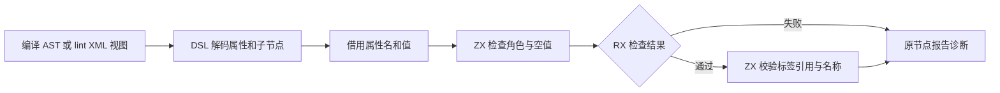

# RX 属性与引用契约自举

## Intent · 目标

将普通模块、Gateway 和 Store 在结构解码后的属性检查迁入 Source。范围包含 DSL、RX 标签与 schema、路径判定以及 XML 适配的 51 个 Zig 文件，共 2,782 行。按退出正式入口的检查和调度计量进度。

## Data · 现有调用链

编译路径传入解码后的 AST，lint 传入 XML 视图。两者先由 DSL 检查未知、重复、缺失或不能转换的属性，再解码子节点。标签随后逐个调用角色和空白检查，在 Zig 中决定错误优先级，以及何时检查路径、别名或调用目标。

## Edges · 边界

保留 DSL 转换与子节点诊断的先后顺序。同一节点上，形式错误优先于空值；Store Field 允许空的初始值，字段名的空值优先于类型。Call 的目标互斥与 setter 授权先于模块路径检查。Module.fn 与子节点互斥。宿主按标签的编译期字段数在栈上投影借用视图，诊断位置仍来自原节点。初始 seed 保留原检查。

## Answer · 验收

从已验证的 Source 引导器生成候选，核对候选自生成、真实入口、既有正反例和错误位置。对影响编译开销的属性遍历做同配置性能对照。

仓库的 932 个非归档 RX 用前后两版 CLI 做只读 lint 对照，928 个通过，4 个既有拒绝输入保留原诊断。另对照 78 个属性样例和 30 个改变属性次序的输入，逐例的退出码、诊断文本、路径及行列完全相同。四类 4,096 节点输入分别覆盖 Type、Call、Store Field 和 Gateway Route，两版单进程峰值持平或下降，CPU 中位数分别为 0.05、0.07、0.07 和 0.06 秒。

初始 seed 成功构建解析器，编译器 RX 回归通过 39 项。上一阶段 Source 引导器成功构建本阶段工具，新工具用同一份清单生成 772 个入口，排除输入身份戳后 13,049 个文件逐字节一致。下游通过 456 项 Zig 测试、16 项 Store 物理路径检查、9 项磁盘项目检查、55 项 RX 属性执行、6 项语义拒绝和 86 项 Gateway 应用检查。

### 固定清单的生成开销

固定 735 个入口。对照及候选工具均由 Source 构建，启用 Source 分析和生成，使用 ReleaseSmall、16 分区、关闭驻留。11,758 个输出逐字节相同，所有权 memo 哈希相同。表中是交替三轮中位数，单位 MB 采用十进制。

| 指标                 |   上阶段 |   本阶段 | 固定基线 | 本阶段相对固定基线 |
| -------------------- | -------: | -------: | -------: | -----------------: |
| 冷生成墙钟           |   2.58 s |   2.58 s |   2.85 s |            −0.27 s |
| 冷生成 CPU           |  12.23 s |  12.27 s |  12.58 s |            −0.31 s |
| 冷生成进程树采样峰值 | 719.8 MB | 720.5 MB | 893.0 MB |          −172.5 MB |
| 冷生成单进程系统峰值 | 750.6 MB | 816.0 MB | 939.7 MB |          −123.7 MB |
| 热生成墙钟           |   2.00 s |   1.98 s |   2.25 s |            −0.27 s |
| 热生成 CPU           |   8.24 s |   8.27 s |   8.61 s |            −0.34 s |
| 输入未变墙钟         |   0.03 s |   0.03 s |   0.04 s |            −0.01 s |

三轮中单进程系统峰值的中位数上升 65.4 MB；同组对照也有一轮达到 822.7 MB。为定位峰值，独立进行了六对交替冷生成，用系统终止时记录的 RSS 结合 2 毫秒采样。系统峰值中位数 744.0 → 743.3 MB，采样峰值中位数 734.5 → 734.0 MB。候选仍有一轮达到 807.3 MB。根据每轮墙钟扣除生成及写入耗时，两版最晚在进程启动 1.50 秒内完成推导，12 次采样峰值都出现在 2.00 秒以后。属性检查使用编译期定长栈视图和容量为零的分配器；本次未观测到属性校验阶段出现相应的持续增长。计时覆盖生成器，不含最终应用的 LLVM 编译。

40 个实际编译器和 genz 入口的 3,343 个产物逐字节相同。三轮冷生成墙钟 1.04 → 1.02 秒，CPU 5.29 → 5.30 秒，单进程峰值 462.9 → 481.7 MB。对同一清单补做六对独立冷生成，系统峰值中位数 441.7 → 439.3 MB，CPU 5.32 → 5.31 秒。个别运行的峰值仍有波动，保留首组数据与独立复核结果。

通用 DSL 的结构解码、编译期类型转换、节点定位和诊断呈现仍由 Zig 执行；初始 seed 保留独立的原生检查。正式 Source 路径已移出逐属性角色与空值判断、错误优先级、调用目标互斥，以及引用路径和别名检查的调度。
