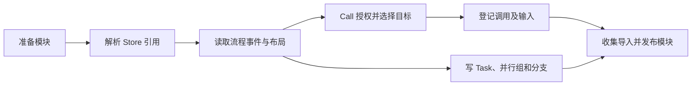

# RX 模块准备与调用绑定自举

## Intent · 目标

贯通模块准备、调用授权与解析、流程事件到最终表行的绑定，移除 rx_prepare 专用包。把调用目标选择、隐式输入的前驱位置、流程错误和准备顺序留在 RX/ZX，宿主直接写入持有节点与签名的最终表。

## Data · 原有调用链

起点为 `72745f190`。模块、Call 和流程事件共享同一个原生包，以不透明指针和 C 状态码调用三种 Zig 状态。项目推导按模块生成调用表、导入表和流程表；错误必须在原节点位置返回，解析输入借用项目的输入 arena。

## Edges · 边界

保留无索引 AST 和初始 seed 的既有入口。不能提前读尚未写入的前驱行。平行 Task 的隐式 Return 先发布，带 Store 的命名调用在解析签名前拒绝。模块退出时仍由现有 arena 和宿主管理表达式、签名和节点引用。

## Answer · 验收

从构建清单、生成 Zig 和链接参数核对原生依赖退出，用两代 Source 工具比较完整输出。通过现有 RX 推导、命名调用、默认输入、Store、Task 及并行运行回归；按固定输入检查时间和内存。

### 已迁移的职责

模块准备和 Call 绑定现在从 `prepare/sequence.rx` 取得各自的步骤顺序。编译器在编译期展开步骤，模块的流程与导入结果、调用的授权与目标都放在有类型的局部变量中。命名调用能否访问目标、能否授予 Store setter、是否记为本地调用，由 `call/availability.zx` 判定。

对于带索引的流程，`prepare/flow/next.rx` 根据原始元数据给出下一项写入及其前驱位置。宿主直接把结果写进最终的 Call、Task、分支或并行表。流程诊断由 ZX 选择种类和文本。原 `rx_prepare` 的模块准备 5 个、Call 绑定 6 个、流程写入 10 个原生回调均已从构建和生成入口移除。

本批核对了 26 个文件中的 2,968 行原有 Zig。实际变更的 Zig 新增 244 行、删除 553 行，净减 309 行。ZX 净减 161 行，RX 净减 83 行。模块遍历、AST 节点与签名存储、表达式解析及无索引 AST 的递归遍历仍有手写 Zig。

### 正确性

上一阶段 Source 工具引导构建通过 38/38 步，初始 seed 引导构建通过 36/36 步。两条引导路径对四个相关入口生成的 25 个文件逐字节一致。

完整清单包含 765 个入口、5,521 个模块和 4,918 个函数文件。上一阶段与当前 Source 工具生成的 12,923 个可比较文件逐字节一致，仅排除记录路径的 `.zxc-inputs`。12,922 个生成 Zig 文件中已无旧包或回调引用。两版 v18 所有权缓存的载荷均为 14,320,605 字节，SHA-256 均为 `a9b8e714d3b279322c9e178649eb8e7800e7d8fe8846c131069fe743cdc4dd14`。

现有 RX 推导、Task 输出、并行推导、顺序运行、并行运行和项目 CLI 六组回归共 1,257 项通过，构建图 1,106 步全部成功。

### 生成耗时与内存

用同一固定清单的 735 个入口交替运行三轮，取中位数。两版工具都由 Source 引导构建，运行 Source 分析和生成，使用 ReleaseSmall、16 分区并关闭常驻生成器。计时从打开清单到 Zig 源码写完。11,758 个可比较文件和所有权缓存载荷均一致。

| 指标                 | 上一阶段同轮 |    本阶段 | 固定基线 |
| -------------------- | -----------: | --------: | -------: |
| 冷生成墙钟           |       2.65 s |    2.61 s |   2.85 s |
| 冷生成 CPU           |      12.43 s |   12.37 s |  12.58 s |
| 冷生成进程树采样峰值 |    713.83 MB | 704.41 MB | 893.0 MB |
| 冷生成单进程系统峰值 |    788.58 MB | 806.63 MB | 939.7 MB |
| 热生成墙钟           |       1.99 s |    1.98 s |   2.25 s |
| 热生成 CPU           |       8.28 s |    8.26 s |   8.61 s |

冷生成进程树采样峰值下降 9.42 MB，单进程系统峰值上升 18.06 MB，比固定基线低 133.07 MB。两版无修改重跑均为墙钟 0.04 s、CPU 0.03 s。LLVM 编译和链接不在这组生成计时中。
