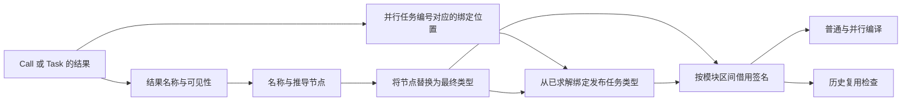

# RX 流程结果与签名发布自举

## Intent · 目标

贯通 Call、Task 和 Parallel 的结果登记、类型求解、模块签名与增量复用。一个并行任务的输出只求解一次。签名直接保留端口列和结果区间，避免为每个模块再次组装名称和类型切片。

## Data · 数据流

原路径先按作用域遍历顺序记录每个结果的图节点，并为并行任务再记录一对任务编号与同一个图节点。求解器发布绑定类型后又沿任务图节点查询一次。宿主最后逐模块分配好的签名行保存端口值和三个切片，增量比较再将这些行包装为跨距列。

## Edges · 边界

保留结果登记、首错诊断和求值顺序。void 占用结果记录，求值后只有可见值进入作用域。嵌套并行任务的完成顺序可能不同于任务编号顺序。历史帧中的所有视图必须在求解工作区释放后仍然有效。

## Answer · 验收

对照现有嵌套 Task、可见性、作用域冲突、分配失败和增量复用回归。检查两代生成的一致性以及同一清单的性能。

### 正式路径

- 约束收集在并行 Task 结束时，按任务编号保存当前模块内的绑定位置。绑定类型求解结束后，ZX 才把这些位置原地替换成最终类型。内层 Task 可以先结束，外层 Task 仍可按原编号取到自己的类型。无法立即求解的绑定仍由同一求解器处理，已完成的记录不会再次发布。
- 普通 Call、普通 Task 和并行 Task 共用一个 Source 结果读取入口。void 结果仍占一个位置。普通 Task 先在内部作用域求值，再恢复外层作用域，最后发布可见名称。
- 历史帧保留求解完成的端口列、绑定列、任务列及模块结束位置。编译单个模块时按区间借用，增量扫描也直接借用同一批列。删除了排在求解后的逐模块签名组装循环和历史扫描的跨距列适配。64 位宿主原先为每模块另存 56 字节的签名行，本批保留的端口与边界列每模块合计 25 字节，另有每张表固定的切片描述符。
- 图、求解工作区、列表扩容与错误报告仍由宿主管理。本次迁移覆盖结果类型的发布和消费。

### 正确性

用 `efacc5393` 的 Source 引导器构建候选。两代 Source 引导器对同一清单的 772 个入口生成 13,089 个相同文件，对照排除了工具身份输入戳。原生 seed 检查通过 39 项。使用候选生成的正式编译器通过 201 个构建步骤和 540 项 Zig 测试，以及 55 项属性执行、6 项属性拒绝和 9 项磁盘项目检查，覆盖并行运行、分配失败、失败后重建和链接。

常驻生成器编译现有 379 模块的校验工程。ZX 正文编辑命中 376 个模块复用，随后 RX 编辑命中 377 个。引入坏依赖时编译失败，恢复后重新生成成功，无改动请求命中缓存。初次、两次编辑和恢复四种状态各自的 709 个 Zig 文件均与空缓存重建一致。

### 性能

两个工具本体均由 Source 构建，运行时使用 Source 分析和生成。固定 735 个入口、ReleaseSmall、16 分区、关闭常驻，交错运行三轮取中位数。11,758 个生成文件和所有权 memo 逐字节一致。下列时间只覆盖 Source 生成。

| 指标                 | 同轮上批 |     本批 | 相对固定基线 |
| -------------------- | -------: | -------: | -----------: |
| 冷生成墙钟           |   2.61 s |   2.62 s |      −0.23 s |
| 冷生成 CPU           |  12.21 s |  12.26 s |      −0.32 s |
| 冷生成进程树采样峰值 | 719.4 MB | 730.7 MB |    −162.3 MB |
| 冷生成单进程系统峰值 | 802.9 MB | 750.7 MB |    −189.0 MB |
| 热生成墙钟           |   2.01 s |   1.99 s |      −0.26 s |
| 热生成 CPU           |   8.26 s |   8.21 s |      −0.40 s |
| 输入未变墙钟         |   0.04 s |   0.03 s |      −0.01 s |

冷生成阶段的树峰值采样增加 11.3 MB，系统单进程峰值下降 52.1 MB。三轮采样均未观测到子进程，两个数字使用不同的采样方式，仍需分别跟踪。两种嵌套 Task 工程各交替运行 15 轮实际 CLI 无缓存生成，输出 Zig 均一致。普通嵌套场景的墙钟从 8.49 ms 到 8.42 ms，系统峰值均为 11.53 MB。借用外层值的嵌套场景从 8.39 ms 到 8.37 ms，峰值从 11.29 MB 到 11.26 MB。
