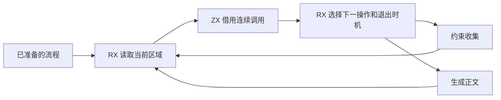

# RX 约束与降级共用流程遍历

## Intent · 目标

让项目约束收集和正文降级共用按区域推进的 RX 遍历。每次给出一段相邻 Call 的起止行，同时决定接下来的结构操作及作用域是否退出。去掉经过 C ABI 回调宿主、读取游标、再回到生成代码的往返。

## Data · 原实现与数据流

起点为 `49732bc56`。沿准备、约束、正文降级和 Task 捕获核对了 21 个 Zig 文件、3,343 行。准备阶段已经生成步骤种类、载荷行号和子区域。旧遍历对每个事件从十二个原生回调里选择操作，运行时还要通过布尔标志在约束与降级两种宿主中选择。两种宿主又分别按行号从计划中取同一段调用或同一个载荷。

## Edges · 边界

按原顺序执行同一段内的调用，第一个错误立即返回。选择区域的游标是分支序号，不能按步骤行读取。并行 Task 在收集约束时进入子域，在降级时由独立的 Task 编译入口消费。含表达式和绑定的有类型帧继续由使用它的宿主持有，出错时依原路径释放。

## Answer · 验收

从正式推导和降级入口核对原生依赖退出。用已有 RX 推导与运行回归覆盖 Task、Parallel、Switch、If、返回和错误传播，比较前后两版完整输出及固定清单的时间和内存。

### 实现与正确性

`flow/traversal/advance.rx` 先取相邻 Call 的结束位置，再决定执行哪个载荷、游标移到哪里、是否释放当前帧。Case 序号和步骤行号分别处理。约束收集和代码生成对同一列取切片，分别执行类型推导和 IR 写入。宿主保留有类型的帧、作用域、实际表达式计算和错误清理。返回值只有游标、载荷行、操作和退出标志，正式入口通过空缓冲分配器按值调用。

从包注册、构建输入、分区链接和生成清单中移除了 `rx_prepared_flow`。原有十二种 C 回调和用于传递不透明指针的适配函数均已删除。

在当前 765 个入口、5,539 个模块的清单上，上一阶段与本阶段的 Source 工具分别生成 13,026 个可比较文件，逐字节一致，仅排除记录调用路径的 `.zxc-inputs`。另行比较的所有权缓存 v18 载荷共 14,326,663 字节，SHA-256 均为 `52055dfae8194450cc469f9bb792a1d47349bc605218cbfa4b2269301e386fd6`。

原始 Zig seed 和既有 Source 引导器均成功构建。直接用原始 seed 生成时，扫描循环的两个临时变量编号互换，相应文件清单哈希随之变化。用 seed 构建的下一代工具重新生成，新遍历入口的 9 个文件与既有 Source 引导器逐字节一致。已有 RX 推导、Task 输出、并行推导、顺序运行和并行运行五组回归共 1,257 项全部通过，包含分支作用域、并行输出与失败清理。

### 性能与剩余职责

735 个固定入口、16 分区，两代 ReleaseSmall 自举工具均用 Source 分析和生成，交替运行三轮，取中位数。冷、热指重新生成 Zig 源码的开销，不含 LLVM 编译及链接。固定清单上的 11,758 个文件和所有权缓存载荷也一致。

| 指标                 | 上一阶段同轮 |    本阶段 | 固定基线 | 本阶段距固定基线 |
| -------------------- | -----------: | --------: | -------: | ---------------: |
| 冷生成墙钟           |       2.63 s |    2.64 s |   2.85 s |          −0.21 s |
| 冷生成 CPU           |      12.41 s |   12.30 s |  12.58 s |          −0.28 s |
| 冷生成进程树采样峰值 |    703.14 MB | 702.71 MB | 893.0 MB |       −190.29 MB |
| 冷生成单进程系统峰值 |    796.95 MB | 740.23 MB | 939.7 MB |       −199.47 MB |
| 热生成墙钟           |       1.99 s |    2.00 s |   2.25 s |          −0.25 s |
| 热生成 CPU           |       8.26 s |    8.30 s |   8.61 s |          −0.31 s |

输入不变时，两版墙钟和 CPU 中位数均为 0.03 s。本批 Zig 新增 119 行、删除 374 行，净减 255 行；RX 与 ZX 合计新增 48 行、删除 438 行，净减 390 行。流程帧的实际表达式求值、绑定存储、IR 写入及其下游语句遍历仍有手写 Zig，继续计入待迁移工作。
