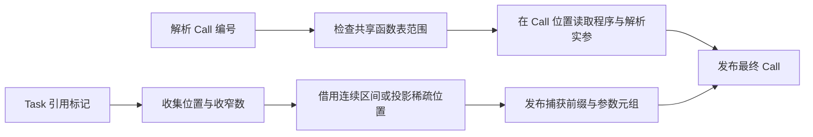

# RX 调用与任务输入自举

## Intent · 目标

贯通混合项目的 Call 准备、流程编译和 Parallel Task 捕获输入。Call 仅读取解析后的函数编号与既有列，在消费处构造被调程序。捕获布局由 RX 选择借用或投影，由 ZX 生成实参需要的类型和行位置。

## Data · 现有路径

`mixed/rx.prepare` 为每个调用预建含整个 Program 的 Loaded 行，`flow_compile.call` 随后又把 Program 写入最终 Call。Parallel Task 先生成捕获位置，再分别映射源类型和参数类型，最后第三次遍历两列统计收窄。IR 发布阶段宿主逐个复制捕获符号名。

## Edges · 边界

同层并行编译只读共享表，外部函数的可执行入口由当前编译者申请存储。模块入口元数据必须在共享表继续增长后保持有效。Task 的位置始终按环境顺序发布，收窄类型只影响入参，嵌套 Task 向外层报告原位置。符号文本在 IR 的持有期内有效。

## Answer · 验收

使用现有普通、并行、外部函数、借用与分配失败回归，核查两代 Source 引导产物。比较固定清单冷暖生成和实际嵌套 Task 的 CLI 输出、时间及内存。

### 实现与剩余边界

本组以 `e533cc60e` 为起点，沿调用准备、普通与并行流程编译、捕获参数构造、项目发布及直接依赖划定范围，共 23 个 Zig 文件、2,994 行原实现。这个数字描述检查范围。实际退出执行路径的职责如下。

- 删除逐 Call 构造的 `Module.Loaded` 数组。ZX 在准备阶段检查整列函数编号，复用原有的链接边界算法。普通模块、提前并行编译和嵌套 Task 读取同一组只读列。外部函数在消费位置生成可执行入口，工作线程使用自己的分配器。同步编译只在本次降低期间保留编号，小表使用栈缓冲，较大的表在作用域结束或失败时释放。
- RX 依次收集捕获位置、选择源类型列，并仅在存在类型收窄时选择第二列。ZX 在同一次标记扫描中得到首位置、区间连续性和实际收窄数量。连续位置使用原类型切片，稀疏位置仅投影选中行。无收窄时，两种类型共享结果。生成 Zig 的连续分支直接返回 `borrowU32Range` 的结果。
- 捕获符号的名称选择和持久化迁入 Source。参数 IR 借用被调程序已持有的符号名前缀，省去第二份名称列及逐个文本复制。实参的源位置和类型仍为本次调用独立生成的值，因此外层借用、可空收窄和诊断位置均可独立表达。

当前宿主仍管理函数表 ABI 视图、IR 存储及分配器，外部入口适配和具体 Call 参数编译也仍有 Zig 实现。

### 正确性与生成一致性

以 `e533cc60e` 的 Source 引导器构建候选，再分别运行两代工具生成相同 772 个入口。排除输入身份戳后，13,093 个产物逐字节一致。原生 seed 路径通过 39 项回归。常驻编译器在 379 模块工程中分别复用 376 个正文编辑前的模块和 377 个 RX 编辑前的模块，依赖失效、恢复、无改动命中均符合预期。四种成功状态各有 709 个 Zig 文件与空缓存重建一致。

正式回归通过 432 项 Zig 测试、9 项磁盘项目检查和 Task 源码与编译库迁移路径。并行浮点矩阵的 36 组执行每组通过 452 项，覆盖 f32/f64、直接与捕获输入、线程及分配失败。合并命令中唯一失败的步骤是夹具目录检查：浮点 RX 生成脚本还使用旧排版，提交 `4e4d8793b` 已将真实夹具格式化。修正生成源并单独重跑其 `--check` 命令，四份 452 项目录及配套 RX、ZX 夹具逐字节通过。已有用例保持原样。

### 性能

同机、同一份 735 入口固定清单，ReleaseSmall、16 分区、关闭驻留。两个工具本体均由 Source 引导生成，运行 Source 分析与生成，交错三轮取中位数。11,758 个文件和所有权 memo 相同。MB 为十进制。

| 指标                 | 同轮上批 |     本批 | 相对固定基线 |
| -------------------- | -------: | -------: | -----------: |
| 冷生成墙钟           |   2.64 s |   2.62 s |      −0.23 s |
| 冷生成 CPU           |  12.29 s |  12.30 s |      −0.28 s |
| 冷生成进程树采样峰值 | 719.6 MB | 718.8 MB |    −174.2 MB |
| 冷生成单进程系统峰值 | 760.3 MB | 739.9 MB |    −199.8 MB |
| 热生成墙钟           |   1.99 s |   2.00 s |      −0.25 s |
| 热生成 CPU           |   8.25 s |   8.26 s |      −0.35 s |
| 输入未变墙钟         |   0.04 s |   0.04 s |       0.00 s |

两版 CLI 对三个既有工程各交替运行 15 轮无缓存生成。普通嵌套 Task 的墙钟中位数从 8.52 ms 到 8.49 ms，带外层借用的嵌套 Task 从 8.49 ms 到 8.35 ms，两个 Store 模块与七个顶层 Call 的工程从 13.15 ms 到 13.02 ms。三个工程的输出 Zig 均逐字节相同。这些数据覆盖生成与实际 RX 编译入口，本组未重新计时包含 Zig/LLVM 的完整冷构建。
