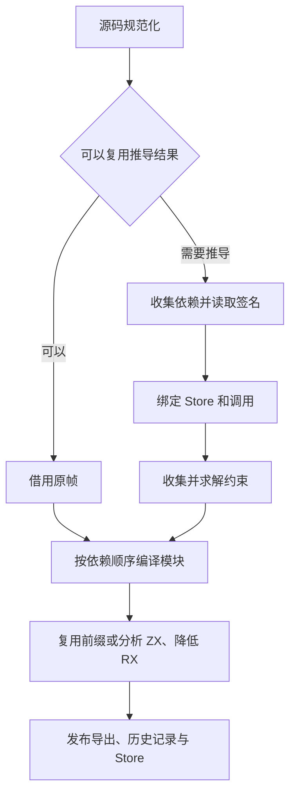

# RX 项目推导与混合编译自举

## Intent · 目标

迁移 RX 项目推导、签名复用、约束求解到混合模块编译与导出发布的完整调用链，让宿主直接使用 RX/ZX 决定的操作和模块行号，移除 `rx_project_workflow` 原生包。

## Data · 起点

从 `22001b71b` 的 `project.infer` 到混合模块发布共使用 31 个原生回调。四种不透明状态在每次调用时还原成项目、签名推导、求解器或混合编译事务。原始图顺序、批次边界、缓存前缀和已准备模块都可直接借用。

## Edges · 边界

保持现有历史记录的生命周期、失败时的诊断、并行预分析结果的所有权和提交顺序。求解器在约束收集结束后释放临时内存。缓存只命中前缀或一个批次全部可跳过时，下一个批次必须从正确位置继续。

## Answer · 验收

从正式清单及生成代码核对外部接口退出。用 seed 和 Source 引导构建，比较同一输入的生成结果；集中运行项目推导、混合编译、缓存和 Store 回归，按固定清单对照生成时间和峰值内存。

### 实际调用链

这批沿 29 个 Zig 文件、4,122 行原始实现追踪了项目入口、约束求解、模块预分析、混合编译和结果发布。`workflow/history.zx` 选择重新推导、检查旧签名或直接借用旧帧。比较旧签名前要求存在历史且当前没有 Store；只改函数体时按原约定复用完整帧。签名指纹和源码一致性继续由原有 Source 实现判定。

`workflow/sequence.rx` 描述六条步骤序列。Zig 在编译期展开每条序列，正式路径直接操作带类型的上下文。混合编译从 Source 分派结果取得当前行与下一行，批内剩余行全部跳过时直接进入下一批。调用成功后才登记历史边界。准备导出依赖图时直接读取导出记录的路径字段，省去临时路径数组与一次逐项复制。

项目推导、签名推导、约束求解和混合编译四种不透明句柄及 31 个 C 回调已退出构建。相对起点，Zig 新增 225 行、删除 477 行，净减 252 行；RX/ZX 合计新增 156 行、删除 259 行，净减 103 行。宿主仍负责 AST 和图表存储、调用编译与链接、并行预分析和 arena 生命周期。

### 正确性及增量恢复

Source 引导构建通过 38/38 步，初始 seed 引导通过 36/36 步。步骤序列、历史复用、正文分派三个入口在两条路径生成的 16 个文件一致。完整清单包含 765 个入口、5,508 个模块和 4,869 个函数文件。两代 Source 工具的 12,823 个可比较文件全部一致，排除记录运行路径的 `.zxc-inputs`。12,822 个生成 Zig 文件均无旧回调或包引用。两版所有权缓存载荷均为 14,316,957 字节，SHA-256 均为 `1ddc2ca0a2c03bee5021027391d393546ef24f13a15f66b62214dae11096b998`。

既有 RX 推导、项目 CLI、混合库与应用 Store 目标通过 85/85 步、138/138 项测试。独立的常驻服务核验覆盖首次生成、仅改 ZX 函数体、改 RX、依赖错误、恢复和无修改重跑。四个有效输入各有 42 个生成 Zig 文件与当次冷生成一致；修改 ZX 函数体使用旧推导帧，恢复后的内容与初次生成一致，无修改时直接命中。

### 固定清单性能

两个工具均由 Source 引导生成，并使用 Source 分析及生成实现。固定 735 个入口，关闭常驻服务，候选与上阶段工具交替运行各三次，取中位数。计时覆盖 RX/ZX 到 Zig 源码生成，未包含后续 Zig/LLVM 编译。

| 场景           | 上阶段墙钟 / CPU | 本阶段墙钟 / CPU | 相对固定基线的墙钟 / CPU |
| -------------- | ---------------- | ---------------- | ------------------------ |
| 冷生成         | 2.65 / 12.38 秒  | 2.69 / 12.42 秒  | −0.16 / −0.16 秒         |
| 有缓存重新生成 | 2.01 / 8.29 秒   | 2.00 / 8.26 秒   | −0.25 / −0.35 秒         |
| 输入无改动     | 0.04 / 0.03 秒   | 0.03 / 0.03 秒   | —                        |

冷生成墙钟与 CPU 较上阶段各增加 0.04 秒。按十进制 MB 计算，冷生成进程树采样峰值从 703.3 MB 降到 703.0 MB，系统记录的单进程峰值从 748.6 MB 升至 766.0 MB，分别低于固定基线约 190.0 MB 和 173.7 MB。进程树按 40 毫秒间隔采样，系统记录也包括采样间的瞬时峰值。固定清单两版生成的 11,758 个文件一致，所有权缓存载荷的 SHA-256 均为 `76562648064cc2080c35869617027c250fbb139033441baa15a9f10bf6a3ef94`。
