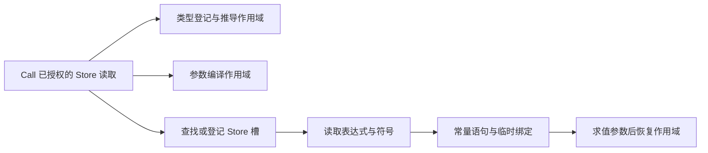

# Store 读取绑定与快照发布自举

## Intent · 目标

沿 Call 的 Store getter 从授权结果追到约束图、参数类型检查和最终控制流。将三个入口中的逐项发布迁入 Source。复用现有授权记录及最终存储，空列表保持直接返回。

## Data · 调用链

项目约束使用图节点编号，参数编译使用类型编号。两者借用同一份授权名称。程序 IR 需要持有符号名称并为每个 getter 生成一条读取表达式和常量语句。现有 Source 已负责授权匹配、Store 槽合并、表达式头与控制语句的编码。上批提交 `ea54f803b` 中，本次沿调用链检查的项目约束、Store 访问、控制流及表达式链接范围共 26 个 Zig 文件、3,396 行。

## Edges · 边界

保留声明顺序、类型不一致时的诊断、读写权限合并和初始 seed 路径。授权记录和名称视图的生命周期保持原契约。最终 IR 独立持有需要跨越构建期的文本。类型推导按序提交已处理的绑定。最终表达式和符号在写入成功后统一更新长度。

## Answer · 验收

从相同清单验证两代 Source 的输出，执行已有 Store、类型推导、并行权限与项目回归。分别记录受影响入口和固定清单的性能。

### 正式入口的变化

- 项目约束与参数编译都直接借用 getter 名称和类型列。参数编译发布原类型编号。推导阶段批量发布已登记的图节点，遇到首个未知类型便提交已完成的前缀，沿既有类型登记入口补齐该类型后继续。绑定只在求值这次 Call 的参数时可见。
- 链接 getter 和链接被调函数的 Store 声明共用同一条槽位匹配、兼容性检查与权限合并规则。槽号写入最终读取表达式的操作数列，删除了为每个 getter 拼装单行 Store 表的路径。未登记的槽仍由宿主在原有存储中扩容并持有路径。
- RX 连接读取表达式、独立持有名称的符号以及常量语句三个阶段。现有按行写表达式头和写常量语句的 ZX 原子同时用于这批 getter。控制流游标、表达式编号、符号编号与声明顺序一致。手写 Zig 仍负责预留最终列、借出视图、提交长度和初始 seed。Call 与 Task 的结果发布、项目约束状态及其余控制流仍有 Zig 实现。

### 正确性

以 `ea54f803b` 的 Source 引导器构建本批工具，候选再次生成同一份 771 入口清单。排除输入戳，13,085 个文件逐字节相同。原生 seed 构建与 39 项 RX 检查通过。正式 Source 编译通过 154 个构建步骤、476 项 Zig 测试，以及同一批次的 CLI 与属性执行检查。覆盖同一对象重复读取、同一 Call 读取两个 Store、嵌套槽映射、权限隔离、参数求值后恢复作用域以及分配失败清理。

中途尝试给普通 Call 的单行表达式头接口增加索引参数，执行回归发现普通 Call 也报告越界，两代生成文件对照无法发现这类执行错误。最终批量发布直接复用已有按行写入原子，普通 Call 保留原接口。两套接口分别通过实际执行入口验证。

### 性能

两个工具本体均由 Source 引导生成，执行时使用 Source 的分析和生成实现。固定 735 入口、ReleaseSmall、16 分区，关闭驻留，交替三轮取中位数。固定清单的 11,758 个文件和所有权 memo 均一致。MB 使用十进制。

| 指标                 | 同轮上批 |     本批 | 阶段差异 | 相对固定基线 |
| -------------------- | -------: | -------: | -------: | -----------: |
| 冷生成墙钟           |   2.53 s |   2.59 s |  +0.06 s |      −0.26 s |
| 冷生成 CPU           |  12.16 s |  12.22 s |  +0.06 s |      −0.36 s |
| 冷生成进程树采样峰值 | 718.0 MB | 718.6 MB |  +0.6 MB |    −174.4 MB |
| 冷生成单进程系统峰值 | 746.7 MB | 739.5 MB |  −7.2 MB |    −200.2 MB |
| 热生成墙钟           |   1.96 s |   1.99 s |  +0.03 s |      −0.26 s |
| 热生成 CPU           |   8.15 s |   8.22 s |  +0.07 s |      −0.39 s |
| 输入未变墙钟         |   0.04 s |   0.03 s |  −0.01 s |      −0.01 s |

对同一份现有 Store 工程使用两代 CLI 的 `--no-cache` 源码生成入口，交替运行 15 轮。下表含进程启动、项目读取与输出写盘。两项最终 Zig 均逐字节一致。

| Store 场景                         | 上批墙钟 | 本批墙钟 | 上批 CPU | 本批 CPU | 系统峰值变化 |
| ---------------------------------- | -------: | -------: | -------: | -------: | -----------: |
| 读写权限合并与重复读取             | 10.57 ms | 10.62 ms | 11.55 ms | 11.59 ms |     +0.05 MB |
| 单次 Call 读取两个 Store、交换槽序 |  7.04 ms |  7.06 ms |  6.99 ms |  7.00 ms |      0.00 MB |

固定清单覆盖 Source 生成。回归同时构建了最终 CLI，Zig 汇总显示该编译步骤的峰值为整数档 `3G`。本批没有单独测量端到端冷构建时间。
