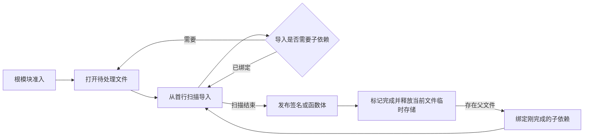

# ZX 依赖装载与导入恢复自举

## Intent · 目标

将首次进入文件、依赖返回、继续扫描、发布签名或函数体、关闭文件连成一条由 RX/ZX 决定的处理链。取消导入装载器向 Zig 传递不透明指针的专用接口，同时让项目签名和函数体分析共用有类型的文件访问路径。

## Data · 当前实现

起点为 `db3ef7699`。从 `analyzeSignatureEntries` 和 `analyzeWithCaches` 进入 `Project.loadFrames`，沿导入选择、路径解析、绑定与发布核对的范围为 20 个文件、3,318 行 Zig。原始 Source 遍历依赖 `project_frame` 的七个接口操作，对应六个 C 符号，每次快照与访问都需从不透明指针恢复同一项目并重新选择 AST 布局。

## Edges · 边界

保留输入顺序、访问过的依赖标记、未使用导入也检查环、深度上限、失败时的诊断位置和资源释放。绑定子依赖成功后从挂起行的下一行继续。AST、签名存储和文件路径的短期分配仍由现有宿主管理。

## Answer · 验收

用正式 Source 工具和初始 seed 生成并构建，比较同一清单的输出，检查构建图和生成代码中旧接口的引用。运行覆盖模块导入、签名、缓存和循环拒绝的既有用例，并在固定清单上比较冷、热生成的时间和峰值内存。

### 实际变更

父文件首次进入时从第一行开始。子文件完成后，`step.rx` 先要求绑定挂起的导入，绑定成功才前移；遇到新的子依赖时，返回要打开的文件编号。`scan.zx` 按当前行和导入总数选择下一项导入、签名发布或函数体发布。`admit.zx` 的首次访问标记和 `complete.zx` 的完成标记直接写入原状态列。

宿主在每次进入或恢复文件时选择一次 AST 布局，复用借用的文件头执行本轮命令。原先三字游标、四字文件头快照、不透明项目句柄和 C 状态码已从执行路径与分区构建一起删除。打开文件、访问 AST、写签名和函数体、管理帧栈和路径暂存仍由 Zig 执行。

相对起点，Zig 新增 99 行、删除 252 行，净减 153 行。RX、ZX 合计新增 61 行、删除 315 行，净减 254 行。

### 正确性

初始 seed 引导构建通过 36/36 步，上阶段 Source 引导构建通过 38/38 步。两条路径生成的四个相关入口共 29 个文件逐字节一致。

完整清单的 767 个入口涵盖 5,515 个模块与 4,905 个函数文件。两代 Source 工具对同一清单生成的 12,902 个可比较文件全部一致，仅排除记录运行路径的 `.zxc-inputs`。12,901 个生成 Zig 文件和 6 项外部接口中已无 `project_frame` 依赖。两版 v18 所有权缓存载荷均为 14,318,105 字节，SHA-256 均为 `40762c9cd066eabd26bdde4029122c38b58f22a71880c2e083cdd1496d7d088f`。

模块路径、模块产物、语义缓存、模块记录、原生声明和 RX 推导六组构建目标通过 156/156 步、328/328 项测试，覆盖规范化路径形成的环、深度上限、缓存恢复及分配失败。

### 性能

固定清单含 735 个入口。两代 ReleaseSmall 工具均由 Source 引导构建，运行 Source 分析与生成，关闭常驻、16 分区，交替三轮取中位数。两版 11,758 个生成文件及所有权缓存载荷一致。

| 指标                 | 上阶段同轮 |    本阶段 | 固定基线 |
| -------------------- | ---------: | --------: | -------: |
| 冷生成墙钟           |     2.66 s |    2.61 s |   2.85 s |
| 冷生成 CPU           |    12.36 s |   12.37 s |  12.58 s |
| 冷生成进程树采样峰值 |  701.40 MB | 702.68 MB | 893.0 MB |
| 冷生成单进程系统峰值 |  811.79 MB | 741.51 MB | 939.7 MB |
| 热生成墙钟           |     1.97 s |    1.97 s |   2.25 s |
| 热生成 CPU           |     8.25 s |    8.23 s |   8.61 s |

进程树采样峰值较配对对照增加 1.28 MB，比固定基线低 190.32 MB；单进程系统峰值下降 70.29 MB。两版无修改重跑的墙钟及 CPU 均为 0.03 s。本轮测量从读取清单到写完 Zig 源码。
