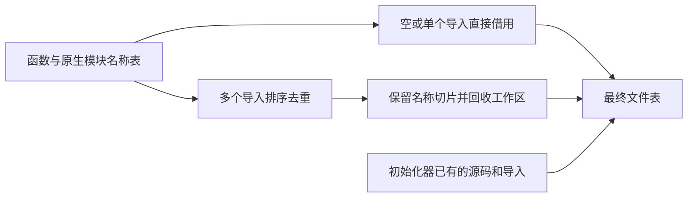

# 函数与初始化器文件表装配自举

## Intent

应用和库共用正式的 RX/ZX 文件发布入口。一次确定函数文件的顺序，填入文件名、源码和导入清单，将 Store 初始化器接在函数文件之后。发布后的文件表在生成工作区释放后仍然有效。

## Data

实现起点为 `76087bfef`，工作规则更新见 `a41c85444`。上阶段已经用 Source 登记同名函数文件，Zig 仍逐个读取被选中的行、逐文件创建导入分析 arena 并装配文件表。库还会复制公开入口和初始化器的源码切片，供常规调用扫描，随后再复制整张函数文件表来追加初始化器。

正式入口为 `backends/zig/function_files/register.rx`。RX 先决定重复文件是否冲突，再发布函数行和初始化器行。导入解析复用 GenZ 的 `analysis/references/imports.rx`。公开入口、初始化器和函数作为三个借用区间传给 `regular_calls/scan_sources.rx`，工作线程按位置读取。

## Edges

- 文件名和源码字节由最终 bundle 持有。零导入使用空列表，单个调用借用对应名称所在的切片，原生函数借用原生模块名称表中的单项。独立调用 GenZ 导入 API 时，仍由调用者提供的分配器持有结果列表。
- 多个调用先收集函数体、契约与公开成员的引用，再排序去重。发布时仅将字符串切片描述符复制到结果 arena，随后回收该文件的排序工作区。下一文件复用这块工作区。
- 同名文件保留首次登记的物理位置。内容不同时，先报告冲突，再由调用方放弃本次发布。追加的初始化器保持输入顺序。
- 源码扫描按公开入口、初始化器、生成函数的顺序读取。补生成的下一轮只扫描刚生成的函数。
- 正式 Zig 适配器负责借出已存在的表、提供两个不同生命期的分配器、接回最终切片。操作系统线程、缓存读写、公开库入口元数据的绑定以及初始引导 seed 仍有手写 Zig。

## Answer

三个受影响入口由两代 Source 引导器分别生成，排除输入身份戳后，100 个文件的相对路径和字节全部一致。由上阶段 Source 引导器构建候选引导器通过 25/25 步，原生 seed 构建通过 14/14 步并能独立生成同一清单。

生成缓存、应用运行、库链接、函数文件与 Store 初始化器发布的七组既有回归通过 134/134 步、95/95 项 Zig 测试。单独的装配对照还核对了无导入、单个契约引用、重复公开名称、混合原生函数、排序去重、初始化器末尾位置和冲突拒绝。结果中的源码和被引用的名称字节继续指向 bundle 已拥有的存储。

### 性能

Zig 0.17.0、ReleaseSmall。候选 CLI 与局部工具由 Zig 构建，候选执行上一阶段 Source 引导器生成的正式分析和生成实现。局部对照交错运行同一输入，完整发布轮换三版顺序，预热后取八次中位数。CPU 为用户态与内核态之和，内存为单进程峰值 RSS。

| 装配场景                    | 轮数 | 上阶段 CPU |  候选 CPU | 上阶段 RSS | 候选 RSS |
| --------------------------- | ---: | ---------: | --------: | ---------: | -------: |
| 8 个文件                    | 1000 |   1.904 ms |  1.722 ms |   2.06 MiB | 1.91 MiB |
| 512 个独立名称              |   35 |  14.405 ms | 12.816 ms |   7.28 MiB | 3.00 MiB |
| 1,024 个函数复用 128 个名称 |   20 |   4.816 ms |  4.606 ms |   4.19 MiB | 3.98 MiB |
| 2,048 个独立名称            |    8 |  26.682 ms | 26.256 ms |   9.02 MiB | 6.00 MiB |

两组完整发布均按输出路径和 SHA-256 核对了所有文件。

| 库发布                       | 固定对照 `6e0cf529f` | 上阶段 `76087bfef` |         候选 |
| ---------------------------- | -------------------: | -----------------: | -----------: |
| Store 库（14 个文件）        |            37.677 ms |          37.861 ms |    37.711 ms |
| 120 个公开路径（149 个文件） |         1,135.505 ms |       1,133.079 ms | 1,130.768 ms |

Store 库相对上阶段，墙钟减少 0.150 ms，CPU 减少 0.110 ms，RSS 减少 8 KiB。相对固定对照，墙钟增加 0.034 ms，CPU 增加 0.102 ms，RSS 增加 16 KiB。

120 个公开路径相对上阶段，墙钟减少 2.310 ms，CPU 减少 1.319 ms，RSS 增加 56 KiB。相对固定对照，墙钟减少 4.737 ms，CPU 减少 4.518 ms，RSS 减少 24 KiB。

本批计时覆盖文件装配和库发布。全编译器冷构建继续沿用先前的独立基线。
