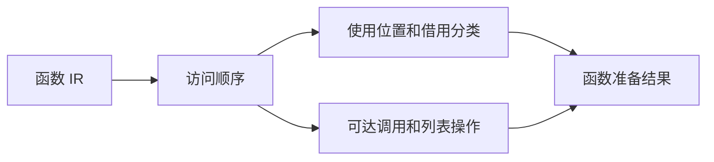
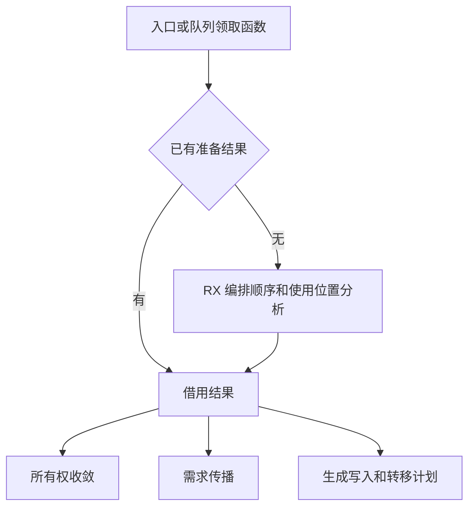

# 函数所有权分析准备自举

## Intent · 目标

让函数所有权分析在一个 RX 入口完成访问顺序、使用位置和操作筛选。前台分析、后台预计算和单独入口共享这份准备结果。函数收敛会多次访问相同的元数据，只保留后续需要的列。

## Data · 证据

正式的 Unit.initialize 在 Zig 中分三次调用已迁移的算法。第一次调用把访问顺序的五列边复制进持久区；使用位置生成后，所有正式求解器读取使用位置表，不再读取这五列。初始种子另有实现。

## Edges · 边界

保留对不可达表达式、分支、循环、任务和跨函数借用的现有语义。按函数懒准备；一次准备完成后再发布，后台读取的描述符和列必须存活到最后一轮。缓存格式、函数顺序和线程领取协议不变。

## Answer · 验收

比较相同清单生成的文件和所有权缓存，运行现有函数分析、模块生成、缓存所有权和字段事实回归。固定 735 入口配对测量冷暖生成的墙钟、CPU 和内存，核对仍由宿主执行的职责。

需求传播和计划生成还各有一段相同的宿主接线：先建立求解上下文并完成循环状态收敛，再重建上下文进入下一阶段。批次将两条链都迁入 RX；读取标记分为收敛前段和需求后段，仍按原先顺序发布。结算路径只发布消费方使用的读取标记、传参事实、改变的函数和输出等级。

### 实现和验证结果

正式函数首次访问通过 prepare/build.rx 构建函数的顺序、使用分类和可达操作。求解用到的最终列跨轮保留，五列原始边随本次准备的临时区释放。结算、需求和计划均在 RX 中取得循环状态；需求阶段把收敛和传播两段的读取记录按原顺序交给发布器，计划只交出四项待发布结果。独立入口继续使用原来的需求收敛循环，通过同一份准备结果和计划契约生成产物。

原有访问顺序与使用位置的 ZX 算法仍由正式 RX 调用。去掉了整套手写调用适配、跨阶段求解状态和七个单独构建入口。初始种子继续执行旧算法。宿主仍负责线程、缓存、跨轮存储和把增长记录转为求解器描述符；现在每次需求或计划访问构建一次上下文。长期保留的结果列仍从临时区复制，边和中间求解状态不再跨这条边界。

在相同源码及 ReleaseSmall 配置下，上阶段 Source 工具（源码提交 `05473228f`）生成本批解析器和工具通过 38 个构建步骤，独立种子路径通过 49 个步骤。种子构建工具和 Source 构建工具各自处理包含递归追踪和工作队列的三个入口，190 个文件逐字节一致。两代 Source 工具在空缓存下处理本批完整清单（772 个入口、5,567 个模块），排除输入戳，13,144 个文件逐字节相同。两版 v18 缓存载荷同为 14,337,923 字节，SHA-256 为 `0b89c0f381b60a227e737747470c50c021662e0b2e1d6dc7eddb905733a6a7ed`。

函数分析、模块生成、缓存所有权和字段事实四组共 249 项测试通过。379 模块的常驻工程经历 ZX 正文修改、增删被调函数、RX 修改、无效依赖和恢复；各成功状态的 709 个生成文件均与同输入的冷生成相同。9 个改动的 RX/ZX 文件通过格式和 lint 检查。

### 性能与规模

以改动前的 17 个函数、顺序、使用位置、工作分发等 Zig 文件（3,322 行）估算本批涉及的调用链。提交前按仓库格式统计，手写 Zig 新增 280 行、删除 593 行，净减 313 行。RX 新增 114 行、删除 10 行，ZX 新增 35 行、删除 5 行。独立种子仍需的访问方法一并计入 Zig 行数。

两版工具均使用 Source 分析及生成。固定 735 个入口、16 个分区，冷缓存、无修改、保留缓存重新写出各交错测三轮，取中位数。第一次计时与 Zig 回归编译重叠，只复用其产物对照（11,758 个文件和 v18 缓存载荷一致）。表中计时单独在回归退出后取得，不含 LLVM 编译及链接。

| 指标                 |   上一版 |     本批 | 本批相对固定基线 |
| -------------------- | -------: | -------: | ---------------: |
| 冷生成墙钟           |   2.80 s |   2.62 s |          −0.23 s |
| 冷生成 CPU           |  12.26 s |  12.36 s |          −0.22 s |
| 冷生成进程树采样峰值 | 702.0 MB | 703.7 MB |        −189.3 MB |
| 冷生成单进程系统峰值 | 781.5 MB | 798.2 MB |        −141.5 MB |
| 热生成墙钟           |   1.95 s |   1.97 s |          −0.28 s |
| 热生成 CPU           |   8.20 s |   8.25 s |          −0.36 s |
| 无修改墙钟           |   0.03 s |   0.04 s |                — |

冷生成进程树采样峰值增加 1.6 MB，单进程系统峰值中位数增加 16.7 MB。后者三轮范围分别为 765.5～801.7 MB 和 738.6～806.6 MB。已有对照能确认去掉了跨轮保存的五列边，尚不能据此断言整轮峰值内存下降。
