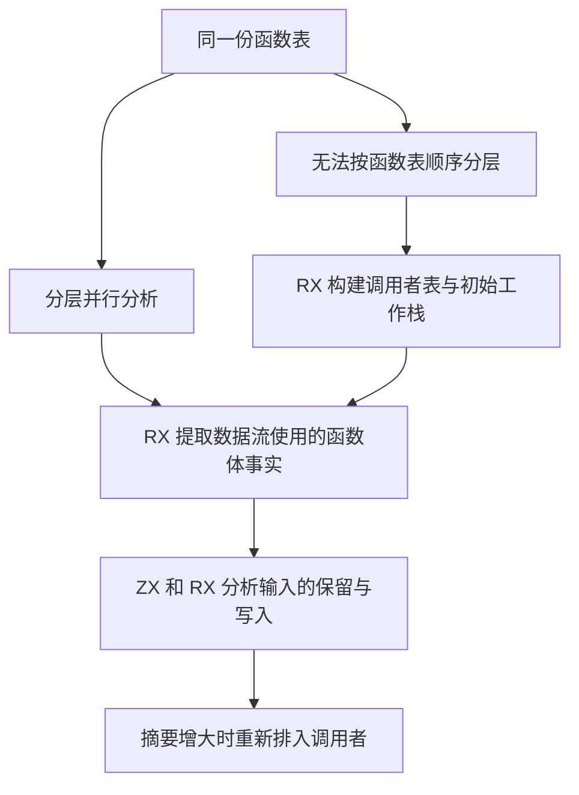

# 函数数据流建图与收敛自举

## Intent · 目标

将所有权数据流对函数体的准备和非拓扑顺序调用图的工作队列迁入 RX/ZX。分层并发和有环收敛共用同一种函数体事实，保持原有摘要、访问顺序和缓存键。

## Data · 现有实现

原流程为每个待分析函数建立完整所有权访问顺序，再复制节点、区域、边和重复范围等列。数据流实际只读表达式是否可达、符号定义、函数返回表达式和列表槽。遇到自调用、互相调用或表中靠后的被调函数时，Zig 还要重扫表达式、构建调用者表、维护栈和去重标记。

## Edges · 边界

保留调用表达式顺序及重复边、原有后进先出顺序和同一函数最多排队一次的约束。临时准备内存在最后一次读取以后才可重置。分层只访问一次，直接借用；重复访问的函数只保留下一次还要读的列。

## Answer · 验收

运行既有函数分析与所有权回归，用有自调用、前向调用和环的输入核对生成结果。旧 Source 工具与新工具对同一正式清单比较生成树和缓存载荷，固定清单配对测量生成时间与峰值内存。

### 已迁入正式入口的职责

分层分析通过 `flow/body/visit.rx` 选择准备或复用函数体事实。准备时共享原有的表达式访问顺序，只收集数据流分析读取的可达标记、符号定义和返回表达式，随后计算列表槽。分层任务直接在自己的临时区使用这些列。有环收敛可能多次访问同一函数，首次访问才生成事实，跨轮只保留后续会读的列。完整所有权分析仍能从同一遍历得到节点、区域和边。

遇到无法按函数表顺序分层的调用图，`flow/fixpoint/create.rx` 先标记参与分析的函数，再按被调函数统计边数，一次分配后反向填入调用者编号。每条重复调用保留一个编号，同一函数至多排队一次。摘要增长后，`advance.rx` 把需要重算的调用者放回栈并取出下一个函数。宿主保留临时区管理、跨轮事实的生命周期、线程调度和调用求解器的外层循环。初始种子继续使用独立 Zig 实现。

### 核验

上一批 Source 工具（源码提交 `f1c84588a`）生成本批工具，构建及安装解析器通过 38 步；独立种子生成解析器通过 29 步。两版使用 Source 分析和生成，在空缓存下处理包含 779 个入口、5,563 个模块的本批正式清单。排除环境输入戳，13,208 个文件逐字节一致。双方 v18 所有权缓存载荷都是 14,303,620 字节，SHA-256 为 `637bd1b344a2e61e39ad0e274a19e2a51130244d880d5b3831a0c281eeb97f3a`。

单列现有的递归函数追踪入口和有序的工作队列入口，分别比对了 176 和 51 个文件，同一输入的所有权缓存载荷也逐字节一致。递归样本实际包含对自身的调用，未单独构造双函数互相递归的夹具。

按提交前仓库格式统计，本批 RX 新增 171 行、删除 5 行，ZX 新增 386 行、删除 62 行。手写 Zig（含构建登记、种子兼容和宿主适配）新增 156 行、删除 68 行。

函数分析、模块生成、缓存所有权和字段事实四组共 249 项回归通过。修改的 RX 和 ZX 均通过格式与 lint 检查。

### 固定清单性能

两版均用 Source 工具和后端，固定 735 个入口、16 个分区，冷暖生成交错各测三轮，取中位数。计时覆盖分析和 Zig 源码生成。11,758 个结果文件和 v18 所有权缓存载荷逐字节一致。

| 指标                 |   上一版 |     本批 | 相对固定基线 |
| -------------------- | -------: | -------: | -----------: |
| 冷生成墙钟           |   2.60 s |   2.62 s |      −0.23 s |
| 冷生成 CPU           |  12.30 s |  12.24 s |      −0.34 s |
| 冷生成进程树采样峰值 | 709.3 MB | 700.8 MB |    −192.2 MB |
| 冷生成单进程系统峰值 | 747.0 MB | 765.9 MB |    −173.8 MB |
| 热生成墙钟           |   2.02 s |   1.95 s |      −0.30 s |
| 热生成 CPU           |   8.25 s |   8.22 s |      −0.39 s |
| 无修改墙钟           |   0.03 s |   0.04 s |            — |

冷生成墙钟增加 0.02 秒。进程树采样峰值下降 8.5 MB，单进程系统峰值中位数增加 18.9 MB。两种峰值采集方式不同，独立保留两项数值；单进程系统峰值继续跟踪。
