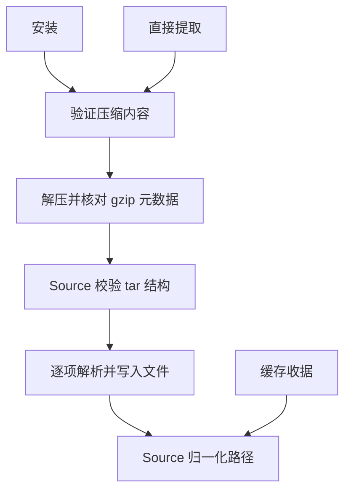
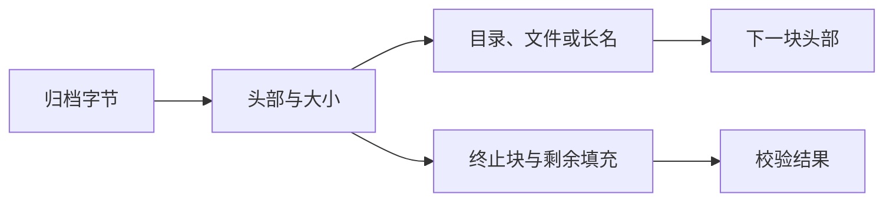

# 包安装归档校验自举

## Intent · 目标

让安装入口和缓存收据共享 Source 路径规则。将 tar 的头部遍历、大小、长文件名和结束标记的判定迁入 ZX，首次安装只核验一次压缩内容的 SHA-256。

## Data · 证据

起点为 `f911523df`。安装入口 `package/store.zig` 首先比对压缩包摘要，创建暂存目录后再调用 `archive.extract`；后者重复计算同一摘要。提取和已安装文件收据分别调用同一个 Zig 路径校验函数。回归已有归档内容、结构、路径、分配失败、缓存发布和真实离线安装等场景。

## Edges · 边界

保留标准库的 SHA-256、gzip 解码、tar 条目读取和文件 I/O。先校验完整归档，再写入条目。路径结果引用调用者持有的原输入。tar 的大小解析要兼容现有八进制文本和二进制大端编码，并保留多处异常同时出现时的首个诊断。

## Answer · 验收

通过正式包归档、包存储和安装回归。对照迁移前后的 tar、路径诊断及切片结果，在相同工具链上比较相关解析和哈希成本。

### 结果

- 压缩数据摘要在创建暂存目录前核验一次，通过后传递原字节切片。直调提取仍执行完整校验。`archive/verify.rx` 先判断 gzip 的 CRC、长度和流结束位置，成功后进入 tar 遍历。路径的范围计算和分量校验共用 `path/normalize.rx`。
- 包归档、包存储和包安装三个正式目标通过。对照旧实现时，32 份 tar 输入分别设置四种条目上限，128 个结果一致。6,750 个路径结果一致，非空结果同时核对原切片地址。正常、空和越界区间的六项字节比较均符合契约。
- 初始 seed 生成的 Source 工具，以及由上批 Source 工具生成的本批工具，运行同一份核验清单，41 个文件逐字节一致。清单比生产多一个直接测量 tar 的入口。固定旧引导器时，先用它构建 `bootstrap-stage`，再用新工具构建 CLI，以取得新增的 `std:bytes.allEqual` 声明。
- 扩展到标准库资源后，2,907 项 Zig 测试通过。独立 HTTP 应用在 macOS 上启动时收到 SIGKILL，导致整个标准库目标未通过。候选和上批 CLI 单独复跑均复现。生成文件通过 codesign 验证。后续使用同一份二进制做三轮文件名对照，每轮 .app 都收到 SIGKILL，无后缀与 .bin 都能启动并报告输入缺少字段。测试驱动改用普通可执行文件名后，原有 70 项 HTTP 应用检查全部通过，覆盖直接 ZX 与编排 RX 两条入口。随后整个 `test-standard-resources` 目标通过。

### 性能

基线为上一批 CLI `f911523df`，相同 Zig 0.17.0 和 small 模式。旧版及候选均由 Source 生成器提供分析和生成产物。以下测量覆盖归档解析和首次安装。

| 场景                                           |         旧版 |         候选 |
| ---------------------------------------------- | -----------: | -----------: |
| 校验含 4,096 个文件头的 tar，80 次，墙钟中位数 |      6.13 ms |      2.47 ms |
| 校验 1 MiB 全零归档，300 次，墙钟中位数        |     77.26 ms |     76.75 ms |
| 首次安装 16,782,631 字节本地压缩包，墙钟中位数 |     93.99 ms |     88.73 ms |
| 同一安装的进程 CPU 中位数                      |        80 ms |        70 ms |
| 同一安装的单进程峰值 RSS 中位数                | 37,650,432 B | 37,699,584 B |

初版按四字节一组读零填充，300 次比旧实现多约 69 ms。改用通用标准库操作，先检查一次半开区间，再直接比较借用切片，恢复了旧版的扫描速度。解析各交替测量九轮；安装预热后交替七轮，每次清空项目安装状态和包缓存，锁文件、收据及命令输出相同。RSS 差值为 48 KiB。阶段新增 RX 44 行、ZX 430 行，手写 Zig 净减少 47 行。
