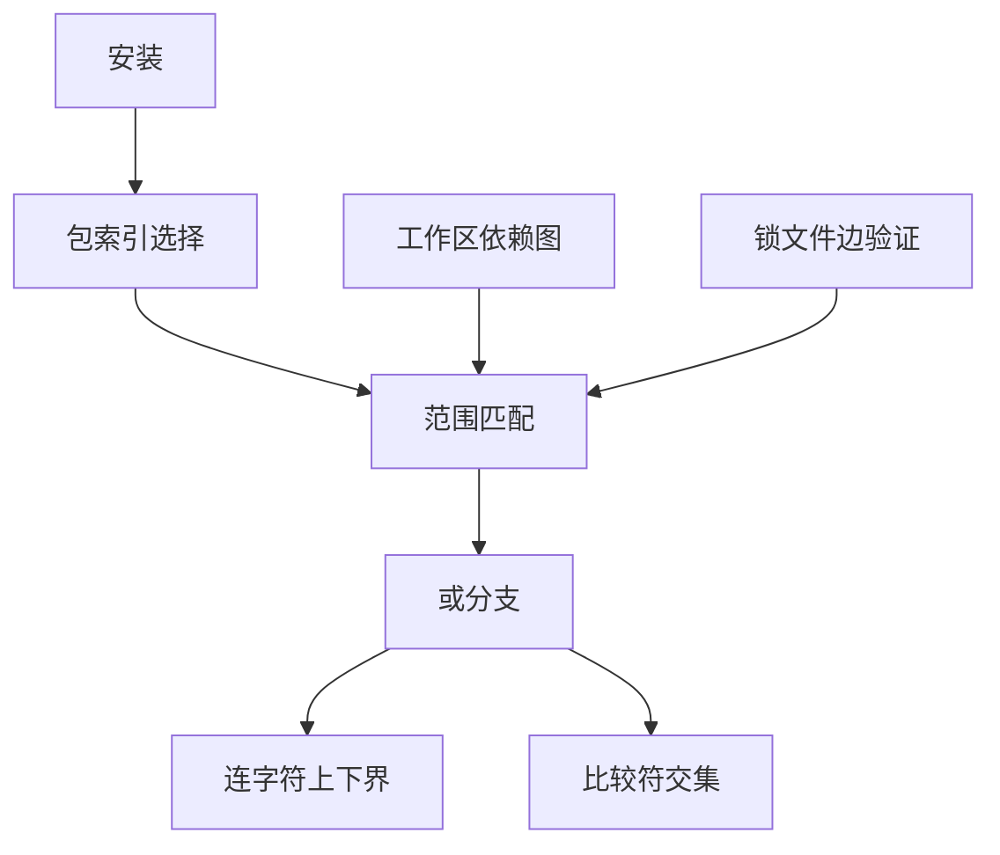

# 包版本范围与依赖选择自举

## Intent · 目标

让包索引、工作区依赖图、安装与锁文件共用 Source 的版本范围判断。保留错误顺序、目标平台整数上限及预发布版本准入规则。

## Data · 证据

起点为 `742b1c562`。四条路径共用 `packages/pkgs/src/version.zig`。旧实现先把范围拆成或分支，再逐个解析交集比较或连字符范围。只要存在无效分支就返回错误。

## Edges · 边界

保留调用方已解析的版本和借用的预发布字符串。解析范围时使用原字符串的位置，避免复制标识符与构造临时列表。比较范围中的数字按调用方目标平台的 usize 上限检查。索引读取、锁文件持久化与图状态另有职责。

## Answer · 验收

使用工作区依赖图、包索引、锁文件和安装的已有入口核对成功与错误路径。对照旧实现的边界输入、零临时分配和运行成本。

### 实际迁移

- 范围解析支持或分支、比较符交集、连字符、通配分量、波浪号和插入符。`range/clause.rx` 先读取词元，再分派到交集或上下界。ZX 在原字符串内解析数字和预发布标识符。裸版本比较继续接受调用方用 Zig 标准库解析好的候选版本。
- 工作区依赖图、安装和锁文件共用同一份依赖声明解析。锁文件查找先检查一次所有者和路径边界，然后逐个比较候选。比较时从路径末尾跳过被 `..` 抵消的目录，两侧直接借用原文。旧实现会为每个候选分配两个规范化路径。
- 包名、归档源地址和 SHA-256 文本校验已迁入 Source。索引接受大小写十六进制，锁文件要求小写。RX 保持先报源地址错误、再报摘要错误的顺序。
- Zig 仍持有索引和锁文件的 JSON 数据、包表、去重表及图遍历状态，工作区依赖图仍按当前操作系统解析文件系统路径。本批没有计入这些职责。

### 正确性

- 现有七个目标通过，覆盖清单和工作区依赖图、清单资源、包索引及其资源、锁文件解析、锁文件依赖图和实际安装。共执行 2,099 个 Node 测试与 75 个 Zig 测试。
- 零容量分配器下与旧实现逐项对照了 111,930 个版本范围结果、18,456 个工作区依赖结果、73,205 个包名和 16,384 个归档字段结果。另核对四个 32 位分量上限。分别用初始 Zig seed 直接生成的包规则和 Source 引导器生成的包规则运行了这些对照。
- 初始 seed 生成的 Source 引导器和由上批 Source 引导器生成的工具，对同一包规则清单执行 Source 分析与生成。排除输入路径记录后，45 个产物逐字节一致。包规则清单已纳入 CLI 的编译缓存指纹。

### 成本

macOS arm64、Zig 0.17.0、Small 优化。算法对照在同一可执行文件内分别调用 `742b1c562` 的 Zig 实现和 Source 引导器生成的本批规则，交替 9 轮取中位数。

| 场景                             |   迁移前 |   迁移后 |
| -------------------------------- | -------: | -------: |
| 176,400 次版本范围判断           | 32.99 ms | 15.45 ms |
| 152,000 次工作区相对路径依赖比对 | 24.32 ms |  6.95 ms |

在含 48 个包、2,304 个版本的相同索引上，前后 CLI 各执行 `zxc pkg resolve` 11 轮，均返回同一个 `1.15.4` 版本，标准输出逐字节一致。墙钟中位数由 5.67 ms 变为 5.51 ms，CPU 由 4.73 ms 变为 4.63 ms，峰值 RSS 由 4,489,216 字节变为 4,456,448 字节。

独立构建 `pkgs` 使用普通标准库。与 CLI 一起链接时复用编译器的同一标准库模块。用初始 seed 核对独立构建，构建图从 21 步减为 17 步，移除了此前额外耗时约 2 秒的整个编译器 Source 生成步骤。首次从源码构建 seed 本身仍有编译成本。
