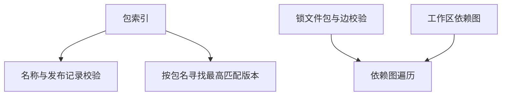

# 包索引与依赖图遍历自举

## Intent · 目标

让包索引校验与最高版本选择、工作区和锁文件的依赖图遍历在 Source 中运行，直接读取宿主已有的包与依赖数组。

## Data · 证据

起点为 `2f16a14b7`。索引在检查每个版本时反复解析前面的版本，在选择时反复解析已经选中的版本。锁文件用递归深度优先遍历检测环、最长依赖链和不可达包。工作区图单独实现了递归遍历，已访问的节点会直接跳过。

## Edges · 边界

保留原文件格式、诊断优先级、返回的发布记录及其字符串存储。锁文件从所有工作区成员起步，时间和空间开销按包数与边数核对。工作区图保持首次发现错误的节点位置。

## Answer · 验收

用已有索引、锁文件、清单和安装回归核对正式入口，另对照错误顺序、数值边界、共享子图和内存成本。

### 正式入口与剩余职责

- `Index.validate` 和 `Index.select` 把原始包表及发布记录借给 Source。每条发布记录只解析一次，已校验的版本按去除构建元数据后的版本身份去重。选出最高版本后按位置返回调用方原有的发布记录。
- `zxc pkg graph` 与锁文件验证共用同一个 Source 深度优先遍历，覆盖环、深度上限和不可达节点。锁文件复用已完成子图的高度，工作区保持原有跳过已访问节点的规则。64 位目标上，锁文件每包临时表由 9 字节降为 2 字节，另使用固定 4 KiB 栈空间，工作区临时表保持每包 1 字节。
- JSON 解析、锁文件中的包身份和依赖边元数据校验仍在 Zig。以上数字限于访问标记与高度表，未把它们折算为整个编译器的内存收益。

### 核对结果

- 索引、索引资源限制、锁图、锁文件解析、工作区清单及安装六组回归通过。Zig 构建汇总 86/86 步、69/69 项测试；各 Node 测试组均为零失败。
- 在同一输入下与旧实现核对 72,828 个索引结果、65,536 张四节点有向图、111,930 个版本范围结果及 4 个模拟 32 位上限。索引选择还核对归档路径是否指向原存储。
- 用原始 seed 与 Source 工具分别生成的包规则均通过索引和图对照。由 seed 生成和由上一阶段 Source 工具生成的两个引导器，各自用 Source 分析和生成同一份包规则，排除输入路径记录后 69 个文件逐字节一致。

### 受影响路径的性能

在同一台 arm64 机器以 Zig small 配置比较。候选 CLI 的包规则由 Source 自编译引导器生成，前一阶段为 `2f16a14b7`。公开命令交替运行 11 轮取中位数，使用同一份 48 包、2,304 个版本的索引，均选出版本 `1.15.4`。

| 场景                                          |    前一阶段 |      本阶段 |
| --------------------------------------------- | ----------: | ----------: |
| `zxc pkg resolve` 墙钟                        |     5.00 ms |     2.96 ms |
| 同一进程 CPU                                  |     4.27 ms |     2.28 ms |
| 同一进程峰值 RSS                              | 4,456,448 B | 4,505,600 B |
| 256 个版本的校验与选择，30 次                 |    40.12 ms |     4.39 ms |
| 176,400 次独立范围判断                        |    15.21 ms |    15.76 ms |
| 4,096 个独立节点，遍历 160 次                 |     2.02 ms |     1.93 ms |
| 4,096 个节点共享叶子，遍历 160 次             |     2.34 ms |     2.04 ms |
| 4,096 个节点分组成多层共享依赖图，遍历 160 次 |     7.36 ms |     5.64 ms |

上一批固定对照中，相同公开命令墙钟 5.67 ms、CPU 4.73 ms、RSS 4,489,216 字节。独立范围判断固定对照为 32.99 ms，本阶段较上阶段增加 0.55 ms。此次核验覆盖包管理路径，未测整仓冷构建。
