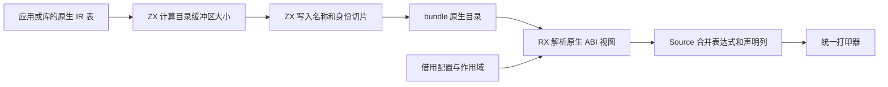
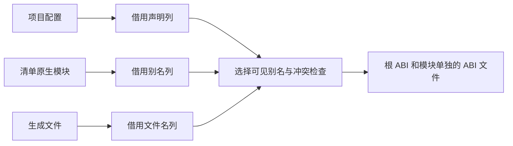

# 原生模块目录与 ABI 发布自举

## Intent

让应用和库共用 Source 原生模块目录装配。源码验证与 bundle 发布直接借用各自的原生绑定资料，由 RX/ZX 选择别名并生成 ABI 声明表，交给统一打印器输出。

## Data

起点为 `5d50c2ce7`。之前应用和库通过 Zig 逐项复制原生模块名称并扩展目录数组。源码 ABI 需要将作用域根路径和绑定字段整理成新数组，CLI ABI 还会重建作用域、设置、文件名和别名数组。GenZ 生成 ABI AST 后，Zig 再将表达式和声明导入自己的 Builder，随后调用打印器。

## Edges

- 原生目录由结果分配器持有，顺序、可空身份、模块导入名和说明符保持原有契约。目录只发布链接所需名称。类型信息继续由 ABI 及原有 IR 表承载。
- 单文件源码 ABI 采用首个匹配作用域，找不到时使用项目级原生接口与外部声明。bundle 继续按原顺序合并所有匹配根作用域的声明。
- 缺少别名映射与显式空映射保持各自行为。冲突阻止发布，名称相同的有效重复映射保持幂等。
- 别名、作用域与文件名视图在同步生成期间借用输入。输出使用自身分配器持有的目录与文件文本。
- Zig 仍负责将宿主结构绑定为列描述符，分配连续的输出缓冲区，安排文件发布与运行工具链。原生 seed 保留原有路径。

## Answer

两代引导器对 7 个入口分别生成 126 个文件，除工具身份戳外，路径和 SHA-256 全部一致。ReleaseSmall 候选引导器构建通过 25/25 步，原生 seed 构建通过 14/14 步并能生成同一清单。

六组回归通过 94/94 个构建步骤和 63/63 项 Zig 测试。安装版用例覆盖原生对象 ABI、相同模块名的包隔离、离线重发布、缺省与空别名、冲突拒绝、失败后保留原可执行文件及 Store 搬迁。

### 性能

Zig 0.17.0、ReleaseSmall。CLI 由 Zig 编译，候选正式分析和生成实现来自上一阶段 Source 引导器。固定对照为 `6e0cf529f`，上一阶段为 `5d50c2ce7`。三种工具轮换顺序，在同一目录和工具链下预热后取八次中位数。CPU 包含用户态和内核态时间，峰值内存为单进程 RSS。

| 场景               | 固定对照墙钟 | 上阶段墙钟 |  候选墙钟 |
| ------------------ | -----------: | ---------: | --------: |
| 原生库发布         |    18.571 ms |  19.950 ms | 18.996 ms |
| 原生源码与共享 ABI |     4.850 ms |   4.767 ms |  4.781 ms |
| Store 库发布       |    37.960 ms |  37.777 ms | 38.193 ms |

原生库发布较上阶段墙钟减少 0.954 ms，CPU 减少 0.798 ms，峰值 RSS 减少 104 KiB。较固定对照墙钟增加 0.425 ms，CPU 增加 0.250 ms，峰值 RSS 减少 88 KiB。源码加共享 ABI 较上阶段墙钟增加 0.014 ms，CPU 增加 0.084 ms，RSS 持平。较固定对照墙钟减少 0.069 ms，CPU 减少 0.070 ms，RSS 持平。

Store 发布较上阶段墙钟增加 0.416 ms，CPU 增加 0.407 ms，峰值 RSS 增加 24 KiB。较固定对照墙钟增加 0.233 ms，CPU 增加 0.316 ms，峰值 RSS 增加 72 KiB。三种版本的 20 个原生库文件、2 个直接源码产物和 14 个 Store 库文件分别核对了相对路径与 SHA-256，全部一致。

目录装配单独比较同一进程里的旧 Zig 路径和 Source 路径。2,048 个模块重复 80 轮，CPU 由 45.286 ms 降到 42.123 ms，单进程峰值 RSS 由 3.25 MiB 降到 2.61 MiB。对照核对了所有名称和可空身份，确认测试结果持有独立字节，目录中的类型列保持为空。本批只计时受影响的原生目录、ABI 和库发布路径。
