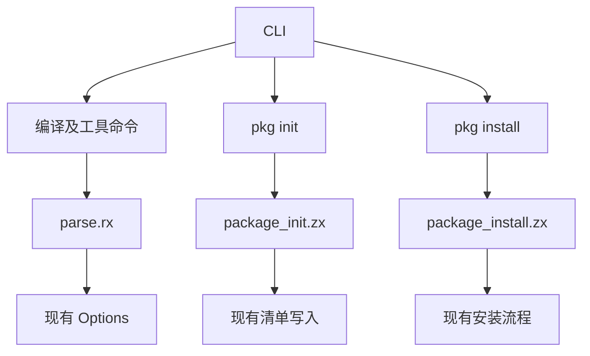

# 命令行参数解析自举

## Intent · 目标

将普通编译、构建、格式化、lint、验证、FPGA 以及包初始化和安装的命令语法迁入 Source。正式 CLI 使用同一套解析规则，命令输入、输出和退出状态保持兼容。

## Data · 证据

基线为 `c1e358e1f`。原实现分别在 `packages/cli/src/cli/options.zig`、`package/init.zig` 和 `package/install/options.zig` 遍历 argv。检查从 `src/main.zig` 调用的正式入口，覆盖连续选项、缺少选项值、重复参数、命令限制和应用参数透传。

## Edges · 边界

- RX 连接命令识别、选项扫描和组合校验。ZX 内部的遍历保存参数位置、布尔标记和数值。包初始化、安装各自只需要一个遍历。
- 来源为 argv 的文本借用原切片。`--` 后的应用参数连同外层切片一起借用。行数上限使用目标平台的 usize 范围，保留十进制符号、分隔符和溢出的原有处理。
- 宿主继续把文本转换成现有 Zig 枚举，并负责文件、网络及进程操作。生成入口调用时可用的分配空间为零。
- 构建使用编译器已经选定的生成器。生成器读入按内容寻址的私有输入目录，复用编译器的标准库模块，避免 CLI 与编译器包相互依赖。

## Answer · 验收

- 以旧提交中的三个 Zig 解析入口为对照。9 组命令前缀与 49 组选项片段两两组合，每个输入比较三个入口，共 64,827 次。逐字段核对成功结果、原始缓冲区指针和错误。初始 seed 和第二阶段 Source 工具各自生成的解析器都通过这组对照。
- 用前一阶段和后一阶段的 Source 工具生成同一批入口。排除本机输入清单后，23 个文件逐字节相同。两个 Source 工具均来自上一批符号调用自举；编译分析和生成均使用 Source 实现。
- Zig 0.17.0、small 模式，8 组命令轮流执行，15 轮交替测量，每轮解析 20 万次。旧入口中位数 8.14 ms，新入口 11.07 ms，单次增加约 14.6 ns。主命令每次进程启动解析一次。
- 通过实际 CLI 入口执行 `fmt packages/cli/src/arguments/parse.rx --check`，旧版和候选先各预热一次，再交替执行 30 次。墙钟中位数分别为 1.792 和 1.816 ms，CPU 为 1.268 和 1.270 ms。此数据只衡量该命令，编译器的冷构建仍沿用上一批单独记录的基线。
- 正式包清单、包安装、配置格式化与语义 lint 四组回归通过。Zig 构建报告 84/84 步完成，17 组 Node 测试合计 2,247 项通过。候选构建中的 CLI 参数生成步骤耗时 28 ms。
- 本批新增 RX 30 行、ZX 671 行，手写 Zig 新增 96 行、删除 200 行，净减少 104 行。编译器生成、包文件读写和其他 CLI 子命令仍按各自的迁移范围计算。
